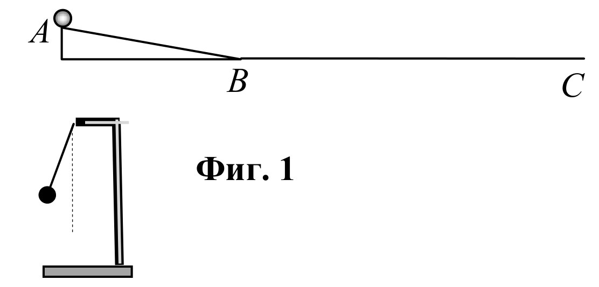
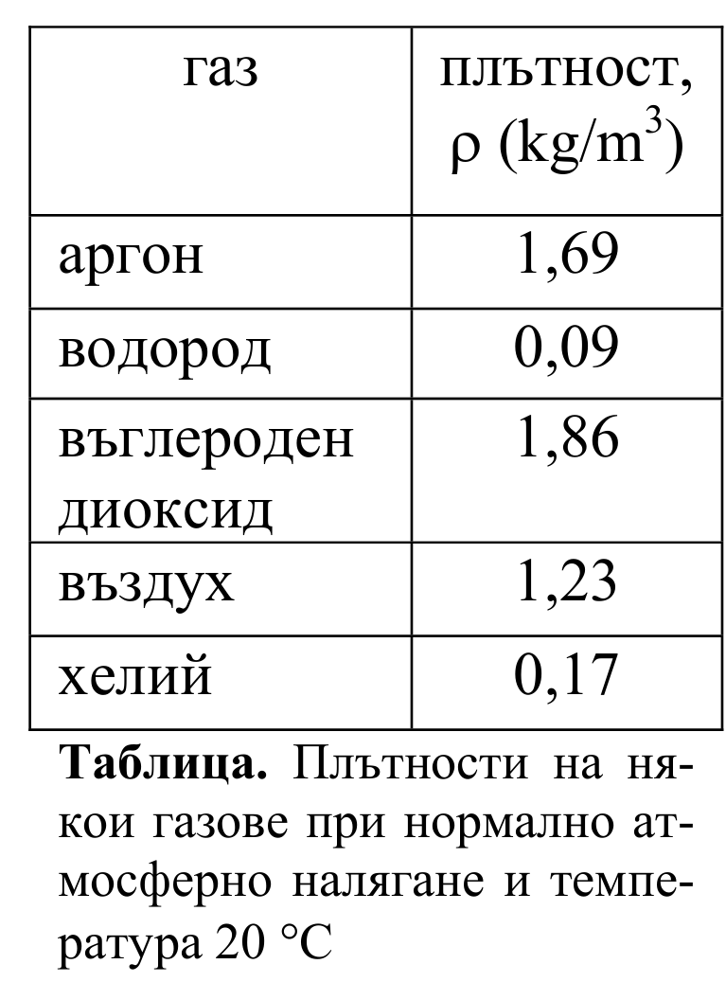
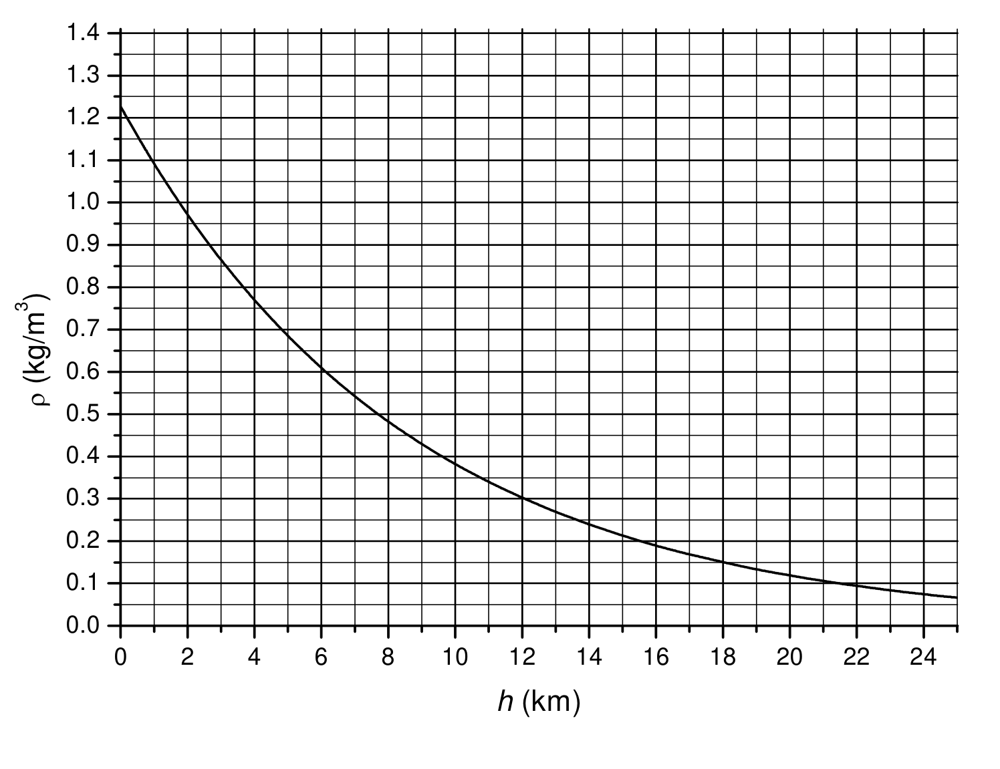
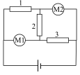

[[Състезания/esenno/8/2011|◂ 2011]] | [[Състезания/esenno/8r/2012|решения]] | [[Състезания/esenno/8/2013| 2013 ▸]]

Задача 1. Хронометър

Топче е пуснато да се търкаля с нулева начална скорост от върха $A$ на наклонена
равнина, както е показано на фиг. 1. То се спуска по нея с ускорение $a = 2{,}0 \text{ m/s}^2$. След
като достигне основата $B$ на наклонената равнина, топчето продължава да се движи по
хоризонталния участък $BC$ с постоянна скорост. Дължините на наклонената равнина и на
хоризонталния участък са съответно: $AB = l_1 = 0{,}64 \text{ m}$ и $BC = l_2 = 4{,}0 \text{ m}$.

а) Намерете времето $t$, за което топчето стига от точка $A$ до точка $C$. [3,5 т]

б) В момента, когато топчето тръгва от точка $A$, е пуснато да се люлее махало, което
първоначално се е намирало в крайно ляво положение (вж. фиг. 1). Периодът на люлеене
на махалото е $T = 2{,}0$ s. На какви разстояния $d_1$ и $d_2$ от точка $B$ се намира топчето в
моментите, когато махалото минава за първи път през вертикално положение и когато
стига до крайно дясно положение. [4,0 т]

в) Начертайте положението на махалото в момента, когато топчето достига точка $C$. За
целта използвайте един от следните символи:

- A – вляво от вертикалата
- B – във вертикално положение
- C – вдясно от вертикалата

Означете също така посоката, в която се движи махалото в този момент, като използвайте
стрелка, насочена наляво ($\leftarrow$) или надясно ($\rightarrow$). [2,5 т]

Задача 2. Балон – рекордьор

а) В таблицата са дадени плътностите на някои газове при нормално атмосферно налягане
и температура 20$^\circ$С. С кои от тези газове може да бъде напълнен балон, за да се издигне
нагоре? Дайте обяснение. [2,0 т]

б) Сферичен балон е напълнен с 34 kg хелий, намиращ се при нормално атмосферно
налягане и температура 20$^\circ$С. Колко е обемът $V$ на балона? [3,0 т]

в) Обвивката на балона е изработена от лек еластичен материал. Когато балонът се издига,
обвивката му се разтяга и обемът му се увеличава. Обяснете защо е възможно това. Не би
ли трябвало газът в балона да се свива заради по-ниската външна температура? [1,0 т]

г) Обвивката може да се разтяга дотогава, докато диаметърът на балона стане с 20% по-
голям от началния му диаметър. На графиката от фиг. 2 е дадена зависимостта на
плътността $\rho$ на въздуха от надморската височина $h$. Като използвате данните от
графиката, определете максималната височина $h_{max}$, на която може да се издигне балонът.

Масата на обвивката се пренебрегва. [4,0 т]

Задача 3. Мултицети

Три еднакви резистора (1, 2, 3) със съпротивление $R = 10 \ \Omega$
всеки и два комбинирани измерителни уреда (мултицети) М1 и М2
са свързани към източник с напрежение $U = 15$ V, както е
показано на фигурата. Всеки от уредите може да работи като
амперметър или волтметър чрез превключване на специален ключ.

Пресметнете показанията на всеки от уредите, когато:

а) М1 и М2 работят като амперметри; [3,0 т]

б) М1 работи като амперметър, а М2 – като волтметър; [3,0 т]

в) М1 и М2 работят като волтметри. [4,0 т]

