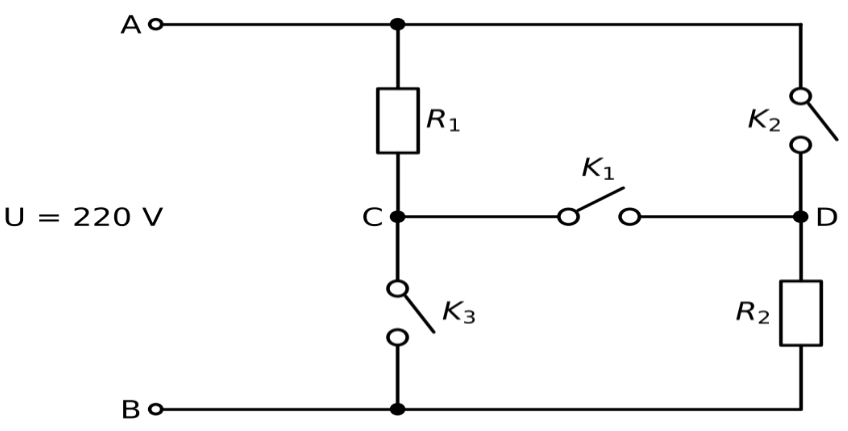
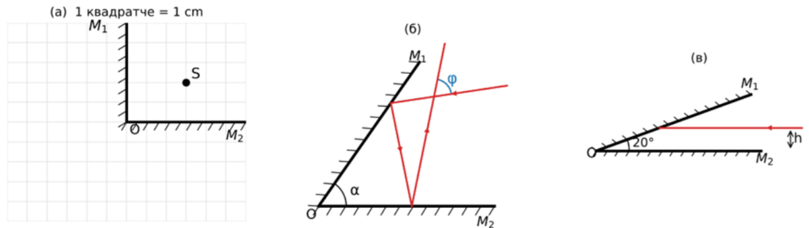
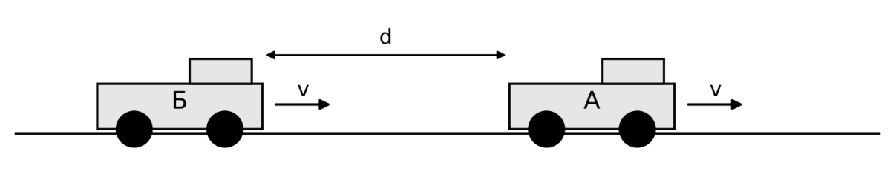

[[Състезания/esenno/8/2025|◂ 2025]] | [[Състезания/esenno/8r/2026|решения]]

**Задача 1. Електрическа кана с два нагревателя**

Електрическа кана има два нагревателя със съпротивления $R_1$ и $R_2$ и три ключа K₁, K₂ и K₃, свързани по схемата на фиг. 1. Каната се включва към напрежение U = 220 V. Върху нагревателите е написано „1200 W, 220 V“ (нагревател 1) и „600 W, 220 V“ (нагревател 2). Съпротивленията на нагревателите не зависят от температурата.

а) Всеки ключ може да бъде отворен или затворен. За всяка комбинация посочете кои нагреватели работят и как са свързани (самостоятелно, последователно или успоредно). Коя комбинация е недопустима и защо? \[2 т.\]

б) Определете мощностите $P_у$ и $P_п$ на каната, когато двата нагревателя са свързани съответно успоредно и последователно. \[2 т.\]

Във всеки следващ опит в каната се налива една и съща маса вода с една и съща начална температура. Всички опити се провеждат при еднакви външни условия. Когато работи само нагревател 1, водата завира за $t_1 = 6\ \text{мин}$ и $40\ \text{с}$, а когато работи само нагревател 2 водата завира за $t_2 = 16\ \text{мин}$ и $40\ \text{с}$.

в) Показват ли тези данни, че част от изразходваната електрична енергия се отдава като топлина на околната среда? Обосновете отговора си. \[1 т.\]

За следващите подусловия приемете, че до завирането на водата каната отдава топлина на околната среда с постоянна мощност $P_з$. Тази мощност е една и съща във всички режими на работа и не се изменя с времето.

г) Намерете $P_з$ и количеството топлина Q, което водата трябва да получи, за да заври. \[2 т.\]

д) За колко време ще заври водата при успоредно и при последователно свързване на нагревателите? \[2 т.\]

е) В кой от четирите режима на работа за завирането на водата се изразходва най-малко електрична енергия? Каква част от тази енергия получава водата? \[1 т.\]

**Задача 2. Ъглови огледала**

Две плоски огледала M₁ и M₂ са съединени по общ ръб и образуват „ъглово огледало“. Всички лъчи лежат в равнината на чертежа, която е перпендикулярна на огледалата.

**А. Перпендикулярни огледала (фиг. 2а).** Огледалата са перпендикулярни, а точковият източник S е на 3 cm от M₁ и на 2 cm от M₂.

а) Постройте всички различни образи на S в ъгловото огледало. Колко са те? Посочете разстоянията от всеки образ до правите, на които лежат огледалата. \[1,5 т.\]

б) Лъч от S се отразява първо от M₁, а след това от M₂. Докажете, че след второто отражение лъчът е успореден на първоначално падащия лъч и се разпространява в противоположна посока, независимо от ъгъла на падане. \[1,5 т.\]

**Б. Лазер към Луната.** От 1969 г. на Луната има ъглови отражатели, използвани за лазерно измерване на разстоянието до нея. Един елемент на такъв отражател може да се моделира с три взаимно перпендикулярни отразяващи повърхности. След отражение от всяка от тях светлината се разпространява в посока, успоредна и противоположна на първоначалната. Кратък лазерен импулс, изпратен от Земята към лунен отражател, се приема обратно след интервал t = 2,56 s. Скоростта на светлината е $c = 3\cdot10^8\ \text{m/s}$.

в) Намерете разстоянието между излъчвателя на Земята и отражателя на Луната. Ако целият интервал от изпращането до приемането на импулса се измерва с абсолютна грешка не по-голяма от $10^{-10}\ \text{s}$, с колко най-много може да се различава определеното разстояние от действителното само поради тази грешка? За оценката приемете c за точно зададена константа и пренебрегнете всички други източници на грешка. Защо се използва ъглов отражател, а не обикновено плоско огледало? \[1,5 т.\]

**В. Огледала под остър ъгъл.** Огледалата сключват ъгъл $\alpha < 90^\circ$.

г) Лъч се отразява първо от M₁, а след това от M₂ (фиг. 2б). С φ е означен ъгълът между посоката на разпространение на светлината непосредствено след второто отражение и посоката, противоположна на първоначалното ѝ разпространение. Докажете, че φ не зависи от ъгъла на падане, и го изразете чрез α. Колко е φ при $\alpha = 60^\circ$? \[2 т.\]

д) Огледалата сключват ъгъл $\alpha = 20^\circ$. Лъч, успореден M₂, влиза между огледалата в показаната на фиг. 2в посока и първо пада върху M₁. Означената височина h > 0 е произволна; числената ѝ стойност не е необходима. Колко пъти ще се отрази лъчът, преди да излезе от ъгловото огледало? В каква посока ще излезе спрямо двете огледала? Обосновете защо след последното посочено от Вас отражение не настъпва следващо. \[2 т.\]

е) Огледалото M₂ и падащият лъч запазват положенията си, а ъгълът α се изменя в границите $\alpha \in (0, 90^\circ)$. Намерете всички стойности на α, при които броят на отраженията е същият като в подусловие д). \[1,5 т.\]

**Задача 3. Безопасна дистанция**

Когато шофьор забележи опасност, той натиска спирачката след време на реакция $t_0$. След като спирачките са натиснати, колата се движи равнозакъснително с постоянно ускорение a до спирането. Пътят s от забелязването на опасността до спирането се нарича пълен спирачен път. В таблицата са дадени измерени стойности за един и същ шофьор и лек автомобил на мокър път, като при всеки опит ще приемем, че времето на реакцията е едно и също.

| Начална скорост v, km/h | 36 | 54 | 72 | 90 |
| --- | --- | --- | --- | --- |
| Пълен спирачен път s, m | 18,0 | 34,5 | 56,0 | 82,5 |

а) Направете графика на скоростта на колата като функция на времето от момента на забелязване на опасността до спирането. Изразете s чрез v, $t_0$ и a. \[1,5 т.\]

б) Определете $t_0$ и a от данните в таблицата. \[2,5 т.\]

в) Ако шофьорът говори по телефона, времето му за реакция се удвоява. Колко е тогава пълният спирачен път при 90 km/h? \[1 т.\]

По магистрала две коли се движат една след друга с еднакви скорости v = 90 km/h на разстояние d една от друга (фиг. 3). Предната кола А внезапно започва да спира. Шофьорът на задната кола Б реагира с време на реакция $\tau = 0{,}6\ \text{s}$ и също започва да спира.

г) Колата А спира с ускорение $6{,}25\ \text{m/s}^2$, а колата Б спира с ускорение $5{,}0\ \text{m/s}^2$. Намерете най-малкото d, при което колите не се удрят. \[2 т.\]

д) Сега колата А спира с ускорение $5{,}0\ \text{m/s}^2$, а колата Б спира с ускорение $6{,}25\ \text{m/s}^2$. Намерете най-малкото d, при което колите не се удрят. \[3 т.\]

*Предайте този лист като част от решението* (лист за графика на задача 3, а).
