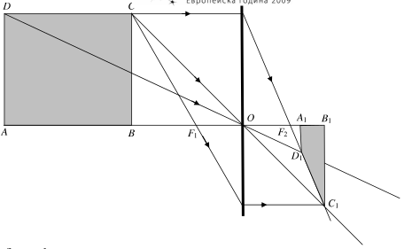
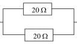
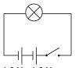

Задача 1.

а) Първото ехо се дължи на отражение от морското дъно. От момента на излъчване
на сигнала до момента на регистриране на първото ехо звукът изминава
разстояние:

$s = 2H$ \[1 т\]

със скорост $u_1$. Следователно:

$2H = u_1t_1$ \[1 т\]

и
$H = \frac{u_1t_1}{2}$ \[1 т\]
$H = \frac{1500 \text{ m/s} \cdot 1,6 \text{ s}}{2} = 1200 \text{ m}$ \[1 т\]

б) Второто ехо се дължи на отражение на звука от дъното на нефтения слой.

Времето, през което звукът се движи в нефта, е:

$t = t_2 - t_1 = 2,2 \text{ s} - 1,6 \text{ s} = 0,8 \text{ s}$. \[1 т\]

Звуковата вълна изминава в нефта път :

$s = 2L$ \[0.5 т\]

със скорост $u_2$. Следователно:

$2L = u_2t$ \[0.5 т\]
$L = \frac{u_2t}{2}$ \[1 т\]
$L = \frac{950 \text{ m/s} \cdot 0,8 \text{ s}}{2} = 380 \text{ m}$ \[1 т\]

в) Понеже първото ехо е регистрирано след по-голямо време, дълбочината на
морето на новото място е по-голяма, т.е. изключваме отговор А). Понеже второто
ехо идва след същото време, следва, че времето t за движение на звука в нефта е по-
малко, отколкото на първото място, т.е. дебелината на нефтения слой е по-малка.

Верният отговор е В). \[2 т\]

Задача 2.

а) Лъчите, падащи към оптичния център на лещата, преминават през нея без да се
пречупват. \[1 т\] Следователно, ако свържем съответните точки на предмета и
образа с прави линии, те ще се пресичат в една точка. \[1 т\] Чрез непосредсвено
построение се убеждаваме, че точките $A_1$, $B_1$, $C_1$ и $D_1$ от образа са разположени,
както е показано на чертежа. \[2 т\]

б) Пресечната точка на линиите, свързващи точките на предмета и образа, е
оптичният център на лещата О. \[2 т\]

в) Лъчи, падащи успоредно на оптичната ос, след пречупване преминават през
единия от фокусите. \[1 т\] Така, след като построим лъча DC$D_1 C_1$, намираме фокуса
$F_2$. \[1 т\] Лъч, преминаващ през фокуса, продължава успореден на оптичната ос.
\[1 т\]. Така построяваме предния фокус $F_1$ \[1 т\].

Задача 3.

а) От закона на Ом намираме:

 R $=\frac{ U 3V}{ I 0,6 A}=$ = 5$\Omega$ \[0,5 т\]

От закона на Джаул-Ленц следва:

P = UI $= 3 V \cdot 0,6 A$ = 1,8 W \[0,5 т\]

б) При последователно свързване през резистора и през лампичката тече един и
същ ток I = 0,6 A. Следователно еквивалентното съпротивление на веригата е:

$R_e=\frac{ U}{I}=\frac{9V}{0,6 A} = 15 \Omega$ \[1 т\]

Понеже при последователно свързване $R_e = R + R_1$, следва:

$R_1 = R_e - R = 10 \Omega$ . \[1 т\]

в) Съпротивление от 10 $\Omega$ може да бъде получено при последователно свързване на
два резистора от 5 $\Omega$, успоредно свързване на два резистора от 20 $\Omega$ или на един
резистор от 15 $\Omega$ и един - от 30 $\Omega$.

г) От връзката q = It намираме големината на 1 mAh, изразена в кулони:
1 mAh $= 0,001 A \cdot 3600 s$ = 3,6 C \[1 т\]

Общият заряд, който може да произведе батерията е:
q = 1500 mA$h \cdot 3,6 C / \text{mA}$h = 5400 C \[1 т\]

Понеже през батерията тече ток I = 0,6 A, лампичката ще свети нормално в
продължение на:

 $t =\frac{q}{I} = \frac{5400 C}{0,6 A}$ = 9000 s = 2,5 h \[1 т\]

д) Лампичката би светила нормално, ако я включим към
две последователно свързани батерии с напрежение 1,5 V
всяка. В този случай двете батерии са еквивалентни на една
батерия с напрежение 3 V. \[1.5 т\]

 Цената на фенерчето в този случай би била: 2
батерии $\cdot 0,50$ лв. + 1 лампичка $\cdot 1,20$ лв = 2,20 лв. Ако
използва някое от свързванията от т. в), цената на 1,5 V 1,5 V
фенерчето ще бъде: 1 батерия $\cdot 3,00$ лв. + 1 лампичка $\cdot 1,20$
лв + 2 резистора $\cdot 0,80$ лв = 5,80 лв. Иван би спестил 3,60 лева. \[0.5 т\]

