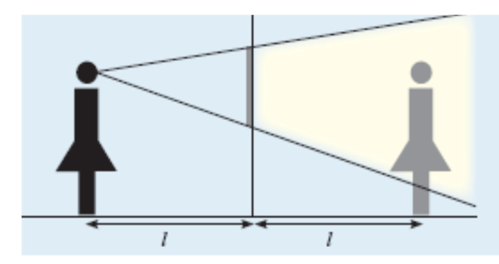
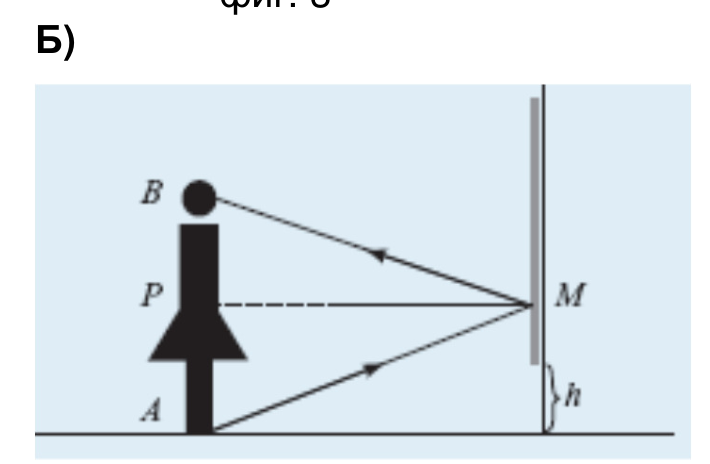
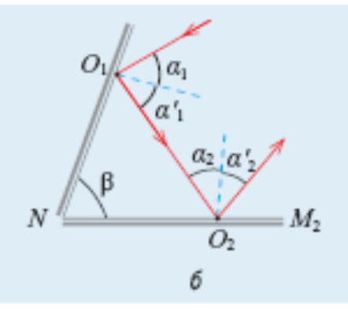

[[Състезания/esenno/8/2010|условия]] | [[Състезания/esenno/8/2011| 2011 ▸]]

 Задача 1. а)

 \[0,5 т.\] \[0,5 т.\]

б) Токът през съпротивлението $R_3$ е I , тъй като двете съпротивления 2 и 3 са
 свързани последователно. \[0,5 т.\] Тогава имаме

 $R_3 = \frac{ V1}{ I} = 20 \Omega$ . \[2 т.\]

 Като отчетем, че напрежението между краищата на съпротивлението $R_2$ е U 1 $- V_1$ \[0,5 т.\] намираме

 $R_2 = \frac{ U 1 - V1}{ I} = 60 \Omega$ . \[2 т.\]

 в) Във втория случай напрежението между краищата на съпротивлението $R_2$ е U 2 $- V_2$ и токът през него е

 $I_1 = \frac{ U 2 - V2}{ R2} = 0,6$ А. \[2 т.\]

 Тъй като съпротивленията 1 и 2 са свързани последователно имаме

 $R_1 = \frac{ V2}{ I1} = 40 \Omega$. \[2 т.\]

 Задача 2. а)

\[0,5 т.\]
 \[0,5 т.\]

б) Токът във веригата 1 е

$$I_1 = \frac{U}{R + R_1} , [1 \text{ т.}]$$

а мощността на консуматора 1 се дава с израза

$$P = \frac{U^2 R_1}{(R + R_1)^2} . [1 \text{ т.}]$$

Аналогично за мощността на консуматора 2 имаме

$$P = \frac{U^2 R_2}{(R + R_2)^2} . [1 \text{ т.}]$$

Като приравним двата израза за мощността намираме

$$\sqrt{R_1}(R + R_2) = \sqrt{R_2}(R + R_1) , [1 \text{ т.}]$$

откъдето следва

$$R = \sqrt{R_1 R_2} = 6 \text{ } \Omega . [2 \text{ т.}]$$

в) Като изразим напрежението на източника

$$U^2 = P \frac{(R + R_1)^2}{R_1} [1 \text{ т.}]$$

и заместим $R = \sqrt{R_1 R_2}$ намираме

$$U = \sqrt{P}(\sqrt{R_1} + \sqrt{R_2}) = 15 \text{ V} . [2 \text{ т.}]$$

Задача 3. А) От закона за отражение следва $\alpha_1$ = $\alpha_1$ = 40 .\[0,5 т.\] Отразеният лъч сключва ъгъл $\gamma$ = 50 с равнината на огледалото M 1 .\[0,5 т.\] От триъгълника $\Delta O_1 N$$O_2$ намираме ъгъла N$O_2 O_1$ = 60 \[0,5 т.\], откъдето следва, че ъгълът на падане към второто огледало е $\alpha_2$ = 30 .\[0,5 т.\] За ъгъла на отражение получаваме $\alpha$ '2 = $\alpha_2$ = 30 ! .\[0,5 т.\]

а) Горният край на огледалото трябва да бъде по-високо от главата на момичето. \[1 т.\] Ще приемем, че долният край е на височина h от пода (фиг. 4,а). Момичето ще види образа на обувките си, ако лъчите излизащи от тях (т. А), след отражение от огледалото попадат в очите му (т. В). \[1 т.\] От еднаквостта на $\Delta$AMP и $\Delta$BMP \[1 т.\] следва, че (т. Р) е среда на отсечката АВ. \[1 т.\] Следователно момичето може да се огледа в цял ръст, ако разстоянието h между долния край на огледалото и пода е по-малко от половината на нейния ръст. \[1,5 т.\]

б) Областта на виждане на образа се определя от лъчите, минаващи през краищата на огледалото (фиг. 4,б). \[1 т.\] Образът на момичето се намира на същото разстояние от огледалото, на каквото то е пред огледалото. Колкото по-високо е поставено огледалото, толкова по-малка част от образа на момичето попада в зоната на виждане. \[1 т.\]

