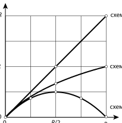

[[Състезания/esenno/8/2010|◂ 2010]] | [[Състезания/esenno/8/2011|условия]] | [[Състезания/esenno/8/2012| 2012 ▸]]

Задача I. Всеки верен отговор на тестовите задачи се
оценява с 1 точка.

 Задача 1 2 3 4 5 6 7 8 9 10
 Верен отговор в г а а в в б г б г

Задача II. а) Частица 1 се движи равномерно със скорост $v_1 = 12$ m/s ................................................. 1 точка

Частица 2 се движи равноускорително без начална скорост .................................................... 1 точка

Ускорението на частица 2 е $a = 1,5\ \text{m/s}^2$ ............................................................. 1 точка

б) До срещата частица 1 изминава път $s = v_1 t$ .......................................................... 1 точка

Частица 2 изминава същия път $s = \frac{at^2}{2}$ ......................................................... 1 точка

Приравняваме десните страни на двете равенства и определяме времето, след което частиците ще попаднат в една точка (ще изминат равни пътища):

$t = \frac{2v_1}{a} = 16$ s ................................................................. 1 точка

в) Двете частици ще изминат път $s = v_1 t = 192$ m ................................................ 1 точка

г) Докато втората частица се движи с по-малка скорост, тя ще изостава от първата частица и разстоянието $\Delta s$ между двете частици ще нараства. Разстоянието $\Delta s$ е максимално в момента, в който скоростите се изравнят. От този момент нататък втората частица ще започне да догонва първата ................................................ 1 точка

От графиката се вижда, че двете частици имат еднакви скорости в момента $t = 8$ s .............................................. 1 точка

Следователно $\Delta s = s_1 - s_2 = v_1 t - \frac{at^2}{2} = 48$ m ........................................ 1 точка

Всяка от графиките се оценява с по 1 точка.

Задача II. а) (Схеми 1, 2 и 3.)

Схема 1 ................................................. 1 точка

Схема 2 ................................................. 1 точка

Схема 3 ................................................. 1 точка

б) За схема 1: $R_0 = r$.
Съответно $R_0 = 0$ при $r = 0$; $R_0 = R/2$ при $r = R/2$ и $R_0 = R$ при $r = R$ ................................................. 1 точка

За схема 2: $R_0 = \frac{Rr}{R + r}$.
Съответно $R_0 = 0$ при $r = 0$; $R_0 = R/3$ при $r = R/2$ и $R_0 = R/2$ при $r = R$ ................................................. 1 точка

За схема 3: $R_0 = \frac{r(R - r)}{R}$.
Съответно $R_0 = 0$ при $r = 0$; $R_0 = R/4$ при $r = R/2$ и $R_0 = 0$ при $r = R$ ................................................. 1 точка

На схема 3 имаме два успоредно свързани резистора със съпротивление r и R - r. Ако разменим техните места, еквивалентното съпротивление не се променя. Затова еквивалентното съпротивление е едно и също при съпротивление на първия резистор r или R - r. (Когато съпротивлението на първия резистор е r, съпротивлението на втория е R - r и обратно: когато първият има съпротивление R - r, съпротивлението на втория е r — сумата от двете съпротивления по условие е равна на съпротивлението R на целия реостат.) Например при $r = R/4$ еквивалентното съпротивление е $R_0 = 3R/16$. То има същата стойност $R_0 = 3R/16$ и при $r = R - R/4 = 3R/4$. Следователно двете части на графиката са симетрични ................................................. 1 точка

Всяка от графиките се оценява с по 1 точка.