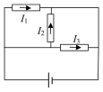
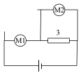

[[Състезания/esenno/8/2011|◂ 2011]] | [[Състезания/esenno/8/2012|условия]] | [[Състезания/esenno/8/2013| 2013 ▸]]

Задача 1. Хронометър

а) От уравнението за пътя при равноускорително движение:

$$s = \frac{1}{2}at^2$$

и като вземем предвид, че при движението по наклонената равнина $s = l_1$, намираме времето за движение от т. А до т. В:

$t_1 = \sqrt{\frac{2l_1}{a}} = 0,8\text{ s}$

В т. В топчето има скорост:

$v = at_1 = 1,6\text{ m/s}$

и продължава да се движи с тази скорост до т. С. Следователно топчето изминава участъка ВС за време:

$t_2 = \frac{l_2}{v} = 2,5\text{ s}$

и общото време за движение е:

$t = t_1 + t_2 = 3,3\text{ s}$

б) Махалото минава през вертикално положение в момента:

$t' = \frac{T}{4} = 0,5\text{ s}$

т.е. когато топчето е още върху наклонената раднина. Пътят, изминат от топчето до този момент, е:

$s' = \frac{1}{2}at'^2 = 0,25\text{ m}$

а разстоянието до т. В:

$d_1 = l_1 - s' = 0,39\text{ m}$

Махалото достига крайно дясно положение в момента:

$t'' = \frac{T}{2} = 1\text{ s}$

Тогава топчето вече е минало през точка В и се движи равномерно по хоризонталния участък в продължение на: $t'' - t_1 = 0,2\text{ s}$. Следователно топчето се е отдалечило от т. В на разстояние:

$d_2 = v(t'' - t_1) = 0,32\text{ m}$

в) До крайния момент махалото е извършило едно пълно трептене за време 2 s,
После е стигнало крайно дясно положение за още 1 s, т.е. в момента 3 s, и е
започнало да се връща наляво, без да е минало през вертикално положение.

Правилният чертеж е даден на фигурата вдясно.

Схема на оценяване
 Елемент от решението Точки
 Използва закона за пътя при равноускорително движение 0,5
 Пресмята $t_1 0,5$

 Използва закона за скоростта при равноускорително движение 0,5

а) Пресмята $v_0$,5
 Използва закона за равномерно движение за участъка ВС 0,5
 Пресмята $t_2 0,5$

 Пресмята $t_0$,5
 Съобразява, че първият момент съответства на четвърт период 0,5
 Съобразява, че в първия момент топчето е още върху наклонената равнина 0,5
 Пресмята пътя по закона за равноускорително движение 0,5
 Пресмята $d_1$ като изважда изминатия път от дължината на участъка AB. 0,5
б)

 Съобразява, че вторият момент съответства на половин период 0,5
 Съобразява, че вън втория момент топчето е върху хоризонталния участък 0,5
 Пресмята времето за движение по хоризонталния участък 0,5
 Пресмята $d_2$ като използва закона за пътя при равномерно движение 0,5
 Правилно нарисувано положение на махалото 0,5
 Правилно означена посоката на движение 0,5

в) Обосновава отговора, като посочва, че: (i) е изминал един пълен период; (ii)
 махалото е достигнало крайно дясно положение; (iii) връща се наляво, като 1,5
 не е минало през вертикално положение.

 Общо: 10,0

Задача 2. Балон - рекордьор

а) Балонът се издига, ако плътността на газа, с който е напълнен, е по-малка от плътността
на въздуха. Следователно балонът ще се издига, ако е пълен с водород или с хелий.

б) От връзката:

$$m = \rho V$$

изразяваме обема на балона:

$$V = \frac{m}{\rho}$$

От таблицата отчитаме, че $\rho = 0,17\text{ kg/m}^3$, откъдето пресмятаме:

$V = 200\text{ m}^3$

в) Газът в балона се разширява, защото атмосферното налягане намалява с увеличаване на
височината.

г) Балонът се издига докато плътността на хелия в него стане равна на плътността на
околния въздух. Ако диаметърът на балона се увеличи с 20%, т.е. стане 1,2 пъти по-голям
от началния диаметър, неговият обем нараства $1,2^3 \approx 1,7$ пъти. Понеже масата на хелия не
се променя, плътността му става 1,7 пъти по-малка от началната, т.е. $\rho_1 \approx 0,1\text{ kg/m}^3$. От графиката се вижда, че плътността на въздуха е такава на височина $h_{max} \approx 21,5\text{ km}$.

Схема на оценяване
 Елемент от решението Точки
 За всеки правилно посочен газ $\times 0,5$ точки 1
 Аргументира избора на водорода и хелия с по-малките им плътности от

а) плътността на въздуха.
 1
 Само 0.5 точки за твърдение от вида "..защото тези газове са по-леки от
 въздуха"
 Записва връзката $m = \rho V 1$

б) Изразява $V_1$

 Пресмята числено $V_1$

в) Посочва, че причината е намаляване на атмосферното налягане 1
 Посочва, че балонът се издига, докато плътностите на хелия и въздуха се
 1
 изравнят
 3
 Съобразява, че крайният обем е 1,2 по-голям от началния 1

г) 3
 Съобразява, че крайната плътност е 1,2 по-малка от началната и я
 1
 пресмята числено.

 Отчита по графиката максималната височина с точност $pm 0,5 \text{km}^{1}$

 Общо 10

Задача 3. Мултицети

а) Когато двата уреда работят като амперметри, тяхното съпротивление е нула и те са еквивалентни на съединителни проводници. На фигурата е показана еквивалентната схема. Всеки от резисторите е съединен директно към източника, т.е. напреженията върху тях са еднакви: $U = 15\text{ V}$. През резисторите съответно текат еднакви токове:

$I_1 = I_2 = I_3 = \frac{U}{R} = 1,5\text{ A}$

чиито посоки са показани на фигурата. Уредът М1 отчита сумарния ток през резисторите 2 и 3, т.е. $I(M1) = 3\text{ A}$. Аналогично, М2 отчита тока през 1 и 2 и $I(M2) = 3\text{ A}$.

б) Когато М2 работи като волтметър, неговото съпротивление е много голямо и той е еквивалентен на прекъсване на веригата.

Тогава през резисторите 1 и 2 няма да тече ток и М1 ще измерва тока през резистора 3:

$I_1 = \frac{U}{R} = 1,5\text{ A}$

а М2 – напрежението върху същия резистор, което е равно на напрежението на източника:

$U_2 = U = 15\text{ V}$

в) Когато уредите работят като волтметри, през тях не тече ток. Следователно трите резистора са свързани последователно и тяхното еквивалентно съпротивление е:

$R_e = R_1 + R_2 + R_3 = 30\ \Omega$

През резисторите тече един и същ ток: $I = \frac{U}{R_e} = 0,5\text{ A}$.

Уредът М1 измерва сумата от напреженията върху резисторите 1 и 2:

$U_1 = IR_1 + IR_2 = 10\text{ V}$

а М2 – върху резисторите 2 и 3: $U_2 = IR_2 + IR_3 = 10\text{ V}$

 Елемент от решението Точки
 Съобразява, че амперметрите са еквивалентни на съединителни
 1
 проводници (екв. схема)

а) Прилага закона на Ом, за да пресметне токовете през резисторите 1
 Пресмята токовете през двата уреда като сума съответно на токовете през 1
 1
 и 2 или през 2 и 3.

 Съобразява, че ток тече само през резистора 3 1
 Съобразява, че М2 измерва напрежението U 0.5
б)

 Съобразява, че $M_1$ измерва тока през резистора 0.5
 Прилага закона на Ом и пресмята тока 1
 Съобразява, че трите резистора са свързани последователно и пресмята
 1
 еквивалентното им съпротивление
 Прилага закона на Ом и пресмята тока във веригата 1

в) Съобразява, че М1 измерва сумата от напреженията върху 1 и 2, а М2 -
 1
 върху 2 и 3.

 Прилага закона на Ом и пресмята $U_1$ и $U_2$. 1

 Общо 10
