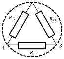
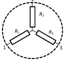
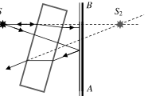
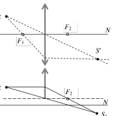
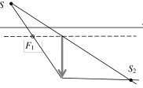

[[Състезания/esenno/8/2017|◂ 2017]] | [[Състезания/esenno/8/2018|условия]] | [[Състезания/esenno/8/2019| 2019 ▸]]

Задача 1. а) Нека означим с а и b разстоянието до мястото на срещата съответно от пункт
А и пункт Б. Тогава средните скорости на движение са съответно

$v_1 = \frac{b}{4}$, $v_2 = \frac{a}{t}$, \[2 т.\]

откъдето намираме търсеното време

$t = 4 \times \frac{a}{b} \cdot \frac{v_1}{v_2}$. \[1 т.\]

Тъй като времето на движение $t_0$ на групите до срещата е едно и също, имаме

$t_0 = \frac{a}{v_1} = \frac{b}{v_2}$ $\to$ $\frac{v_1}{v_2} = \frac{a}{b}$. \[2 т.\]

Тогава след заместване намираме $t = 4\left(\frac{a}{b}\right)^2 = 9$ часа. \[2 т.\]

б) Времето $t_0$ намираме от движението на групата, тръгнала от А:

$t_0 = \frac{a}{v_1} = \frac{4a}{b} = 6$ часа. \[2 т.\]

Следователно в този ден слънцето е изгряло в 6 h. \[1 т.\]

Задача 2. а) Нека изводите 1 и 3 са краищата на едно от съпротивленията. Тогава другите
две съпротивления могат да бъдат свързани едното между точките 1 и 2, а другото между
точките 2 и 3 (фиг. 1, а), при което има възможност да се отчетат указаните напрежения.

Съществува и друга възможност: свързваме две от съпротивленията последователно
между точките 1 и 3, а третото съпротивление се свързва между 2 и разделителната точка
на другите две съпротивления (фиг. 1, б). \[2 т.\]

Фиг. 1, а Фиг. 1, б

б) Нека разгледаме първата възможност (фиг. 1, а). При свързване на източника към 1 и 3
съпротивленията $R_12$ и $R_23$ \[0,5 т.\] са свързани последователно и

$\frac{R_{12}}{R_{23}} = \frac{U_{12}}{U_{23}} = \frac{2}{3}$. \[0,5 т.\]

Когато източникът е свързан към 2 и 3, съпротивленията $R_12$ и $R_13$ са свързани
последователно и

$\frac{R_{12}}{R_{13}} = \frac{U_{12}'}{U_{13}'} = 2$. \[0,5 т.\]

От почленното разделяне на двете равенства намираме

$\frac{R_{13}}{R_{23}} = \frac{1}{3}$. \[0,5 т.\]

Следователно имаме $R_13$ $< R_12$ $< R_23$ , при което намираме $R_13$ = R, $R_12$ = 2R, $R_23$ = 3R \[0,5 т.\].

Във втория случай нека означим общата точка с 0 (фиг. 1, б). При свързване на източника
към 1 и 3 напрежението $U_12$ $= U_10$ , а U 23 = U 03 . Тъй като $R_1$ и $R_3$ са свързани
последователно \[0,5 т.\], имаме

$\frac{R_1}{R_3} = \frac{U_{10}}{U_{03}} = \frac{U_{12}}{U_{23}} = \frac{2}{3}$. \[0,5 т.\]

От друга страна аналогично намираме

$\frac{R_2}{R_3} = \frac{U_{20}}{U_{03}} = \frac{U_{12}'}{U_{13}'} = 2$, $\frac{R_1}{R_2} = \frac{1}{3}$. \[1 т.\]

Следователно имаме $R_1$ $< R_3$ $< R_2$, при което намираме $R_1$ = R, $R_3 = \frac{3}{2}R$, $R_2$ = 3R \[0,5 т.\].

в) По първата схема имаме $U_{13}$ + $U_{23}$ = U \[0,5 т.\]. От $U_{23} = \frac{R_{23}}{R_{13}} U_{13} = 3 U_{13}$ \[0,5 т.\], намираме

$U_{13}$ = 3,75 V, $U_{23}$ = 11,75 V. \[0,5 т.\]

От втората схема имаме $U_{13} = U_{10}$, $U_{23} = U_{02}$. От $U_{23} = \frac{R_2}{R_1} U_{13} = 3 U_{13}$ \[0,5 т.\], намираме

$U_{13}$ = 3,75 V, $U_{23}$ = 11,75 V, \[0,5 т.\]

т. е. двете схеми са еквивалентни. \[0,5 т.\]

Задача 3.

А. а) Във верига лампите могат да бъдат свързани успоредно или последователно. При
успоредно свързване с помощта на ключ може да се прекъсва подаването на напрежение
към една от лампите или към двете едновременно. Следователно, за да отговаря на
поставените условия електрическата схема трябва да включва две последователно
свързани лампи, както е показано на фиг. 2. \[0,5 т.\] Когато ключът К е затворен, той дава
накъсо лампа 1 и тя не свети. При отворен ключ протича ток през двете лампи, но за да
светят са важни конкретните стойности на напрежение между краищата им. \[0,5 т.\]

Фиг. 2 (две последователно свързани лампи 1 [15 W] и 2 [150 W], ключ К накъсо лампа 1; източник 220 V) \[0,5 т.\]

б) При затворен ключ К цялото напрежение от 220 V се подава на лампата 2 и тя свети с
означената си мощност. \[0,5 т.\] При отворен ключ К напрежението U = 220 V се
разпределя между двете последователно свързани лампи. Тъй като съпротивлението на
всяка лампа е съответно

$R_1 = \frac{U^2}{P_1}$, $R_2 = \frac{U^2}{P_2}$, \[0,5 т.\]

то

$\frac{U_1}{U_2} = \frac{R_1}{R_2} = \frac{P_2}{P_1} = 10$. \[0,5 т.\]

Тогава $U_1$ = 200 V, $U_2$ = 20 V. Понеже $U_2 < < U$ = 220 V, лампата 2 няма да свети. Лампата 1
ще свети практически нормално, тъй като $U_1 \approx U$ . \[0,5 т.\]

Б. а) Без стъклената пластина образът $S_1$ на светещия точков източник се намира зад
огледалото на разстояние равно на разстоянието от предмета до огледалото върху
хоризонталната права, която ги свързва (фиг. 3).\[0,5 т.\] За получаване на образа на
източника $S_2$ при наличие на пластина използваме следните два лъча: хоризонтален лъч,
който след пречупване от стъклената пластина остава хоризонтален, но отместен надолу
\[0,5 т.\] и лъч, който пада върху стъклената пластина перпендикулярно и не се пречупва.
\[0,5 т.\] След отражението им от огледалото продълженията на отразените лъчи, които са
между източника и пластината, дават търсения образ.\[0,5 т.\] Образите и направените
построения са показани на фиг. 3. \[0,5 т.\]

 б) Образът на източника се приближава към огледалото. \[0,5 т.\]

В. а) Образът S ' се получава от пресичането на всички лъчи, преминали през лещата, като
положението му се определя от пресичането на два лъча, напр. показаните на фиг. 4, а.
\[0,5 т.\]

 б) Половината от лещата е част от цяла леща с отместена нагоре главна оптична ос,
успоредна на MN .[0,25 т.] Образът се формира от лъчите, които преминават през горната
ѝ половина, поради което образът не е така ярък, както в случая а). \[0,25 т.\] На фиг. 4, б са
показани двата лъча, които определят положението на образа $S_1$ . \[0,5 т.\] Той е отместен
нагоре спрямо в а), като отстои от равнината на лещата на същото разстояние. \[0,5 т.\]

 в) Половината от лещата е част от цяла леща с отместена надолу главна оптична ос,
успоредна на MN .[0,25 т.] Образът се формира от лъчите, които преминават през долната
ѝ половина, поради което образът не е така ярък, както в случая а). \[0,25 т.\] На фиг. 4, в са
показани двата лъча, които определят положението на образа $S_2$.\[0,5 т.\] Той е отместен
надолу спрямо в а), като отстои от равнината на лещата на същото разстояние. \[0,5 т.\]

Фиг. 3

Фиг. 4
