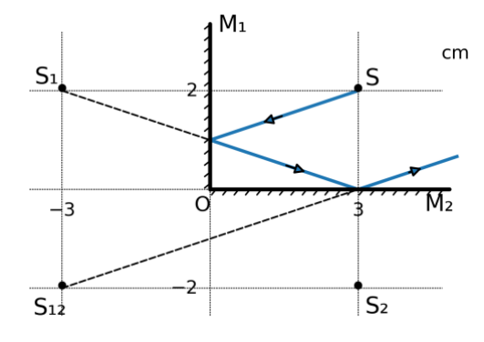
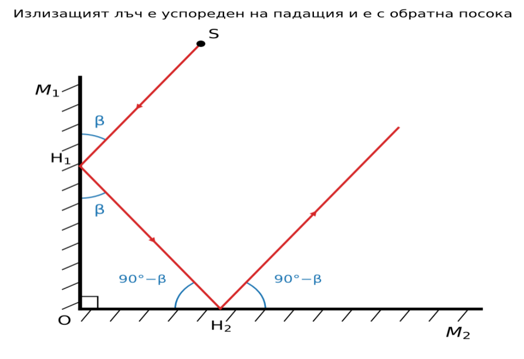
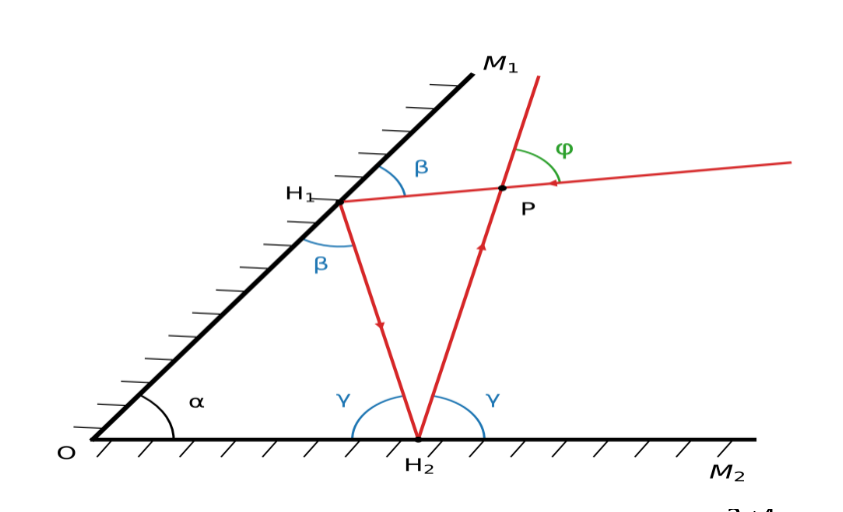
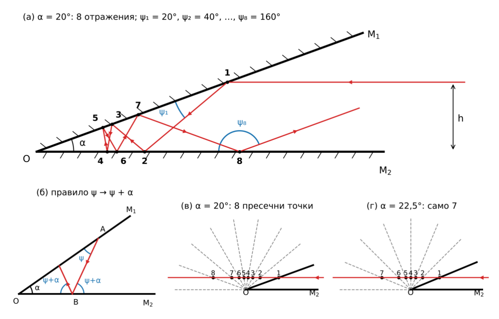
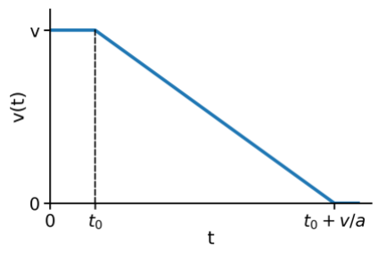

[[Състезания/esenno/8/2025|◂ 2025]] | [[Състезания/esenno/8/2026|условия]]

**Задача 1. Електрическа кана с два нагревателя**

а) \[2 т.\] Означаваме отворен ключ с 0, а затворен с 1. Имаме 8 възможности. Всяка правилна възможност се оценява с 0,25 точки.

| K₁ | K₂ | K₃ | Режим |
| --- | --- | --- | --- |
| 0 | 0 | 0 | Нито един нагревател не работи. |
| 0 | 0 | 1 | Работи само $R_1$. |
| 0 | 1 | 0 | Работи само $R_2$. |
| 0 | 1 | 1 | $R_1$ и $R_2$ са свързани успоредно. |
| 1 | 0 | 0 | $R_1$ и $R_2$ са свързани последователно. |
| 1 | 0 | 1 | Работи само $R_1$; $R_2$ е шунтиран. |
| 1 | 1 | 0 | Работи само $R_2$; $R_1$ е шунтиран. |
| 1 | 1 | 1 | Недопустимо. Имаме късо съединение. |

б) \[2 т.\] При еднакво номинално напрежение $P = U^2/R$ \[0,5 т.\], следователно $R_2 = 2R_1$. Успоредно всеки нагревател е под напрежение U, затова $P_у = 1200 + 600 = 1800\ \text{W}$ \[0,5 т.\].

Последователно токът е общ и $U_2 = 2U_1$; от $U_1 + U_2 = U$ получаваме $U_1 = U/3$ и $U_2 = 2U/3$ \[0,5 т.\]. Мощността на всеки нагревател се изменя с квадрата на напрежението:

$P_п = 1200\cdot\frac{1}{9} + 600\cdot\frac{4}{9} = 400\ \text{W}$. \[0,5 т.\]

в) \[1 т.\] Да, има загуби \[0,5 т.\]. Без загуби двата опита биха дали едно и също Q. Но $P_1 t_1 = 1200\cdot 400 = 480\ \text{kJ}$, а $P_2 t_2 = 600\cdot 1000 = 600\ \text{kJ}$ \[0,5 т.\]. Разликата доказва отдаване на топлина към околната среда при зададените идеализации.

г) \[2 т.\] Полезната мощност е $P - P_з$ \[0,5 т.\]. За двата опита:

$(1200 - P_z)\cdot 400 = (600 - P_z)\cdot 1000 = Q$ \[0,5 т.\]

$P_з = 200\ \text{W},\quad Q = (1200 - 200)\cdot 400 = 400\,000\ \text{J} = 400\ \text{kJ}$ \[0,5 т.\]

д) \[2 т.\] От $t = Q/(P - P_з)$ \[0,5 т.\] получаваме времената в таблицата. Електричната енергия е $E = Pt$ \[0,5 т.\].

| Режим | P, W | t | E, kJ |
| --- | --- | --- | --- |
| Само нагревател 1 | 1200 | 400 s = 6 min 40 s | 480 |
| Само нагревател 2 | 600 | 1000 s = 16 min 40 s | 600 |
| Успоредно | 1800 | 250 s = 4 min 10 s \[0,5 т.\] | 450 |
| Последователно | 400 | 2000 s = 33 min 20 s \[0,5 т.\] | 800 |

е) \[1 т.\] Най-малко енергия се изразходва при успоредно свързване: $E = 450\ \text{kJ}$ \[0,5 т.\]. Водата получава $Q/E = 400/450 = 8/9 \approx 88{,}9\%$ \[0,5 т.\].

**Задача 2. Ъглови огледала**

а) \[1,5 т.\] Избираме O за начало, M₂ за положителна хоризонтална ос, а M₁ за положителна вертикална ос. Образът в плоско огледало е симетричен на предмета спрямо правата на огледалото. Получават се три образа:

- $S_1$ – образ в M₁ (едно отражение): на 3 cm зад правата на M₁ и на 2 cm от правата на M₂ \[0,5 т.\];
- $S_2$ – образ в M₂ (едно отражение): на 3 cm от правата на M₁ и на 2 cm зад правата на M₂ \[0,5 т.\];
- $S_3$ – образ на $S_1$ в M₂ (две отражения); той съвпада с образа на $S_2$ в M₁: на 3 cm и 2 cm зад двете прави, симетричен на S спрямо O \[0,5 т.\].

$S_3$ лежи зад двете огледала, затова той не дава нови образи.

Пунктирите на фиг. 1 са продължения, а не действителни лъчи.

б) \[1,5 т.\] Нека лъчът пада върху M₁ в точка H₁ под ъгъл β спрямо повърхността на огледалото.

1. По закона за отражението отразеният лъч $H_1H_2$ също сключва ъгъл β с M₁ \[0,5 т.\].
2. В правоъгълния триъгълник $OH_1H_2$ ъгълът при H₂ е $90^\circ - \beta$. Толкова е и ъгълът на излизащия лъч с M₂ \[0,5 т.\].
3. Падащият лъч сключва ъгъл β с M₁. Излизащият сключва ъгъл $90^\circ - \beta$ с M₂, т.е. ъгъл β с права, успоредна на M₁. Двата лъча са успоредни, а посоките им са противоположни \[0,5 т.\].

Разсъждението не зависи от β.

в) \[1,5 т.\] Импулсът изминава разстоянието D два пъти:

$D = \frac{ct}{2} = \frac{3{,}0\cdot 10^8\cdot 2{,}56}{2} = 3{,}84\cdot 10^8\ \text{m} = 384\,000\ \text{km}$ \[0,5 т.\]

$\Delta D = \frac{c\Delta t}{2} = \frac{3{,}0\cdot 10^8\cdot 10^{-10}}{2} = 0{,}015\ \text{m} = 1{,}5\ \text{cm}$ \[0,5 т.\]

Ъгловият отражател връща светлината точно назад към източника при всяка негова ориентация. Плоското огледало връща лъча назад само ако е точно перпендикулярно на него. Това не може да се поддържа, защото посоката към Земята постоянно се променя \[0,5 т.\].

г) \[2 т.\] Означаваме с H₁ и H₂ точките на отразяване, а с P означаваме пресечната точка на падащия и излизащия лъч. β и γ са ъглите на лъча $H_1H_2$ с M₁ и M₂.

1. При H₁ падащият и отразеният лъч сключват равни ъгли β с M₁. Затова $\angle PH_1H_2 = 180^\circ - 2\beta$ \[0,4 т.\].
2. Аналогично при H₂: $\angle PH_2H_1 = 180^\circ - 2\gamma$ \[0,4 т.\].
3. В триъгълника $OH_1H_2$ имаме $\alpha + \beta + \gamma = 180^\circ$, т.е. $\beta + \gamma = 180^\circ - \alpha$ \[0,4 т.\].
4. В триъгълника $PH_1H_2$ ъгълът при P е връхен на φ, така че:

$\varphi = 180^\circ - (180^\circ - 2\beta) - (180^\circ - 2\gamma) = 2(\beta + \gamma) - 180^\circ = 180^\circ - 2\alpha$ \[0,4 т.\]

φ зависи само от α. При $\alpha = 60^\circ$ имаме $\varphi = 60^\circ$ \[0,4 т.\].

д) \[2 т.\] При всяко отражение означаваме с ψ ъгъла между отразения лъч и частта от огледалото, която е откъм върха O (на фиг. а са отбелязани $\psi_1$ и $\psi_8$). Номерът показва поредното отражение.

1. Падащият лъч е успореден на M₂, затова сключва с M₁ ъгъл α (съответни ъгли). По закона за отражението отразеният лъч сключва с M₁ същия ъгъл откъм O: $\psi_1 = \alpha = 20^\circ$ \[0,5 т.\].
2. Правило (фиг. б): нека лъчът напуска огледалото в точка A под ъгъл ψ и пада върху другото огледало в точка B. В триъгълника OAB ъглите при O и A са α и ψ, затова външният му ъгъл при B е $\psi + \alpha$. Това е ъгълът между падащия лъч и частта от огледалото, която е от B навън. По закона за отражението отразеният лъч сключва същия ъгъл с частта откъм O, т.е. следващият ъгъл е $\psi + \alpha$ \[0,5 т.\].
3. Следователно $\psi = 20^\circ, 40^\circ, 60^\circ, 80^\circ, 100^\circ, 120^\circ, 140^\circ, 160^\circ$: отраженията 1, 3, 5, 7 са от M₁, а 2, 4, 6, 8 са от M₂. Докато $\psi < 90^\circ$, лъчът се приближава към O, а при $\psi > 90^\circ$ се отдалечава \[0,5 т.\].
4. След 8-ото отражение (от M₂) лъчът сключва с M₂ ъгъл $160^\circ$ откъм O, т.е. $20^\circ$ в посока от O. Той е успореден на M₁ и не може да го пресече, а от M₂ се отдалечава, затова 9-о отражение няма \[0,5 т.\].

Имаме 8 отражения. Лъчът излиза успоредно на M₁ (под 20° спрямо M₂), насочен навън от върха O.

Проверка (фиг. в): при „разгъване“ на ъгловото огледало лъчът е права, която пресича образите на огледалата под ъгли 20°, 40°, …, 160° — 8 пресечни точки; правата под 180° е успоредна на лъча.

е) \[1,5 т.\] Разсъждението от д) е вярно за всяко α: k-тото отражение е под ъгъл $\psi_k = k\alpha$.

1. То настъпва само ако $k\alpha < 180^\circ$. При $k\alpha = 180^\circ$ лъчът е успореден на огледалото, а при $k\alpha > 180^\circ$ не може да го достигне. Следователно броят на отраженията е най-голямото цяло k, за което $k\alpha < 180^\circ$ \[0,5 т.\].
2. Осем отражения има точно когато $8\alpha < 180^\circ$ и $9\alpha \ge 180^\circ$ \[0,5 т.\].
3. Оттук $20^\circ \le \alpha < 22{,}5^\circ$ \[0,5 т.\]. При $\alpha = 20^\circ$ деветото отражение би било под $180^\circ$ – лъчът е успореден на M₁, затова границата се включва (случаят от д). При $\alpha = 22{,}5^\circ$ имаме $8\alpha = 180^\circ$: след седмото отражение лъчът е успореден на M₂ и отраженията са само 7 (фиг. г), затова тази граница се изключва. При грешно включена или изключена граница се отнемат 0,25 т.

Фиг. (а) Ход на лъча при $\alpha = 20^\circ$; ψ е ъгълът между отразения лъч и огледалото откъм O. (б) Защо всеки следващ ъгъл е с α по-голям. (в), (г) „Разгъване“ при $\alpha = 20^\circ$ и $\alpha = 22{,}5^\circ$: лъчът е права, а отраженията са пресечните ѝ точки с образите на огледалата.

**Задача 3. Безопасна дистанция**

а) \[1,5 т.\] Графиката е хоризонтална до $t_0$ \[0,5 т.\], след което е права с наклон $-a$ до спирането в $t_0 + v/a$ \[0,5 т.\]. Площта на правоъгълника и триъгълника дава:

$s = vt_0 + \frac{1}{2}v\cdot\frac{v}{a} = vt_0 + \frac{v^2}{2a}$ \[0,5 т.\]

б) \[2,5 т.\] Скоростите са 10, 15, 20 и 25 m/s. От таблицата $s/v = 1{,}8; 2{,}3; 2{,}8; 3{,}3$ s \[0,5 т.\]. Понеже $s/v = t_0 + v/(2a)$, при увеличение на v с 5 m/s отношението нараства с 0,5 s \[0,5 т.\]:

$\frac{5}{2a} = 0{,}5$ \[0,5 т.\] $\Rightarrow a = 5{,}0\ \text{m/s}^2$ \[0,5 т.\], $\quad t_0 = 1{,}8 - \frac{10}{10} = 0{,}8\ \text{s}$ \[0,5 т.\]

Проверката чрез $s = 0{,}8v + v^2/10$ дава съответно 18,0; 34,5; 56,0; 82,5 m — съвпадение с всичките четири стойности.

в) \[1 т.\] Новото време на реакция е 1,6 s \[0,5 т.\]. При $v = 25\ \text{m/s}$ и по формулата от а): $s = 102{,}5\ \text{m}$ \[0,5 т.\].

г) \[2 т.\] От закона за скоростта $v = v_0 - at$ и при нулиране на скоростта при спирането, намираме, че кола А спира за 4 s, а кола Б за 5,6 s. От t = 0 до спирането на кола Б е по-бърза от А, затова разстоянието непрекъснато намалява \[0,5 т.\]. Пътищата от общия начален момент са:

$s_A = \frac{v_0^2}{2a} = \frac{25^2}{2\cdot 6{,}25} = 50\ \text{m}$ \[0,5 т.\]; $\quad s_B = vt_0 + \frac{v^2}{2a} = 25\cdot 0{,}6 + \frac{25^2}{2\cdot 5} = 77{,}5\ \text{m}$ \[0,5 т.\].

Минималната дистанция е разликата: $d = s_B - s_A = 27{,}5\ \text{m}$ \[0,5 т.\].

д) \[3 т.\] Началната скорост е $v_0 = 90\ \text{km/h} = 25\ \text{m/s}$. Разстоянието намалява, докато задната кола Б е по-бърза от А, и започва да нараства, когато стане по-бавна. Следователно търсим момента на изравняване на скоростите \[0,5 т.\].

Докато и двете коли спират, $v_A = 25 - 5t$ и $v_B = 25 - 6{,}25(t - 0{,}6)$. От $v_A = v_B$ получаваме $t_и = 3$ s, като скоростта тогава е 10 m/s \[0,5 т.\].

До този момент А изминава: $s_A = \frac{25 + 10}{2}\cdot 3 = 52{,}5\ \text{m}$ \[0,5 т.\].

Б първо се движи равномерно 0,6 s, а после спира 2,4 s: $s_B = 25\cdot 0{,}6 + \frac{25 + 10}{2}\cdot 2{,}4 = 57\ \text{m}$ \[0,5 т.\].

След $t_и$ кола Б е по-бавна от А и разстоянието нараства. Б спира при $t = 4{,}6$ s, а А спира при $t = 5$ s; следователно по-късно няма ново сближаване \[0,5 т.\].

Най-голямото скъсяване на разстоянието е $s_B - s_A = 4{,}5\ \text{m}$. При критичната дистанция минималното разстояние е нула, затова $d = 4{,}5\ \text{m}$ \[0,5 т.\].
