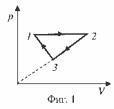
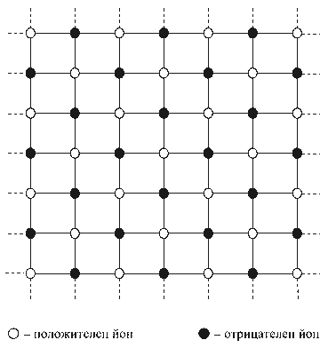

[[Състезания/esenno/9/2010|◂ 2010]] | [[Състезания/esenno/9r/2011|решения]] | [[Състезания/esenno/9/2012| 2012 ▸]]

Задача 1. Тяло 1 се движи по хоризонтална равнина с ускорение $a_1 = 2\ (m/s)^2$ под действие на хоризонтална сила $F$ и пренебрежимо триене. Тяло 2, еднакво по форма с първото, се движи по същата равнина с ускорение $a_2 = 1\ (m/s)^2$, когато му действа силата $F$, но при наличие на триене. Тялото 2 се поставя и залепва върху тялото 1 и новото тяло 1+2 се движи по равнината с ускорение $a_3 = 0{,}8\ (m/s)^2$ под действие на силата $F$.

С какво ускорение $a$ ще се движи по равнината тялото 1+2 под действие на силата $F$, когато тялото 1 е поставено върху тялото 2?

 Задача 2. На фиг. 1 е показан процесът 1–2–3–1, извършен с един мол хелий, разглеждан като идеален газ. В участъка 1–2 газът върши работа $A = 830\ \mathrm{J}$ и температурата му се увеличава 3 пъти. Температурите в състояния 1 и 3 са равни.

Газовата константа за един мол газ е $B = 8{,}3\ \mathrm{J/K}$.

а) Определете температурата $T_1$ на газа в състояние 1.

б) Дайте геометрично тълкуване на работата $W$, извършена от газа в процеса 1–2–3–1.

в) Намерете работата $W$.

 Задача 3. На фиг. 2 е показана плоска квадратна решетка, състояща се от $N$ на брой положителни и отрицателни йони със заряд $q_0$, които се намират във възлите на решетката. Най-малкото разстояние е между два разноименни йона и е равно на $R$. Всички йони, които се намират на еднакви разстояния от даден йон, формират координационна окръжност.

а) По фиг. 2 определете радиусите на първите осем координационни окръжности около даден йон (положителен или отрицателен), броя и вида на йоните в тях.

По определение електростатичната енергия на взаимодействие между два точкови заряда е равна на произведението от заряда на единия от тях и потенциала на полето, създадено от другия заряд, в точката, където се намира първият.

б) Определете енергията на взаимодействие на един заряд с всички
останали, като отчетете само взаимодействията между него и зарядите от първите
осем координационни окръжности, а взаимодействията с другите заряди
пренебрегнете.

в) Пълната електростатична енергия на взаимодействие на всички йони може да се запише във вида

$$W = -\alpha \frac{N e_2}{R},$$

където $e_2 = k q_0^2$, $k = 9 \cdot 10^9\ \mathrm{N \cdot m^2/C^2}$. Определете константата $\alpha$ за описаната квадратна решетка, като отчетете, че броят на йоните с по-малко от осем координационни окръжности е пренебрежим спрямо $N$.

Забележка. Всяка задача се оценява с максимален брой 10 точки.
