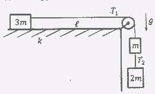
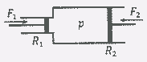
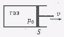
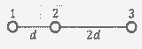

[[Състезания/esenno/9/2016|◂ 2016]] | [[Състезания/esenno/9r/2017|решения]] | [[Състезания/esenno/9/2018| 2018 ▸]]

**Задача 1. Трупчета и макара**

Три трупчета с маси $m$, $2m$ и $3m$ са свързани с безмасови неразтегливи нишки, както е показано на фигурата вляво. Трупчетата с маси $m$ и $2m$ са оставени свободно да висят, окачени на безмасова макара. Преди системата да започне да се движи трупчето с маса $3m$ се намира на разстояние $\ell = 2\ m$ от макарата върху хоризонтална повърхност, като коефициентът на триене между трупчето и повърхността е $k = 0{,}3$. Може да използвате, че земното ускорение е $g \approx 10\ m/s^2$. Съпротивлението на въздуха да се пренебрегне.

а) Определете големината на ускорението $a$, с което се движат трупчетата. \[2 т.\]

б) Ако големината на силата на опън на горната нишка е $T_1 = 5\ N$, намерете стойността на масата $m$. \[1 т.\]

в) На колко е равна големината $T_2$ на силата на опън на долната нишка? \[1 т.\]

След като хоризонтално движещото се трупче изминава две трети от първоначалното си разстояние до макарата, долната нишка (която свързва трупчетата с маси $m$ и $2m$) е прерязана.

г) Определете времето $t$ от началото на движението на системата, за което хлъзгащото се трупче ще стигне до макарата. \[3,5 т.\]

д) Намерете нарастването на температурата $\Delta T$ на трупчето с маса $3m$. Приемете, че при хлъзгането му върху повърхността 1/3 от работата на силата на триене се е трансформирала в предадена на трупчето топлина. Използвайте също, че 1/2 от кинетичната енергия на трупчето се превръща в топлина за неговото загряване, когато то се удря в макарата и спира да се движи. Специфичният топлинен капацитет на трупчето е $c = 600\ \mathrm{J/(kg \cdot K)}$. \[2,5 т.\]

**Задача 2. Цилиндри с бутала**

Част I Хидравличната машина на фигурата вляво е изградена от два хоризонтални цилиндрични участъка с радиуси $R_{1} = 0{,}\!1\ \mathrm{m}$ и $R_{2} = 0{,}\!25\ \mathrm{m}$. По-малкото бутало има маса $m_{1} = 2\ \mathrm{kg}$, а по-голямото бутало е с маса $m_{2} = 10\ \mathrm{kg}$. Пространството между буталата е запълнено с несвиваем идеален флуид. Върху буталата са приложени външни сили с големини $F_1 = 0{,}\!15\ \mathrm{kN}$ и $F_{2} = 0{,}\!9\ \mathrm{kN}$, като посоките на силите са означени на фигурата. Приемете, че налягането на флуида не се изменя. Налягането на околната среда е $p_{0} = 10^5\ \mathrm{Pa}$.

а) Определете големината на ускорението $a_1$ на по-малкото бутало. \[4 т.\]

б) На колко е равна големината на ускорението $a_2$ на по-голямото бутало? \[1 т.\]

в) Намерете налягането $p$ на флуида в хидравличната машина.
\[1,5 т.\]

**Част II** В хоризонтален топлоизолиран цилиндър с напречно сечение $S = 30\ \mathrm{cm}^2$ и с бутало, което може да се движи без триене, е затворено определено количество идеален газ при атмосферно налягане $p_0 = 10^5\ \mathrm{Pa}$. В цилиндъра има електрически нагревател с неизвестна постоянна мощност $P$.

След включване на нагревателя буталото започва да се движи надясно със скорост $v = 2\ \mathrm{cm/s}$. Вътрешната енергия на газа се дава с израза $U = 3BT/2$, където $B$ е константа, а $T$ е температурата на газа. Съотношението между обема и температурата на газа преди включване на нагревателя е $p_0 V_0 = BT_0$. Намерете мощността $P$ на нагревателя. \[3,5 т.\]

**Задача 3. Топчета на нишки**

Три еднакви малки метални топчета са свързани с безмасови непроводящи нишки, както е показано на фигурата вляво. Разстоянията между топчетата са указани на фигурата. Първоначално топчетата не са електрически заредени. Четвърто топче (идентично по размер и структура на свързаните топчета) със заряд $q$ се допира последователно до всяко едно от трите свързани топчета по ред на нарастване на номерата им, при което свързаните топчета се зареждат. След тези действия четвъртото топче се отдалечава от останалите три топчета. Електричната константа е $k$.

а) Намерете големината на силата $F$, с която останалите заряди действат на средното топче. \[3 т.\]

б) На колко е равна големината на интензитета $E$, който създава системата от заряди в средата на отсечката, свързваща крайните топчета? \[2 т.\]

в) Определете потенциала $\varphi$ в средата на отсечката, която свързва крайните две топчета. \[1 т.\]

г) На колко е равно отношението $T_1/T_2$, където $T_1$ е големината на силата на опън на лявата нишка (между топчетата 1 и 2), а $T_2$ е големината на силата на опън на дясната нишка (между топчетата 2 и 3)? \[2,5 т.\]

д) В един момент и двете нишки са прерязани. Определете големините на ускоренията $a_1$, $a_2$ и $a_3$, с които топчетата започват да се движат, ако масите им са равни на $m$. \[1,5 т.\]
