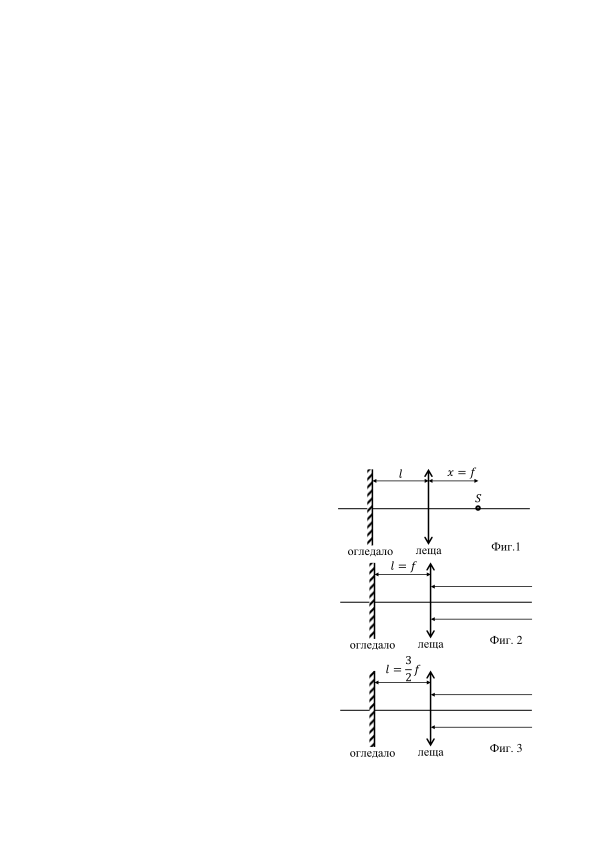
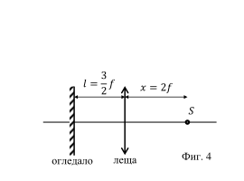

[[Състезания/esenno/9/2019|◂ 2019]] | [[Състезания/esenno/9r/2022|решения]] | [[Състезания/esenno/9/2023| 2023 ▸]]

Задача 1. Снимки на кола.

Направени са 8 снимки на потегляща кола. Тя първоначално е в покой, след това се
движи с ускорение a, а след като достигне максималната си скорост $v_{max}$ , продължава да се движи равномерно. Снимките са правени през интервал от време $t_0$ = 1,00 s. Сравнени са положенията на колата. Оказало се, че между третата и четвъртата снимка колата е изминала път $s_34$ = 5,50 m, между четвъртата и петата снимка изминатият път е $s_45$ = 10,50 m, между шестата и седмата - $s_67$ = 15,00 m, а между седмата и осмата - $s_78$ = 15,00 m. Изминатият път между петата и шестата снимка е $s_56$ $< s_67$ , а между втората и третата е $s_23$ > 0. От дадените данни изчислете:

а) максималната скорост $v_{max}$ ; \[1 т.\]

б) ускорението a; \[2 т.\]

в) скоростта на колата в момента на петата снимка $v_5$ ; \[2 т.\]

г) изминатия път между петата и шестата снимка $s_56$ ; \[2 т.\]

д) изминатия път между втората и третата снимка $s_23$ ; \[2 т.\]

е) изминатия път между първата и втората снимка $s_12$ ; \[1 т.\]

Задача 2. Събирателна леща и огледало.

В тази задача ще се разгледа как работят събирателна леща и огледало, поставено на
някакво разстояние зад нея, така че да е перпендикулярно на нейната ос. Фокусното
разстояние на лещата е f. Светлинните лъчи (светлинният сноп) от светлинен източник преминават през лещата, отразяват се от огледалото и на връщане пак преминават през лещата.

а) На Фиг. 1 светлинният точков източник S се намира на разстояние x = f от лещата и лежи на нейната ос. Огледалото се намира на неизвестно разстояние l oт лещата. Как ще изглежда (къде ще се събира) завръщащият се от лещата светлинен сноп? \[2.5 т.\]

б) На Фиг. 2 светлинният точков източник S се намира безкрайно далеч от лещата (пада успореден светлинен сноп) и лежи на нейната ос. Огледалото се намира на разстояние l = f oт лещата. Как ще изглежда (къде ще се събира) завръщащият се от лещата светлинен сноп? \[2.5 т.\]

в) На Фиг. 3 светлинният точков източник S се намира безкрайно далеч от лещата (пада успореден светлинен сноп) и лежи на нейната ос.

Огледалото се намира на разстояние $l = \frac{3}{2} f$ oт лещата. Как ще изглежда (къде ще се събира) завръщащият се от лещата светлинен сноп? \[2.5 т.\]

 г) На Фиг. 4 светлинният точков източник S се намира на разстояние x = 2f от лещата и лежи на нейната ос. Огледалото се намира на разстояние $l = \frac{3}{2} f$ oт лещата. Как ще изглежда (къде ще се събира) завръщащият се от лещата светлинен сноп? \[2.5 т.\]

Задача 3. Електроенергия.

Приемете, че в едно домакинство единствените консуматори на електроенергия са
хладилник, телевизор и осветление. Първоначално домакинството ползвало за
осветление лампи с волфрамови жички и плащало през зимен месец 24 лв/месец. След като заменило тези лампи с LED крушки, които консумират 6 пъти по-малка
електрическа мощност в сравнение със старите крушки, през зимен месец разходите
паднали на 14 лв/месец. Веднъж домът не бил обитаван в продължение на месец, само хладилникът работел и тогава сметката за месеца била 3 лв. Приемете, че всеки месец има 30 дни.

а) Колко лева на месец струва електроенергията, консумирана от телевизора? \[2 т.\]

б) Ако електрическата мощност на телевизора е 150 W и той работи средно по 10 часа
на ден, колко струва 1 kWh електроенергия? \[2 т.\]

в) Колко е средната консумирана мощност от хладилника? \[2 т.\]

г) Ако лампите през зимен месец светят средно по 8 часа на денонощие, колко е била
общата мощност на старото осветление с лампи с волфрамови жички? \[2 т.\]

д) Ако новите LED лампи през летен месец светят средно по 5 часа на денонощие,
каква месечна сметка ще плаща домакинството през летен месец? \[2 т.\]