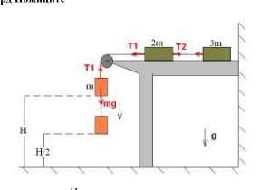
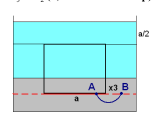
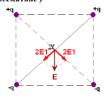
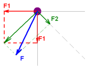

[[Състезания/esenno/9/2011|◂ 2011]] | [[Състезания/esenno/9/2012|условия]] | [[Състезания/esenno/9/2013| 2013 ▸]]

Задача 1. Едуард Ножиците

а) Прилагаме втория закон на Нютон върху системата от три тела, на която действа
външна сила mg. $mg = (m + 2m + 3m)a$ $\Rightarrow$ $a = \frac{g}{6}$ (1 т.)

б) Прилагаме втория закон на Нютон върху тялото с маса m.

$mg - T_1 = ma$ $\Rightarrow$ $T_1 = m(g - a) = \frac{5}{6}mg$ (2 т.)

в) Първи начин:

Разглеждаме тялото с маса 2m и прилагаме втория закон на Нютон.

$T_1 - T_2 = 2ma$ $\Rightarrow$ $T_2 = T_1 - 2ma = \frac{5}{6}mg - 2m\cdot\frac{g}{6} = \frac{1}{2}mg$ (1,5 т.)

Втори начин:

За тялото с маса 3m прилагаме втория закон на Нютон.

$T_2 = 3ma$ $\Rightarrow$ $T_2 = 3m\cdot\frac{g}{6} = \frac{1}{2}mg$ (1,5 т.)

г) Началната скорост на тялото е 0. Разделяме движението на два етапа. Преди
срязването на нишката то се движи равноускорително с ускорение а и изминава
разстояние H/2 и достига скорост $v_0$: (0,5 т.)

$v_0^2 - 0^2 = 2a\cdot\frac{H}{2} = \frac{gH}{6}$

След срязването тялото се движи равноускорително с ускорение g, начална скорост $v_0$ и
изминава разстояние H/2 до земята. Крайната скорост нека означим с v.

$v^2 - v_0^2 = 2g\cdot\frac{H}{2}$ $\Rightarrow$ $v = \sqrt{\frac{gH}{6} + gH} = \sqrt{\frac{7gH}{6}}$ (1,5 т.)

д) $Q = E_k = \frac{1}{2}mv^2 = \frac{1}{2}m\cdot\frac{7gH}{6} = \frac{7mgH}{24} = cm\Delta T$ $\Rightarrow$ $\Delta T = \frac{7gH}{24c}$ (1,5 т.)

е) $\Delta$T = 5.71 $\times$ 10 -3 K (0,5 т.)

 1

Задача 2. Стомана, живак и вода

а) От първия принцип на Нютон следва, че сумата от силите, действащи на кубчето е 0,
защото то се намира в покой. Действащите сили са силата на тежестта G и
Архимедовата сила FA. (0,5 т.)
$F_A = G$ $\Rightarrow$ $\rho_2 g x_1 a^2 = \rho_1 g a^3$ $\Rightarrow$ $x_1 = \frac{\rho_1}{\rho_2}a$ (1,5 т.)

б) Прилагаме същите разсъждения от подточка а) с единствената разлика, че този път
имаме допълнителна Архимедова сила, създавана от водата. Внимавайки за това от коя
течност колко обем е изместен, получаваме (0,5 т.)
 $\rho$ - $\rho_0$
$F_A = F_{вода} + F_{живак} = G$ $\Rightarrow$ $\rho_0 g a^2(a - x_2) + \rho_2 g a^2 x_2 = \rho_1 g a^3$ $\Rightarrow$ $x_2 = \frac{\rho_1 - \rho_0}{\rho_2 - \rho_0}a$ (2,5 т.)

в) Тази подточка е уловка. Могат да се дадат много сходни обяснения. Едно от тях е, че
допълнителното хидростатично налягане, което създава долятата вода, не променя
разликата в наляганията между точките А и B, които образуват скачен съд,
следователно няма причина за помръдване на кубчето. (2 т. - за обяснение)
$x_3 = x_2$ (1,5 т. - за отговор)

 $x_1 \approx 28.9 \text{cm}$

г) (1,5 т.)
 x 2 $= x_3 \approx 27.2 \text{cm}$

Задача 3. Зарядите на Георги

а) Потенциалът в центъра е сума от потенциалите, създавани от всеки от зарядите
поотделно.

$\varphi = 2\varphi_+ + 2\varphi_- = 2\cdot\frac{1}{4\pi\varepsilon_0}\cdot\frac{q}{l} - 2\cdot\frac{1}{4\pi\varepsilon_0}\cdot\frac{q}{l} = 0$ (1 т.)

б) Прилагаме принципа за суперпозиция. Интензитетът в центъра е векторна сума от
интензитетите на всеки от зарядите в тази точка. Големината на интензитета, създаван
от всеки заряд е Е1. (1 т. за схема + 1 т. за пресмятане )

$E_1 = \frac{1}{4\pi\varepsilon_0}\cdot\frac{q}{l^2}$

$E = 2\sqrt{2}E_1 = \frac{2\sqrt{2}}{4\pi\varepsilon_0}\cdot\frac{q}{l^2}$

 2

в) Има повече от един начин за намирането на енергията на системата. Един от тях е
намирането на потенциалните енергии отделно на всички двойки заряди и събирането
им. Друг вариант е използването на дефиницията, че потенциалната енергия на
системата е $\frac{1}{2}\sum q_i \varphi_i$, което е малко по-трудоемко, но практически същото. Ще
илюстрираме първия подход. Има шест двойки заряди.

$E_p = \sum_{i=1}^{6} E_i = \frac{1}{4\pi\varepsilon_0}\left(\frac{q^2}{\sqrt{2}l} + \frac{q^2}{\sqrt{2}l} - \frac{q^2}{\sqrt{2}l} - \frac{q^2}{\sqrt{2}l} - \frac{q^2}{2l} - \frac{q^2}{2l}\right) = -\frac{1}{4\pi\varepsilon_0}\cdot\frac{q^2}{l}$ (3 т.)

г) (1,5 т.)

 Ще разгледаме само горният ляв заряд, тъй като ситуацията е симетрична и няма
 причина на някой от зарядите да действа по-голяма сила, отколкото на другите.

 Силите $F_1$ се създават от близкостоящите заряди, а силата $F_2$ се създава от
 отдалечения заряд. Векторната сума на двете $F_1$ е стрелката, която е без означение.

 Впоследствие намираме векторната сума на $F_2$ с нея (F), която се явява и търсената
 сила.

$F_1 = \frac{1}{4\pi\varepsilon_0}\cdot\frac{q^2}{(2l)^2}$

$F_2 = \frac{1}{4\pi\varepsilon_0}\cdot\frac{q^2}{4l^2}$

$F_1 = 2F_2$

$F = \sqrt{(\sqrt{2}F_1)^2 + (F_2)^2} = \sqrt{(2\sqrt{2}F_2)^2 + (F_2)^2} = 3F_2$

$F = \frac{1}{4\pi\varepsilon_0}\cdot\frac{3q^2}{4l^2}$ (2,5 т.)

 3
