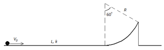
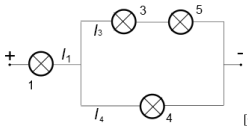
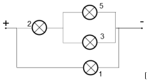
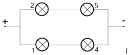
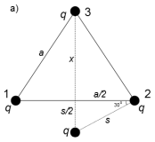
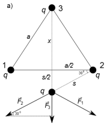
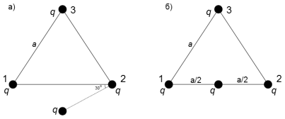

[[Състезания/esenno/9/2013|◂ 2013]] | [[Състезания/esenno/9/2014|условия]] | [[Състезания/esenno/9/2015| 2015 ▸]]

Задача 1. (Механика)

а) С Е1 и Е2 ще означим механичните енергии на тялото съответно в началото на движението,
където тялото е в крайно лява позиция, и в края, където тялото е на връхната точка на дъгата.

Имаме следната връзка:

 $E_2$ $- E_1$ = A, \[0.5 т.\]

където А е работата на силата на триене, натрупана при движението по хоризонталната
повърхност. Имаме А = -kmgL \[0.5 т.\], $E_1 = \frac{mv_0^2}{2}$ \[0.5 т.\] и $E_2 = \frac{mv^2}{2} + mgh$ \[0.5 т.\], където v
е скоростта на тялото във връхната точка на дъгата. От геометрични съображения
получаваме, че h = R/2 \[0.5т\] (използваме, че в правоъгълен триъгълник отношението на
катета и хипотенузата е 1/2 при срещулежащ ъгъл от 30о). Следователно:

$\frac{mv_0^2}{2} - \left(\frac{mv^2}{2} + \frac{mgR}{2}\right) = kmgL$. \[0.5 т.\]

За да падне тялото, трябва да е изпълнено v > 0, откъдето за началната скорост получаваме

 $v_0$ > $\sqrt$g(2kL + R). \[1 т.\]

б) В този случай имаме $E_1$ = mgh \[0.5 т.\], Е2 = 0 \[0.5 т.\] и А = -kmg$L_2$ \[0.5 т.\], където Е1 е
механичната енергия на тялото в началната позиция (на върха на дъгата), Е2 е механичната
енергия на тялото в покой, след като то е изминало разстояние $L_2$ по хоризонталната
повърхност, а А е работата на силата на триене.

Имаме mgh = kmg$L_2$ \[0.5 т.\]. Отново заместваме h = R/2 и получаваме
$L_2 = \frac{R}{2k}$ \[1 т.\].

в) Движението на тялото по хоризонталната повърхност е равнозакъснително с ускорение а.

Имаме F = kmg = ma \[0.2 т.\], откъдето получаваме a = kg \[0.2 т.\]. За изминатото
разстояние х имаме $x = v_0 t - \frac{kgt^2}{2}$ \[0.3 т.\], а за скоростта имаме $v = v_0 - kgt$ \[0.3 т.\]. Нека
означим с Т времето, за което тялото изминава пътя с дължина L (до основата на дъгата,
където движението спира). Така намираме $v_0 = kgT$ \[0.2 т.\], а оттам получаваме $T = \sqrt{\frac{2L}{kg}}$
\[0.5т\]. За пълната работа на силата на триене намираме А = -kmgL \[0.3 т.\]. Така
окончателно за средната мощност получаваме
$P = \frac{A}{T} = -m\sqrt{\frac{(kg)^3 L}{2}}$ \[1 т.\].

Фиг. 1

Задача 2. (Електричество)

а) С1 и С2 са отворени. Еквивалентната схема е следната (ток през втората крушка не
протича):

 [0. 5 т. ]

С $I_1$, $I_3$ и $I_4$ са означени токовете, протичащи съответно през крушките 1, 3 и 4. Изпълнено е
$I_3$ $= I_5$. За токовете намираме следната връзка:

$I_2 = 0$ [0.2 т.], $I_3 = \frac{I_1}{3}$ [0.2 т.], $I_4 = \frac{2I_1}{3}$ [0.2 т.], $I_5 = \frac{I_1}{3}$ [0.2 т.].

Тъй като за всяка крушка е изпълнен законът на Ом U = R I, за мощността имаме $P = I^2R$,
където R e съпротивлението на всяка крушка. Следователно за мощностите получаваме
следната връзка:

$\frac{P_2}{P_1} = 0$ [0.3 т.], $\frac{P_3}{P_1} = \frac{1}{9}$ [0.3 т.], $\frac{P_4}{P_1} = \frac{4}{9}$ [0.3 т.], $\frac{P_5}{P_1} = \frac{1}{9}$ [0.3 т.].

б) С1 и С2 са затворени. Еквивалентната схема е следната (ток през четвъртата крушка не
протича):

 [0. 5 т. ]

За токовете намираме следната връзка:

$I_2 = \frac{2}{3}I_1$ [0.2 т.], $I_3 = \frac{I_1}{3}$ [0.2 т.], $I_4 = 0$ [0.2 т.], $I_5 = \frac{I_1}{3}$ [0.2 т.].

За мощностите получаваме следната връзка:

$\frac{P_2}{P_1} = \frac{4}{9}$ [0.3 т.], $\frac{P_3}{P_1} = \frac{1}{9}$ [0.3 т.], $\frac{P_4}{P_1} = 0$ [0.3 т.], $\frac{P_5}{P_1} = \frac{1}{9}$ [0.3 т.].

в) С1 е отворен, а С2 затворен. Еквивалентната схема е следната (ток протича само през
първата крушка):
 [0. 5 т. ]

За токовете намираме следната връзка:

 $I_2$ = 0 [0. 2 т. ], $I_3$ = 0 [0. 2 т. ], $I_4$ = 0 [0. 2 т. ], $I_5$ = 0 [0. 2 т. ].

За мощностите получаваме следната връзка:

$\frac{P_2}{P_1} = 0$ [0.3 т.], $\frac{P_3}{P_1} = 0$ [0.3 т.], $\frac{P_4}{P_1} = 0$ [0.3 т.], $\frac{P_5}{P_1} = 0$ [0.3 т.].

г) С1 е затворен, а С2 е отворен. Поради симетрията в електрическата схема ток не протича
през крушка 3 и следователно еквивалентната схема е:

 [0. 5 т. ]

За токовете намираме следната връзка:

 $I_1$ $= I_2$ $= I_4$ $= I_5$ , $I_3$ = 0. [по 0.2 т. за равенство]

За мощностите получаваме:

$\frac{P_2}{P_1} = 1$ [0.3 т.], $\frac{P_3}{P_1} = 0$ [0.3 т.], $\frac{P_4}{P_1} = 1$ [0.3 т.], $\frac{P_5}{P_1} = 1$ [0.3 т.].

Задача 3. (Електростатика)

а) Работата А намираме чрез потенциала на електричното поле $\varphi_a$, създадено от триъгълника,
в точката, където е поставен зарядът q:

$A = q\varphi_a$ \[0.5 т.\].

Потенциалът $\varphi_a$ е сума от потенциалите на трите заряда в триъгълника:

$\varphi_a = k\frac{q}{s_1} + k\frac{q}{s_2} + k\frac{q}{s_3}$ \[0.5 т.\],

където $s_1$, $s_2$ и $s_3$ са разстоянията между свободния заряд и зарядите в точки 1, 2 и 3.

Изпълнено е $s_1 = s_2 = s$.

Използваме Питагорова теорема, за да пресметнем разстоянието s: $\frac{s^2}{4} + \frac{a^2}{4} = s^2$ \[0.2 т.\], като
използваме свойството, че в правоъгълен триъгълник с ъгъл от 30 градуса отношението
между катета и хипотенузата е 1/2 (виж фигурата) \[0.2 т.\].

Така за s намираме: $s = \frac{a}{\sqrt{3}}$ \[0.1 т.\]. По същия начин за височината х получаваме $x = \frac{\sqrt{3}}{2}a$ \[0.1
т.\]. Намираме $s_3$ като сума от височината х и разстоянието s/2:

$s_3 = \frac{\sqrt{3}}{2}a + \frac{a}{2\sqrt{3}} = \frac{2a}{\sqrt{3}}$. \[0.1 т.\]

Така получаваме: $\varphi_a = k\frac{q}{a}\cdot\frac{5\sqrt{3}}{2}$ \[0.3 т.\] и съответно

$A = k\frac{q^2}{a}\cdot\frac{5\sqrt{3}}{2}$ \[1 т.\].

б) Силата, с която действат зарядите от триъгълника върху свободния заряд, е векторна сума
от сили: $\vec{F} = \vec{F_1} + \vec{F_2} + \vec{F_3}$ \[1 т. \]. От съображения за симетрия силата $\vec{F}$ е с вертикално
направление (виж фигурата долу).

Проекциите на $\vec{F_1}$ и $\vec{F_2}$ във вертикално направление получаваме като разделим големините
им на 2 (имаме срещулежащ ъгъл от 30 градуса). Така големината на пълната сила $\vec{F}$, която
бележим с F, е равна на

$F = F_1 + F_3$ \[1 т.\],

където $F_1$ и $F_3$ са големините на $\vec{F_1}$ и $\vec{F_3}$ и сме отчели, че $F_1 = F_2$. Следователно имаме

$F = \frac{kq}{s^2} + \frac{kq}{(x+s/2)^2} = \frac{15\ kq}{4\ a^2}$ \[1 т.\].

От третия принцип на Нютон следва, че големината на силата, с която свободният заряд
действа на триъгълника, е равна на силата F, с която триъгълникът действа на свободния
заряд \[1т\].

в) Допълнителната работа A може да се пресметне чрез напрежението между двете точки
(виж фигурата долу):

$A = q(\varphi_б - \varphi_а)$ \[1 т.\],

където $\varphi_б$ е потенциалът на свободния заряд в положението, указано във фиг. 3 б).

Изведохме $\varphi_а = k\frac{q}{a}\cdot\frac{5\sqrt{3}}{2}$. За $\varphi_б$ имаме $\varphi_б = kq\left(\frac{1}{(a/2)} + \frac{1}{(a/2)} + \frac{1}{x}\right) = \frac{kq}{a}\cdot\frac{2(6+\sqrt{3})}{3}$ \[1 т.\], където х е
разстоянието между свободния заряд и заряда в точка 3 (виж фигурата долу). Следователно
за допълнителната работа получаваме

$A = \frac{kq^2}{a}\cdot\frac{(24-11\sqrt{3})}{6}$ \[1 т.\].

