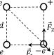

[[Състезания/esenno/9/2015|◂ 2015]] | [[Състезания/esenno/9/2016|условия]] | [[Състезания/esenno/9/2017| 2017 ▸]]

Задача 1. Равноускорително движение.

Част I а) Първоначално полицаите се движат равноускорително по закона $x_1 = at^2/2$. \[0,5 т.\] Нарушителите изминават разстояние $x_2 = v_0t$. \[0,5 т.\] Моментът $t_1$, когато полицейската кола спира да ускорява, се получава като решение на квадратното уравнение $x_2 - x_1 = v_0t - at^2/2 = l$. \[0,5 т.\] Трябва да се избере този корен на уравнението, който съответства на момент, когато полицаите настигат другия автомобил, т.е. скоростта им е по-голяма от тази на нарушителите. \[0,5 т.\] Така получаваме $t_1 = (v_0 + \sqrt{v_0^2 - 2al})/a$. \[1 т.\] След този момент полицаите изминават разстояние $x_1' = at_1t_2$, \[0,5 т.\] а другата кола изминава $x_2' = v_0t_2$ \[0,5 т.\] до окончателното застигане, като $x_1' - x_2' = l$, \[0,5 т.\] откъдето $t_2 = l/(at_1 - v_0)$. \[0,5 т.\]

Така получаваме за времето за настигане $t_1 + t_2 = \frac{v_0 + \sqrt{v_0^2 - 2al}}{a} + \frac{l}{\sqrt{v_0^2 - 2al}} \approx 19,7\text{ s}$. \[1 т.\]

б) Пътят, който изминават полицаите, е $v_0(t_1 + t_2) \approx 590\text{ m}$. \[1 т.\]

Част II Средната скорост за първата част от пътя е $\bar{v} = \frac{h}{2t_1}$, \[0,5 т.\] където $t_1$ е времето за достигане на половината дълбочина на кладенеца. От друга страна имаме, че $\frac{h}{2} = \frac{gt_1^2}{2}$. \[0,5 т.\] Като изключим $t_1$ от двете уравнения, ще получим, че $h = \frac{4\bar{v}^2}{g}$. \[0,5 т.\] Времето за достигане на дъното е $t_2 = \sqrt{2h/g} = 2\sqrt{2}\bar{v}/g$. \[0,5 т.\] Изминалото време, докато се чуе плясък, е $t = t_2 + \frac{h}{v_S} = \frac{2\sqrt{2}\bar{v}}{g} + \frac{4\bar{v}^2}{gv_S} \approx 6,26\text{ s}$. \[1 т.\]

Задача 2. Хидростатично налягане.

Част I Първоначално сапунът плава във вода и от равенството на големините на силата на тежестта и Архимедовата сила, които действат на сапуна, следва $\rho_С gh = 0,75\rho_В gh$, \[1 т.\] откъдето $\rho_С = 0,75\rho_В$. След като е налято олиото, условието за равновесие на сапуна е $\rho_С gh = \rho_О g(h - z)$, \[1 т.\] където със z сме означили височината на частта от сапуна, която се намира над олиото. След заместване се получава, че

$z = (1 - \frac{3\rho_В}{4\rho_О})h = \frac{h}{16} = 0,5\text{ cm}$. \[1 т.\]
Част II а) Под действие на хидростатичното налягане във варела навлиза вода, докато налягането $p_1$ на въздуха във варела се изравни с налягането на съответната дълбочина под повърхността на морето: $p_1 = p_0 + \rho g(d + l - x)$, \[1 т.\] където x е височината на водния стълб във вътрешността на варела. След установяване на термодинамично равновесие знаем, че въздухът във варела не е променил температурата си след потапянето във водата, т.е. може да използваме закона на Бойл-Мариот за изотермен процес: $p_0Sl = p_1S(l - x)$, \[1 т.\] където S е лицето на дъното на варела. Заместваме $p_1$ от първото уравнение във второто и получаваме квадратно уравнение за y = l - x:

$\rho gy^2 + (p_0 + \rho gd)y - p_0l = 0$. \[1 т.\]

Положителният корен на уравнението е $y = \frac{\sqrt{(p_0+\rho gd)^2 + 4p_0\rho gl} - p_0 - \rho gd}{2\rho g}$. \[2 т.\]

Оттук получаваме, че $x = l - y = l - \frac{\sqrt{(p_0+\rho gd)^2 + 4p_0\rho gl} - p_0 - \rho gd}{2\rho g} \approx 0,76\text{ m}$. \[1 т.\]

б) $p_1 = p_0 + \rho g(d + l - x) = \frac{p_0+\rho gd + \sqrt{(p_0+\rho gd)^2 + 4p_0\rho gl}}{2} \approx 1,6\cdot 10^{5}\text{ Pa}$. \[1 т.\]

Задача 3. Електростатика.

а) Силата, която действа на долния десен заряд, е векторна сума от силите, с които му действат останалите три заряда. \[0,5 т.\]

Силите са означени на фигурата вляво. \[0,5 т.\] Големините им са: $F_1 = F_2 = \frac{2ke^2}{d^2}$ и $F_3 = \frac{ke^2}{2d^2}$, \[1 т.\] като сме изразили дължината на диагонала на квадрата чрез дължината на страните. Поради симетрията векторната сума на силите $\vec{F_1}$ и $\vec{F_2}$ е насочена по диагонала на квадрата. \[0,5 т.\] Тъй като $F_1 = F_2$, големината на сумарната сила $\vec{F_1} + \vec{F_2}$ е равна на $\sqrt{2}F_1$. \[0,5 т.\] За големината F на резултантната сила, която действа на долния десен заряд, се получава:

$F = \sqrt{2}F_1 - F_3 = (2\sqrt{2} - \frac{1}{2})\frac{ke^2}{d^2}$. \[1 т.\]

б) Зарядите са симетрично разположени около центъра на квадрата и затова интензитетът в тази точка е равен на нула. \[1 т.\]

в) Потенциалът в центъра на квадрата е алгебрична сума от потенциалите на четирите заряда в тази точка:

$\varphi = \frac{2\sqrt{2}ke}{d}$. \[2 т.\]

г) Работата A намираме чрез потенциала на електричното поле $\varphi'$, създаден от останалите три заряда в точката, където е поставен първоначално долният десен заряд:

$\varphi' = \frac{4ke}{d} - \frac{\sqrt{2}ke}{2d}$. \[1 т.\]

Потенциалът на много голямо разстояние от зарядите е нула, \[1 т.\] така че $A = (-e)(0 - \varphi') = e\varphi' = (4 - \frac{\sqrt{2}}{2})\frac{ke^2}{d}$. \[1 т.\]
