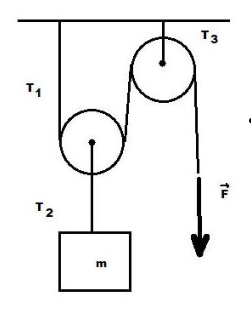

[[Състезания/esenno/9/2025|◂ 2025]] | [[Състезания/esenno/9/2026|условия]]

**Задача 1. Макари**

А) Правилно начертана система с една неподвижна и една подвижна макара, правилно прекарано въже и означена приложена сила. (Забележка: силата на опън не се включва в схемата на точкуване.) \[1 т.\] \[1 т.\]

Б) Ускорението a на подвижната макара (и тялото).

Определяне на тежестта на тялото: $G = mg = 4{,}5\cdot 10 = 45\ \text{N}$ \[0,5 т.\]

Силата, която действа върху подвижната макара нагоре, е 2F, а G е надолу \[1 т.\].

$2F - mg = ma$ \[1 т.\]

$a = \frac{2F - mg}{m} = \frac{2\cdot 31{,}5 - 4{,}5\cdot 10}{4{,}5} = \frac{63 - 45}{4{,}5} = 4\ \text{m/s}^2$ \[0,5 т.\]

В) Изминатият път s за време $t = 4\ \text{s}$.

1. Записване на закона за равноускорително движение \[1 т.\]. Тъй като тялото започва да се движи от покой: $s = v_0 t + \frac{at^2}{2}$, при $v_0 = 0$: $s = \frac{at^2}{2}$.
2. Заместване и пресмятане \[1,5 т.\]: $s = \frac{4\cdot 4^2}{2} = \frac{4\cdot 16}{2}$.

$s = 32\ \text{m}$ \[0,5 т.\]

Г) Времето $t_{10}$, за което подвижната макара ще се издигне на височина $h = 10\ \text{m}$.

Записване на закона за движение: $h = v_0 t + \frac{at^2}{2}$, тъй като $v_0 = 0$: $h = \frac{at^2}{2}$ \[1 т.\].

Изразяване на времето и пресмятане: $t^2 = \frac{2h}{a},\ t = \sqrt{\frac{2h}{a}}$ \[1,5 т.\]. Замествайки:

$t_{10} = \sqrt{\frac{2\cdot 10}{4}} = \sqrt{5} \approx 2{,}24\ \text{s}$ \[0,5 т.\]

**Задача 2. Мощности**

А) Определяне на общото съпротивление при последователно и успоредно свързване.

При последователно свързване \[0,5 т.\]: $R_{посл} = R + R_1 + R_2 = 1 + 2R_x$.

При успоредно свързване \[0,5 т.\]: $R_{усп} = R + \frac{R_1 R_2}{R_1 + R_2} = 1 + \frac{R_x}{2}$.

Изразяване на мощността чрез напрежението и съпротивлението. Мощността, отделена в двата резистора $R_x$, е $P = U^2/R_{общо}$ \[0,5 т.\]. Напрежението върху резисторите ($R_x$) е

$U_{усп} = U_0\frac{R_x/2}{1 + R_x/2},\qquad U_{посл} = U_0\frac{2R_x}{1 + 2R_x}$

При последователно свързване: $P_1 = U_0^2\frac{2R_x}{(1 + 2R_x)^2}$ \[0,5 т.\].

При успоредно свързване: $P_p = U_0^2\frac{R_x/2}{(1 + R_x/2)^2}$ \[0,5 т.\].

Съставяне на уравнение чрез отношението на двете мощности \[1,5 т.\]:

$\frac{P_p}{P_1} = \frac{72}{32} = \frac{\frac{R_x}{2}}{\left(1 + \frac{R_x}{2}\right)^2}\Big/ \frac{2R_x}{(1+2R_x)^2}$

$\frac{9}{4} = \frac{1}{4}\left(\frac{1 + 2R_x}{1 + R_x/2}\right)^2 \Rightarrow 3 = \frac{1 + 2R_x}{1 + R_x/2}$

$3\left(1 + \frac{R_x}{2}\right) = 1 + 2R_x \Rightarrow 3 + 1{,}5R_x = 1 + 2R_x \Rightarrow 2 = 0{,}5R_x$

$R_x = 4\ \Omega$ \[2 т.\]

Б) Общото съпротивление при последователно свързване: $R_{посл} = R + 2R_x = 1 + 2\cdot 4 = 9\ \Omega$ \[0,5 т.\].

При последователно свързване мощността, отделена в двата резистора $R_x$, е $P_1 = I^2\cdot 2R_x$, откъдето $I^2 = \frac{P_1}{2R_x}$,

$I = \sqrt{\frac{P_1}{2R_x}} = \sqrt{\frac{32}{8}} = 2\ \text{A}$ \[0,5 т.\].

Прилагане на закона на Ом за цялата верига \[0,5 т.\]:

$U_0 = I\cdot R_{посл} = 2\cdot 9 = 18\ \text{V}$ \[0,5 т.\]

В) При последователно свързване: мощността, отделена в резисторите $R_x$, е $P_1 = 32\ \text{W}$. Мощността, отделена в резистора $R = 1\ \Omega$, е $P_r = I^2 R = 2^2\cdot 1 = 4\ \text{W}$. Общата мощност е $P_{общ} = P_1 + P_r = 32 + 4 = 36\ \text{W}$. Търсеният процент е:

$\eta = \frac{P_1}{P_{общ}}\cdot 100\% = \frac{32}{36}\cdot 100\% = 88{,}9\%$ \[1 т.\]

При успоредно свързване съпротивлението на двата резистора $R_x$ е $R_{екв} = R_x/2 = 2\ \Omega$. Общото съпротивление на веригата е $R_{общ} = 1 + 2 = 3\ \Omega$. Токът през източника е $I = U_0/R_{общ} = 18/3 = 6\ \text{A}$. Мощността, отделена в резистора $R = 1\ \Omega$, е $P_r = I^2 R = 6^2\cdot 1 = 36\ \text{W}$. Общата мощност е $P_{общ} = P_p + P_r = 72 + 36 = 108\ \text{W}$. Търсеният процент е:

$\eta = \frac{P_p}{P_{общ}}\cdot 100\% = \frac{72}{108}\cdot 100\% = 66{,}7\%$ \[1 т.\]

**Задача 3. Състезание**

А) Съставяне на уравнение при движение в противоположни посоки \[1 т.\]. При движение в противоположни посоки двамата бегачи се приближават със скорост, равна на сбора от скоростите им. За времето $t_1$ те изминават общо една обиколка на пистата:

$L = (v_A + v_B)\cdot t_1 \Rightarrow 400 = (v_A + v_B)\cdot 40 \Rightarrow v_A + v_B = 10\ \text{m/s}$

Съставяне на уравнение при движение в една и съща посока \[1 т.\]. При движение в една и съща посока Асен настига Борис със скорост, равна на разликата между скоростите им. За времето $t_2$ Асен изминава с една обиколка повече от Борис:

$L = (v_A - v_B)\cdot t_2 \Rightarrow 400 = (v_A - v_B)\cdot 200 \Rightarrow v_A - v_B = 2\ \text{m/s}$

Получаваме \[1 т.\]: $2v_A = 12$, откъдето $v_A = 6\ \text{m/s}$ и $v_B = 4\ \text{m/s}$ \[1 т.\].

Б) Контролният маркер се поставя в точка O в момента, когато Асен прави първата си пълна обиколка. Времето за една обиколка на Асен е:

$t_{mA} = \frac{L}{v_A} = \frac{400}{6} \approx 66{,}67\ \text{s}$ \[1,5 т.\]

Тъй като двамата стартират едновременно от точка O и бягат в една и съща посока, Борис достига точка O след завършването на една пълна обиколка: $t_{mB} = \frac{L}{v_B} = \frac{400}{4} = 100\ \text{s}$. Следователно времето от старта до първото преминаване на Борис през маркера е:

$t_{mB} = 100\ \text{s}$ \[1,5 т.\]

В) Изминатите пътища за време $t = 300\ \text{s}$: $s_A = v_A t = 6\cdot 300 = 1800\ \text{m}$ \[1 т.\]; $s_B = v_B t = 4\cdot 300 = 1200\ \text{m}$ \[1 т.\].

Разликата между изминатите пътища е $\Delta s = s_A - s_B = 600\ \text{m}$. Тъй като дължината на една обиколка е 400 m, разликата по пистата е:

$600 - 400 = 200\ \text{m}$ \[1 т.\]
