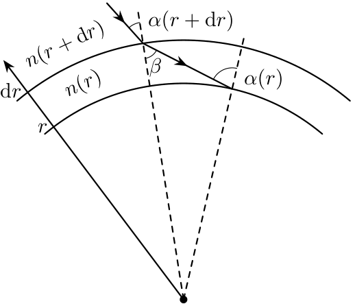
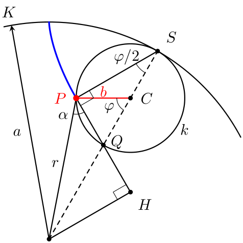
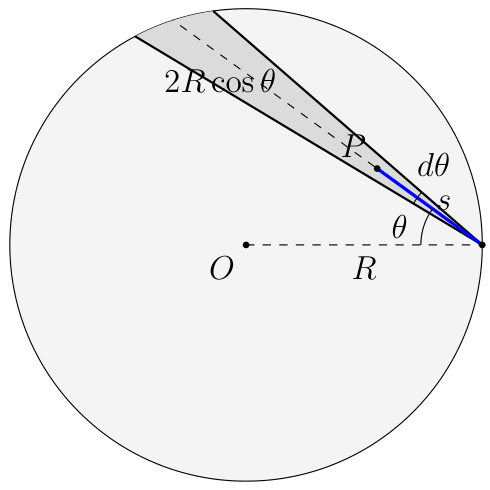

[[Състезания/esenno/st/2025|◂ 2025]] | [[Състезания/esenno/st/2026|условия]]

**Задача 1. Планетарни тунели** \[10 т.\] (решение)

**А.1** \[1,0 т.\] Стандартен резултат е $\vec{g}(r < R) = -g\vec{r}/R$ \[0,5 т.\]. Това може да се получи по много начини. Напр. отчитане на това, че черупката с вътрешен радиус r не допринася към полето g; остава само кълбото с радиус r, откъдето следва $g \propto M_r/r^2 \propto r$ и като се има предвид $g(R) = g$, се получава гореспоменатият резултат.

Оттук следва, че движението на тялото по тунела е като на тяло, свързано към пружина с твърдост $k = mg/R$ \[0,3 т.\], откъдето движението е хармонично с период $T = 2T_d = 2\pi\sqrt{m/k}$, откъдето:

$$T_d = \pi\sqrt{\frac{R}{g}} \qquad [0{,}2\ \text{т.}]$$

*Коментар:* Набитото око забелязва, че T е също и орбиталният период на спътник в ниска кръгова орбита. Това съвсем не е случайно, тъй като това орбитално движение може да се разглежда като суперпозиция на две напречни хармонични колебания с π/2 фазова разлика.

**А.2** \[1,0 т.\] Нека в даден момент тялото се намира в т. $P \in AB$. Нека средата на AB е M ($M \in AB$, $AM = BM$) и положението в тунела се задава от $x := MP$. Лесно се съобразява, че $AB \perp OM$. Силата, действаща на тялото, е

$$\vec{F} = m\vec{g}(OP) = -\frac{mg}{R}\vec{MP} - \frac{mg}{R}\vec{OM}$$

Оттук следва, че надлъжната (по тунела) компонента на силата е $F_{AB} = m\ddot{x} = -mgx/R$ \[0,5 т.\]. Тоест движението отново е хармонично със същата ефективна твърдост на пружината $k = mg/R$ \[0,3 т.\], откъдето времето отново е същото:

$$T_l(\theta) = \pi\sqrt{\frac{R}{g}} = const. \qquad [0{,}2\ \text{т.}]$$

**Б.1** \[6,0 т.\] Законът за запазване на енергията е приложим и следователно \[0,5 т.\]:

$$\frac{1}{2}mv^2 + \frac{1}{2}\frac{mg}{R}r^2 = m\cdot 0 + \frac{1}{2}\frac{mg}{R}R^2 \Rightarrow v(r) = \sqrt{gR\left(1 - \left(\frac{r}{R}\right)^2\right)}$$

Задачата тогава е да се намери формата на крива, свързваща точките A и B, такава, че ако скоростта за движение по нея е $v(r)$, то времето за придвижването по нея е минимално. Това време е \[0,2 т.\]:

$$\tau = \int_A^B \frac{dl}{v(r)} = \frac{1}{\sqrt{gR}}\int_A^B n(r)\,dl, \qquad n(r) := \frac{1}{\sqrt{1 - \left(\frac{r}{R}\right)^2}}$$

Вижда се формалната аналогия, свързваща времето τ с оптичния път Δ на лъч, минаващ по същата крива през среда с променлив показател на пречупване $n(r)$ \[0,8 т.\] (0,2 т. за израза за времето и 0,6 т. за връзката с принципа на Ферма).

В същото време принципът на Ферма гарантира, че лъчите следват траекториите, които отнемат минимално време или имат най-малък оптичен път¹. Тоест, търсената от нас крива е траекторията на светлинен лъч, минаващ през точките A, B в среда с променлив, но сферично-симетричен, показател на пречупване $n(r)$.

¹ По-точно следват траекториите с екстремални стойности на оптичния път, но това не е пречка в случая.

Да разгледаме един такъв лъч (фиг. 1). Представяме плавно изменящата се среда като граница на множество тънки концентрични слоеве с постоянен показател на пречупване \[0,2 т.\]. Лесно се съобразява, че лъчите винаги остават в една и съща равнина и следователно траекторията на лъча ще бъде равнинна крива \[0,2 т.\]. От синусовата теорема \[0,3 т.\] и закона на Снелиус \[0,3 т.\] имаме:

$$n(r)\sin\beta = n(r+dr)\sin\alpha(r+dr) \Rightarrow r\,n(r)\sin\alpha(r) = (r+dr)\,n(r+dr)\sin\alpha(r+dr)$$

$$\Rightarrow r\,n(r)\sin\alpha(r) = const.$$

Фигура 1: Оптически инвариант: $r\,n(r)\sin\alpha(r) = const$.

В нашия случай имаме

$$\frac{r\sin\alpha(r)}{\sqrt{1 - \left(\frac{r}{R}\right)^2}} = const.$$

Тук е моментът да се отбележи, че при $r \to R$, $\sin\alpha \to 0$ и тогава $\alpha \to 0$. Оттук може да се изглежда, че ще получим радиална траектория, но се оказва, че това не е задължително.

Да покажем, че хипоциклоида (фиг. 2) с голям радиус a и малък радиус $b < a$ удовлетворява нужното условие.

Фигура 2: Хипоциклоидата е оптимальната крива.

Първо ще покажем, че PQ е допирателна към хипоциклоидата \[1,0 т.\] и следователно ъгълът $\angle OPQ$ е $\alpha(r)$. Понеже търкалянето е без приплъзване, то точка S е моментна ос на въртене и следователно скоростта $\vec{v}$ на т. P е перпендикулярна на SP. От друга страна, $PQ \perp SP$, тъй като SQ е диаметър в окръжността $k \ni P$. Оттук следва, че $\vec{v} \parallel PQ$, откъдето следва и твърдението.

От фигурата лесно се вижда, че $OH = r\sin\alpha = OQ\cos\angle QOH$ \[0,6 т.\], където $H \in PQ$ е петата на височината от O към PQ. Лесно се съобразява, че $\angle QOH = \angle PSQ = \phi/2$ и $OQ = a - 2b$, откъдето $r\sin\alpha = (a-2b)\cos(\phi/2)$. От друга страна, от косинусовата теорема за △PSO имаме \[0,6 т.\]:

$$r^2 = OS^2 + PS^2 - 2\,OS\,PS\cos(\phi/2) = a^2 + (2b\cos(\phi/2))^2 - 2a(2b\cos(\phi/2))\cos(\phi/2) = a^2 - 4b(a-b)\cos^2(\phi/2)$$

$$\Rightarrow \cos(\phi/2) = \sqrt{\frac{a^2 - r^2}{4b(a-b)}} = \frac{\sqrt{a^2 - r^2}}{\sqrt{a^2 - (a-2b)^2}}$$

Така финално имаме \[0,3 т.\]:

$$r\sin\alpha = (a-2b)\sqrt{\frac{a^2 - r^2}{a^2 - (a-2b)^2}} \Rightarrow \frac{r\sin\alpha(r)}{\sqrt{1 - \left(\frac{r}{a}\right)^2}} = \sqrt{\frac{(a-2b)^2}{1 - \left(\frac{a-2b}{a}\right)^2}} = const.$$

Тоест, ако $a = R$ \[0,2 т.\], получената хипоциклоида изпълнява $r\,n(r)\sin\alpha(r) = const.$ и следователно това е търсената крива. Остава да се определи b.

Преди да продължим, си струва да забележим (и направим проверката), че при най-малката стойност на $r = a - 2b$, когато $P \equiv Q$, полученият горе израз дава $\sin\alpha = 1$, т.е. $\alpha = \pi/2$, което и се очаква за минималната стойност на r.

Лесно се съобразява, че точките A, B са началото и краят на една хипоциклоида и съответстват на моментите, в които $P \equiv S$. Тоест хипоциклоидата, свързваща A и B, е получена при завъртането на малката окръжност на ъгъл $2\pi - \theta$. Това означава, че нейният център е изминал дъга с дължина $(2\pi - \theta)b$, радиус $a - b$ и централен ъгъл θ, откъдето \[0,8 т.\]:

$$(2\pi - \theta)b = (a-b)\theta \Rightarrow 2\pi b = a\theta \Rightarrow b = \frac{\theta}{2\pi}a$$

Следователно финално имаме:

**Тунелът, оптимизиращ времето за придвижване от A до B, е хипоциклоида с голям радиус R и малък радиус θR/2π.**

както и

$$\frac{r\sin\alpha(r)}{\sqrt{1 - \left(\frac{r}{R}\right)^2}} = \sqrt{\frac{1 - \theta/\pi}{1 - (1 - \theta/\pi)^2}}$$

**Б.2** \[2,0 т.\] Да видим каква е скоростта $v = |\vec{v}|$ на точката P. Лесно се съобразява, че ако u е транслационната скорост на окръжността k, а ω е нейната ъглова скорост, то тъй като т. S е моментна ос на въртене имаме \[0,5 т.\]:

$$v = SP\cdot\omega = \frac{SP}{SC}\,u = 2u\cos(\phi/2) = 2u\,\frac{\sqrt{1 - (r/R)^2}}{\sqrt{1 - (1 - \theta/\pi)^2}} \propto \sqrt{1 - (r/R)^2}$$

Това ще рече, че ако изберем \[0,5 т.\]

$$u = \frac{1}{2}\sqrt{gR\left(1 - \left(1 - \frac{\theta}{\pi}\right)^2\right)},$$

то т. P във всеки един момент от равномерното търкаляне ще се движи сякаш под действието на гравитацията в тунела!

В такъв случай, за времето T центърът на малката окръжност изминава разстояние $(a-b)\theta = R\theta(1 - \theta/2\pi)$, движейки се със скорост u \[0,5 т.\]. Тогава \[0,5 т.\]:

$$T = \frac{R\theta\left(1 - \frac{\theta}{2\pi}\right)}{\frac{1}{2}\sqrt{gR\left(1 - \left(1 - \frac{\theta}{\pi}\right)^2\right)}} \Rightarrow T(\theta) = \pi\sqrt{\frac{R}{g}}\left(2 - \frac{\theta}{\pi}\right)\frac{\theta}{\pi}$$

Полезни частни случаи за проверка са $\theta \to 0$, когато $T \to 0$, и $\theta = \pi$, при което $T(\pi) = T_l = \pi\sqrt{R/g}$. И наистина при $\theta = \pi$ имаме, че $a = R$, $b = R/2$ и хипоциклоидата се изражда в диаметър, т.е. се свежда до А.1.

**За любознателните:**
- Обикновените функции най-често взимат за аргументи числа и връщат числа. Тук се срещнахме с друг вид обект, който взима за аргумент цяла крива и връща времето за придвижване по нея. Изображения, които взимат функции, криви или други подобни обекти и им съпоставят числа, се наричат функционали. Функционалите са важни обекти във функционалния анализ – дял от математиката, който изучава пространства от функции и изображенията между тях и обобщава много понятия от обикновения анализ.
- Задачата, която решавахме, е екстремална – търсихме аргумент, който минимизира резултата. Екстремални задачи с функционали се наричат вариационни задачи, а математическият апарат за решаването им се нарича вариационно смятане.
- Задачата, която решихме, е близка роднина на задачата за брахистохроната (от гр. „най-късо време“) – това е формата на рампа, свързваща две точки, по която отнема минимално време да се стигне от една точка до друга под въздействието на хомогенно гравитационно поле. Решението на задачата за брахистохроната е циклоида.
- Задачата за брахистохроната е предложена от Йохан Бернули през 1696 г. Самият Бернули решава задачата именно чрез аналогията с принципа на Ферма и използването на геометрия и закона на Снелиус – това, което и ние правихме. Тази задача е известна и с това, че когато Нютон чува за нея през 1697 г., той я решава само за 1 вечер и анонимно публикува решението си. Когато Бернули вижда решението, той казва: „Лъвът се разпознава по следите от ноктите си.“
- Кривите хипоциклоида и циклоида са примери за един по-общ клас криви, наречени рулетни криви или рулетки – това са всички криви, очертани от точка от търкалящ се обект по друг обект.

**Задача 2. Електростатика** \[10 т.\] (решение)

**А.1** \[0,5 т.\] От съображения за симетрия, електричното поле е радиално и зависи само от r, т.е. $\vec{E}(\vec{r}) = E(r)\vec{e}_r$ \[0,2 т.\]. Следователно, от закона на Гаус \[0,3 т.\] имаме:

$$\oint_{r=const} \vec{E}\cdot d\vec{S} = 4\pi r^2 E(r) = \frac{1}{\varepsilon_0}Q_{затв.} = 0 \Rightarrow E_{int} = 0$$

**А.2** \[1,9 т.\] Ще разгледаме хомоеоид ℋ с полуоси на външния елипсоид a, b, c и полуоси на вътрешния – ma, mb, mc, където $0 < m < 1$, зареден равномерно с обемна плътност на заряда ρ.

За да определим полето в т. P, разбиваме хомоеоида, както е показано на фигурата-подсказка, т.е. на парчета от хомоеоида, отрязани от конус с връх P, направление на оста $\vec{n}$ ($|\vec{n}| = 1$) и телесен ъгъл $d\Omega$ при върха. Всяко от парчетата разбиваме радиално на филийки \[0,1 т.\]. Дадена филия има заряд $dq = \rho\,dr\,dS_r = \rho r^2 dr\,d\Omega$ и съответно има принос $d\vec{E} = -k\,dq/r^2\,\vec{n} = -k\rho\,d\Omega\,\vec{n}\,dr$ \[0,2 т.\]. Следователно цялото парче има принос \[0,2 т.\]:

$$d\vec{E}_1 = -k\rho\,d\Omega\,\vec{n}\int_{PA_i}^{PA_e} dr = -k\rho\,d\Omega\,l_1\vec{n}$$

Общият принос на двете парчета е $d\vec{E} = d\vec{E}_1 + d\vec{E}_2 = k\rho\,d\Omega\,\vec{n}(l_2 - l_1)$ \[0,3 т.\]. От подсказката имаме, че $l_1 = l_2$, откъдето $d\vec{E} = 0$, а оттам и $\vec{E}_P = \oint d\vec{E} = 0$.

Остава да покажем, че $l_1 = l_2$. Точките, лежащи върху оста на конуса, имат радиус-вектори $\vec{r}_P + t\vec{n}$. Пресечните точки на оста на конуса и елипсоида с полуоси ma, mb, mc се дават от решението на системата \[0,7 т.\]:

$$\left(\frac{x}{a}\right)^2 + \left(\frac{y}{b}\right)^2 + \left(\frac{z}{c}\right)^2 = m^2, \qquad x = x_P + n_x t,\ y = y_P + n_y t,\ z = z_P + n_z t$$

Тази система води до квадратно уравнение за t, в което m участва единствено в свободния член. Това квадратно уравнение има две решения, които дават двете пресечни точки, като $PA_i = t_+(m)$, $PA_e = t_+(1)$ и $PB_i = -t_-(m)$, $PB_e = -t_-(1)$. Оттук $l_1 = t_+(1) - t_+(m)$ и $l_2 = t_-(m) - t_-(1)$. Тогава:

$$l_2 - l_1 = [t_+(1) + t_-(1)] - [t_+(m) + t_-(m)] = \Delta[t_+ + t_-]$$

Но от формулите на Виет знаем, че сборът от корените $t_+ + t_-$ се определя от старшия коефициент и коефициента пред линейния член – и двата не зависят от m \[0,4 т.\]. Следователно $t_+(m) + t_-(m) = const_m$ и $l_2 - l_1 = \Delta[t_+ + t_-] = 0$.

Оттук следва и твърдението, че полето във вътрешността на равномерно зареден хомоеоид е 0.

**А.3** \[1,0 т.\] Понеже точката $\vec{r}$ лежи върху елипсоида с полуоси a, b, c, то точката $\alpha\vec{r}$ лежи на елипсоида с полуоси αa, αb, αc. Приносът към $F(\alpha\vec{r}; a, b, c)$ може да се раздели на два приноса – $F(\alpha\vec{r}; \alpha a, \alpha b, \alpha c)$, този от вътрешния елипсоид с полуоси αa, αb, αc, и този на хомоеоида, заключен между двата елипсоида (тук $m = \alpha$) \[0,2 т.\]. Понеже вътрешността на хомоеоида е еквипотенциална, а потенциалът в центъра е $F(0) = 0$, то този принос е 0 \[0,3 т.\] и тогава $F(\alpha\vec{r}; a, b, c) = F(\alpha\vec{r}; \alpha a, \alpha b, \alpha c)$.

Връзката между потенциалите $F(\vec{r}; a, b, c)$ и $F(\alpha\vec{r}; \alpha a, \alpha b, \alpha c)$ е въпрос на скалиране \[0,2 т.\]. Просто казано, вторият потенциал е намерен при същата геометрична постановка, но скалирана α пъти, при което разстоянията се скалират с α, а обемът – с $\alpha^3$. А именно:

$$F(\vec{r}; a, b, c) = k\rho\int d^3s\left(\frac{1}{|\vec{r} - \vec{s}|} - \frac{1}{|\vec{s}|}\right) = \phi(\vec{r}; a, b, c) - \phi(0; a, b, c)$$

Тогава видно е, че при скалирането $d^3s \mapsto \alpha^3 d^3s$ и $|\vec{r} - \vec{s}|,\ |\vec{s}| \mapsto \alpha|\vec{r} - \vec{s}|,\ \alpha|\vec{s}|$, откъдето и финално \[0,3 т.\]:

$$F(\alpha\vec{r}; a, b, c) = F(\alpha\vec{r}; \alpha a, \alpha b, \alpha c) = \alpha^2 F(\vec{r}; a, b, c)$$

Добре е да се отбележи, че тази връзка важи за всяко $\vec{r}$, съответстващо на точка вътре в елипсоида, тъй като всяка такава точка може да се представи като $\vec{r} = \alpha\vec{r}'$, където $\alpha \in (0,1]$ и $\vec{r}'$ лежи върху повърхността на елипсоида.

**А.4** \[0,7 т.\] От полученото в А.3 имаме \[0,1 т.\]:

$$\phi(x, y, z) = \phi(0) + Ax^2 + By^2 + Cz^2 + Dxy + Exz + Gyz$$

Но елипсоидът е симетричен спрямо отражение в равнината xy, т.е. $\phi(x, y, z) = \phi(x, y, -z)$ \[0,3 т.\], откъдето $E = G = 0$. Аналогично имаме, че $\phi(x, y, z) = \phi(-x, y, z)$, откъдето и $D = 0$ \[0,3 т.\]. Така финално:

$$\phi(x, y, z) = \phi_0 + Ax^2 + By^2 + Cz^2, \qquad \phi(0) = \phi_0$$

**Б.1** \[2,3 т.\] Въпросът се свежда до това да се намери разпределение на заряди върху диск $\sigma(r)$, такова, че той да е еквипотенциален с потенциал $\phi(r) = \phi$. Оттам може да се определи зарядът q върху диска и тогава $C = q/\phi$.

Понеже вътрешността на равномерно заредена хомоеоидна черупка е еквипотенциална, то метален елипсоид има разпределение на зарядите по повърхността, еквивалентно на това на тънка равномерно заредена хомоеоидна черупка със същите полуоси \[0,4 т.\]. В частност, когато $a = b = R$ и $c \to 0$, елипсоидът се изражда в диск с радиус R \[0,2 т.\].

Нека разгледаме тънка ($m = 1 - \varepsilon$, $\varepsilon \ll 1$) равномерно заредена хомоеоидна черупка с $a = b = R$ и $c \to 0$ и заряд q. За плътността имаме \[0,2 т.\]:

$$\rho = \frac{q}{V} = \frac{q}{\frac{4}{3}\pi R^2 c(1 - (1-\varepsilon)^3)} \approx \frac{q}{4\pi R^2 c\varepsilon}$$

Лесно се съобразява, че ако $d(r)$ е вертикалната дебелина на хомоеоидната черупка в точка на разстояние r от оста на диска, то $2\rho d(r) \to \sigma(r)$ \[0,3 т.\]. Тогава, ако $z(r)$ е височината на елипсоида, т.е.

$$\frac{r^2}{R^2} + \frac{z^2}{c^2} = m^2 \Rightarrow z = c\sqrt{m^2 - \frac{r^2}{R^2}}$$

то $d(r) = z(r, m=1) - z(r, m=1-\varepsilon)$ \[0,4 т.\]. Тогава:

$$d(r) = c\varepsilon\frac{d}{dm}\sqrt{m^2 - \frac{r^2}{R^2}}\Big|_{m=1} = \frac{c\varepsilon R}{\sqrt{R^2 - r^2}}$$

Откъдето финално \[0,1 т.\]:

$$\sigma(r) = \frac{q}{2\pi R\sqrt{R^2 - r^2}}$$

Бърза проверка показва, че

$$\int_0^R \sigma(r)(2\pi r\,dr) = q\int_0^1 \frac{x\,dx}{\sqrt{1 - x^2}} = q\left[\sqrt{1 - x^2}\right]_1^0 = q$$

което дава именно целия заряд.

Понеже по конструкция дискът е еквипотенциален, то можем да намерим този потенциал, като го пресметнем например в центъра \[0,5 т.\]:

$$\phi = \int_0^R \frac{k\sigma(r)(2\pi r\,dr)}{r} = \frac{kq}{R}\int_0^R \frac{d(r/R)}{\sqrt{1 - (r/R)^2}} = \frac{kq}{R}\arcsin(r/R)\Big|_{r=0}^{r=R} = \frac{k\pi q}{2R} = \frac{q}{8\varepsilon_0 R}$$

Откъдето финално \[0,2 т.\]:

$$C = 8\varepsilon_0 R$$

**Б.2** \[3,6 т.\] Потенциалът, който двата заряда създават в равнината на диска е \[0,4 т.\]:

$$\phi_Q(r) = \frac{kQ}{\sqrt{L^2 + r^2}} - \frac{kQ}{2\sqrt{L^2/4 + r^2}} = \frac{kQ}{L}\left[\left(1 + \left(\frac{r}{L}\right)^2\right)^{-1/2} - \left(1 + \left(\frac{2r}{L}\right)^2\right)^{-1/2}\right] \approx \frac{3kQ}{2L}\left(\frac{r}{L}\right)^2$$

Т.е. търсим такава конфигурация на зарядите $\sigma_2(r)$, че тя да създава потенциал:

$$\phi(r) = \phi_{tot}(r) - \phi_Q(r) = -\frac{3kQ}{2L}\left(\frac{r}{L}\right)^2$$

Този потенциал е квадратичен, което ни навежда на мисълта за израждане на равномерно зареден елипсоид \[0,3 т.\]. Тук лесно се съобразява, че $\sigma(r) = 2\rho z(r) = 2\rho c\sqrt{1 - (r/R)^2}$ \[0,3 т.\], където $\frac{4}{3}\pi R^2 c\rho = q$ \[0,2 т.\], т.е.

$$\sigma(r) = \frac{3q}{2\pi R^2}\sqrt{1 - \left(\frac{r}{R}\right)^2} \qquad [0{,}1\ \text{т.}]$$

Понеже имаме $a = b = R$, то има ротационна симетрия по оста z и тогава потенциалът в елипсоида е \[0,2 т.\]:

$$\phi(\vec{r}) = \phi(0) + A(x^2 + y^2) + Bz^2$$

След израждането до диск имаме $\phi(r) = \phi(0) + Ar^2$. Неизвестните $\phi(0)$ и A могат да се получат директно чрез пресмятане на $\phi(0)$ и $\phi(R)$, като $A = R^{-2}(\phi(R) - \phi(0))$.

За потенциала в центъра имаме \[0,3 т.\]:

$$\phi(0) = \int_0^R \frac{k(2\pi r\sigma(r)dr)}{r} = \frac{3kq}{R}\int_0^1 \sqrt{1 - x^2}\,dx = \frac{3\pi kq}{4R}$$

където е използвано, че $\int_0^1 \sqrt{1 - x^2}\,dx$ е площта на четвърт единична окръжност.

За потенциала на периферията имаме \[0,6 т.\]:

$$\phi(R) = 2\int_0^{\pi/2} d\theta \int_0^{2R\cos\theta} \frac{k\sigma(s, \theta)}{s}s\,ds = 2k\int_0^{\pi/2} d\theta \int_0^{2R\cos\theta} \sigma(s, \theta)\,ds$$

където $(s, \theta)$ са координатите на дадена точка в полярни координати, центрирани в точката по периферията, а за $\theta = 0$ е избрано направлението към центъра на диска (фиг. 3).

Фигура 3: Определяне на φ(R).

От косинусовата теорема имаме:

$$\left(\frac{r}{R}\right)^2 = 1 + \left(\frac{s}{R}\right)^2 - 2\left(\frac{s}{R}\right)\cos\theta$$

откъдето:

$$\sigma(s, \theta) = \sigma(r) = \frac{3q}{2\pi R^2}\sqrt{2c\frac{s}{R} - \left(\frac{s}{R}\right)^2} = \frac{3q}{2\pi R^2}\sqrt{c^2 - \left(c - \frac{s}{R}\right)^2}, \qquad c \equiv \cos\theta$$

Тогава:

$$\int_0^{2Rc} \sigma(s, \theta)\,ds = \frac{3q}{2\pi R}\int_0^{2c}\sqrt{c^2 - (c - x)^2}\,dx = \frac{3q}{2\pi R}\cdot\frac{\pi c^2}{2}$$

където е използвано, че $\int_0^{2c}\sqrt{c^2 - (c - x)^2}\,dx$ е площта на половин кръг с радиус c. Оттук имаме:

$$\phi(R) = \frac{3kq}{2R}\int_0^{\pi/2}\cos^2\theta\,d\theta = \frac{3kq}{2R}\int_0^{\pi/2}\frac{1 + \cos(2\theta)}{2}\,d\theta = \frac{3\pi kq}{8R}$$

Така финално се получава \[0,2 т.\]:

$$\phi(r) = \frac{3\pi kq}{8R}\left(2 - \left(\frac{r}{R}\right)^2\right)$$

Ако приложим суперпозиция на изроден до диск тънък хомоеоид със заряд q и елипсоид със заряд $q'$ \[0,3 т.\], то потенциалът ще е:

$$\phi(r) = \frac{\pi kq}{2R} + \frac{3\pi kq'}{8R}\left(2 - \left(\frac{r}{R}\right)^2\right) = \frac{\pi k}{2R}\left(q + \frac{3q'}{2}\right) - \frac{3\pi k q'}{8R^2}r^2 = -\frac{3kQ}{2L^2}r^2$$

и следователно \[0,2 т.\]:

$$q = -\frac{6R^3}{\pi L^3}Q, \qquad q' = \frac{4R^3}{\pi L^3}Q \Rightarrow q_{инд} = q + q' = -\frac{2R^3}{\pi L^3}Q \qquad [0{,}2\ \text{т.}]$$

**Задача 3. Старата квантова механика** \[10 т.\] (решение)

**А.1** \[0,7 т.\] Понеже електронът се движи по кръгова орбита с радиус r, то електростатичната сила на привличане е центростремителната сила \[0,25 т.\]:

$$\frac{k_C e^2 Z}{r^2} = m\omega^2 r \Rightarrow \omega^2 r^3 = \frac{k_C e^2 Z}{m}, \qquad \frac{k_C e^2 Z}{r} = m(\omega r)^2$$

От друга страна, енергията е \[0,25 т.\]:

$$E = \frac{1}{2}m(\omega r)^2 - \frac{k_C e^2 Z}{r} = \frac{1}{2}\frac{k_C e^2 Z}{r} - \frac{k_C e^2 Z}{r} = -\frac{k_C e^2 Z}{2r}$$

Оттук, елиминирайки r \[0,2 т.\]:

$$E^3 = -\frac{(k_C e^2 Z)^3}{8r^3} = -\frac{(k_C e^2 Z)^3}{8\left(\frac{k_C e^2 Z}{m\omega^2}\right)} = -\frac{A Z^2}{8}\omega^2 \Rightarrow \omega = \frac{8}{A Z^2}(-E)^{3/2}$$

**А.2** \[0,2 т.\] Понеже електронът се движи с честота $\nu = \omega/(2\pi)$ по своята периодична орбита, то очакваме честотата на излъчваната ЕМ вълна да бъде същата, т.е. $\nu = \omega/(2\pi)$.

**А.3** \[1,4 т.\] От принципа за съответствие имаме, че поведението на електрона по орбити с голямо квантово число n е класическо. Ако предположим, че тогава електрон в състояние $n \gg 1$ и енергия $E_n$ излъчва, то от една страна, съгласно предположение (1), той ще премине в състояние $n-1$ и ще излъчи фотон с енергия $\varepsilon = E_n - E_{n-1}$, а от друга, този фотон трябва да бъде с честота именно $\omega(E_n)$. Тогава от формулата на Планк следва \[0,6 т.\]:

$$E_n - E_{n-1} = \hbar\omega(E_n)$$

Използвайки подсказката $E(n) - E(n-1) \approx E'(n)$ и връзката $\omega = \omega(E)$ имаме \[0,3 т.\]:

$$E'(n) \approx \hbar\frac{8}{A Z^2}(-E)^{3/2} \Rightarrow -\frac{A Z^2}{2\hbar^2}\frac{d(-E)}{2(-E)^{3/2}} = d\left(-\sqrt{\frac{A Z^2}{2\hbar^2 E}}\right) = dn$$

Интегрираме това уравнение и получаваме \[0,3 т.\]:

$$-\sqrt{\frac{A Z^2}{2\hbar^2 E}} = n + \kappa \Rightarrow E_n = -\frac{A Z^2}{2\hbar^2(n + \kappa)^2}$$

Ясно е, че при $n \gg 1$, то $n + \kappa \sim n$ и така \[0,2 т.\]:

$$E_n \approx -\frac{A Z^2}{2\hbar^2 n^2} = -\frac{C Z^2}{n^2}, \qquad \text{където}\ C = \frac{A}{2\hbar^2} = \frac{k_C^2 e^4 m}{2\hbar^2} \approx 13{,}6\ \text{eV}$$

**А.4** \[0,5 т.\] Тук се възползваме от получените връзки в А.1 \[0,3 т.\] и резултата за енергията от А.3:

$$L^2 = m\omega^2 r^2 = m\frac{k_C e^2 Z}{m}r = \frac{k_C e^2 Z}{m}\cdot\left(-\frac{k_C e^2 Z}{2E}\right)m = -\frac{A Z^2}{2E} = n\hbar \Rightarrow L = n\hbar \qquad [0{,}2\ \text{т.}]$$

**Б.1** \[0,7 т.\] От $\varphi = \omega_0 t' = \omega t - \vec{k}\cdot\vec{r}$ и Лоренцовата трансформация за $t'$ имаме \[0,2 т.\]:

$$\varphi = \omega_0 t' = \gamma\omega_0\left(t - \frac{\vec{v}\cdot\vec{r}}{c^2}\right) = (\gamma\omega_0)t - \frac{\gamma\omega_0\vec{v}}{c^2}\cdot\vec{r} = \omega t - \vec{k}\cdot\vec{r}$$

Оттук $\omega = \gamma\omega_0$ и $\vec{k} = \gamma\omega_0\vec{v}/c^2$ \[0,2 т.\]. Като имаме предвид и че $\omega_0 = E_0/\hbar = mc^2/\hbar$ \[0,3 т.\], то:

$$\omega = \gamma\omega_0 = \frac{\gamma mc^2}{\hbar} = \frac{\mathcal{E}}{\hbar}, \qquad \vec{k} = \frac{\gamma\omega_0\vec{v}}{c^2} = \frac{\gamma m\vec{v}}{\hbar} = \frac{\vec{p}}{\hbar}$$

Понеже $\mathcal{E} = \gamma mc^2$ и $\vec{p} = \gamma m\vec{v}$ са съответно релативистките енергия и импулс, то:

$$\mathcal{E} = \hbar\omega, \qquad \vec{p} = \hbar\vec{k}$$

**Б.2** \[0,3 т.\] Щом $p = \hbar k$, то $p = \hbar(2\pi/\lambda) = h/\lambda$ \[0,1 т.\]. В същото време $L = rp = h r/\lambda = n\hbar = nh/(2\pi)$, откъдето $2\pi r = n\lambda$ \[0,2 т.\], което означава, че върху дължината на орбитата $2\pi r$ се нанасят цял брой n дължини на вълната, което трябваше да се покаже.

**Б.3** \[0,7 т.\] Ако вълната интерферира конструктивно сама със себе си, то трябва набраната фаза от нея за една обиколка по орбитата да е цяло число пъти $2\pi$, т.е. $\Delta\varphi = 2n\pi$, където $n \in \mathbb{Z}$ \[0,2 т.\].

Да разгледаме елементарно преместване $d\vec{r}$ по орбитата в околност на точка P от нея. Ако $\vec{p}$ е импулсът на тялото в точка P, то вълновият вектор на частицата-вълна в тази точка е $\vec{k} = \vec{p}/\hbar$. Понеже $\vec{p}$ е тангенциален към орбитата, то $\vec{k} \parallel d\vec{r}$ и вълната се разпространява в направлението на движение на частицата. Тогава набраната фаза за това елементарно преместване по орбитата е:

$$d\varphi = 2\pi\frac{dr}{\lambda} = k\,dr = \vec{k}\cdot d\vec{r} \qquad [0{,}3\ \text{т.}]$$

Оттук \[0,2 т.\]:

$$2\pi n = \Delta\varphi = \oint d\varphi = \oint \vec{k}\cdot d\vec{r} = \oint \frac{\vec{p}}{\hbar}\cdot d\vec{r} \Rightarrow \oint \vec{p}\cdot d\vec{r} = 2\pi\hbar n = nh$$

**В.1** \[0,4 т.\] Пълният импулс $\vec{p} = p_r\hat{r} + p_\theta\hat{\theta}$ и преместването по траекторията $d\vec{r} = dr\hat{r} + r d\theta\hat{\theta}$ се разлагат на радиална и азимутална компоненти, като $\hat{r} \perp \hat{\theta}$ са единичните базисни вектори съответно в радиална и азимутална посока. Тогава \[0,25 т.\]:

$$\oint \vec{p}\cdot d\vec{r} = \oint (p_r\hat{r} + p_\theta\hat{\theta})\cdot(dr\hat{r} + r d\theta\hat{\theta}) = \oint(p_r dr + p_\theta r\,d\theta) = \oint p_r dr + \oint p_\theta r\,d\theta = n_r h + \ell h = (n_r + \ell)h = nh \qquad [0{,}15\ \text{т.}]$$

където понеже $n_r$ и ℓ са цели числа, то и тяхната сума $n = n_r + \ell$ е цяло число.

**В.2** \[0,4 т.\] Азимуталната компонента на импулса е $p_\theta = mv_\theta = m\omega r$, откъдето $p_\theta r = L$ \[0,15 т.\]. Понеже разглежданата задача е централна, то моментът на импулса L се запазва по траекторията (орбитата) \[0,15 т.\] и така имаме:

$$\ell h = \oint p_\theta r\,d\theta = \oint L\,d\theta = L\oint d\theta = L(2\pi) \Rightarrow L = \ell\hbar \qquad [0{,}1\ \text{т.}]$$

**В.3** \[1,0 т.\] Пълната енергия се запазва като \[0,3 т.\]:

$$E = \frac{p^2}{2m} + U(r) \Rightarrow 2m(E - U(r)) = p^2 = p_r^2 + p_\theta^2 = p_r^2 + \frac{L^2}{r^2} \qquad [0{,}2\ \text{т.}]$$

откъдето:

$$p_r = \sqrt{2m(E - U(r)) - \frac{L^2}{r^2}} \qquad [0{,}2\ \text{т.}]$$

При движението по една орбита, тялото извършва едно движение в радиално направление $r_- \to r_+$, а после обратното $r_+ \to r_-$. Това значи, че $\oint \equiv 2\int_{r_-}^{r_+}$ \[0,3 т.\]. Така финално:

$$\oint p_r\,dr = 2\int_{r_-}^{r_+}\sqrt{2m(E - U(r)) - \frac{L^2}{r^2}}\,dr = n_r h$$

**В.4** \[1,2 т.\] След заместване на $U(r) = -k_C e^2 Z/r$ и $L = \ell\hbar$ имаме \[0,2 т.\]:

$$\frac{1}{2}n_r h = \int_{r_-}^{r_+}\sqrt{2mE + \frac{2m k_C e^2 Z}{r} - \frac{\ell^2\hbar^2}{r^2}}\,dr$$

Но подинтегралната величина е $\sqrt{(r - r_-)(r_+ - r)}/r$ и тогава от формулата от „полезната математика“ \[0,3 т.\] и формулите на Виет \[0,3 т.\]:

$$r_- + r_+ = -\frac{k_C e^2 Z}{E}, \qquad r_- r_+ = -\frac{\ell^2\hbar^2}{2mE}$$

$$\frac{1}{2}n_r h = \pi\sqrt{-2mE}\left[-\frac{k_C e^2 Z}{2E} - \sqrt{-\frac{\ell^2\hbar^2}{2mE}}\right] \Rightarrow n_r\hbar = \frac{k_C e^2 Z}{2}\sqrt{\frac{2m}{-E}} - \ell\hbar$$

Оттук, използвайки $n = n_r + \ell$ \[0,2 т.\]:

$$n\hbar = \frac{k_C e^2 Z}{2}\sqrt{\frac{2m}{-E}} \Rightarrow E_{n_r,\ell} = -\frac{m k_C^2 e^4 Z^2}{2\hbar^2 n^2} = -\frac{A Z^2}{2\hbar^2 n^2} = -\frac{C Z^2}{n^2} \qquad [0{,}2\ \text{т.}]$$

**В.5** \[2,5 т.\] От релативистката динамика имаме \[0,5 т.\]:

$$\mathcal{E} = \sqrt{p^2 c^2 + m^2 c^4} + U(r) \Rightarrow (\mathcal{E} - U(r))^2 - m^2 c^4 = (\mathcal{E}^2 - m^2 c^4) - 2\mathcal{E}U(r) + U(r)^2 = p^2 c^2$$

Отново, понеже задачата е централна, имаме $L = \ell\hbar = const.$, откъдето $p_r^2 = p^2 - L^2/r^2$ и така \[0,2 т.\]:

$$p_r^2 = \frac{\mathcal{E}^2 - m^2 c^4}{c^2} - \frac{2\mathcal{E}U(r)}{c^2} + \frac{U(r)^2}{c^2} - \frac{\ell^2\hbar^2}{r^2} \qquad [0{,}25\ \text{т.}]$$

След като заместим с $U = -k_C e^2 Z/r$ се получава \[0,25 т.\]:

$$p_r^2 = \frac{\mathcal{E}^2 - m^2 c^4}{c^2} + \frac{2\mathcal{E} k_C e^2 Z}{c^2 r} - \frac{1}{r^2}\left(\frac{\ell^2\hbar^2 c^2 - k_C^2 e^4 Z^2}{c^2}\right)$$

Изразът за $p_r$ в контекста на нерелативистката динамика бе:

$$p_r^2 = 2mE + \frac{2m k_C e^2 Z}{r} - \frac{\ell^2\hbar^2}{r^2}$$

Виждаме тогава, че ако направим във формулата, получена в В.4, замените \[0,4 т.\]:

$$2mE \mapsto \frac{\mathcal{E}^2 - m^2 c^4}{c^2}, \qquad m \mapsto \frac{\mathcal{E}}{c^2}, \qquad \ell^2 \mapsto \ell^2 - \frac{k_C^2 e^4 Z^2}{\hbar^2 c^2} = \ell^2 - \alpha^2 Z^2 \qquad [0{,}4\ \text{т.}]$$

бихме получили същия интеграл и съответно двете решения са свързани именно с тези замени. Така се избягва нуждата от повторно пресмятане на интеграла.

Правейки ги в израза $2mE = -2mC Z^2/(n_r + \ell)^2$ имаме:

$$\left((n-\ell) + \sqrt{\ell^2 - \alpha^2 Z^2}\right)\hbar = \alpha Z\hbar\,\frac{\mathcal{E}}{\sqrt{m^2c^4 - \mathcal{E}^2}} \Rightarrow \frac{\alpha^2 Z^2}{\left((n-\ell) + \sqrt{\ell^2 - \alpha^2 Z^2}\right)^2} = \frac{m^2c^4}{\mathcal{E}^2} - 1$$

Откъдето финално (формула на Зомерфелд) \[0,5 т.\]:

$$E_{n,\ell} = mc^2\left[\frac{1}{\sqrt{1 + \left(\dfrac{\alpha Z}{(n-\ell) + \sqrt{\ell^2 - \alpha^2 Z^2}}\right)^2}} - 1\right]$$

**За любознателните:**
- Както видяхме в Б.1, съотношенията на дьо Бройл са следствие от формулата на Планк и относителността (чрез Лоренцовите трансформации). Всъщност, физически ние задаваме връзка между параметрите на вълната и частицата в една отправна система, а тази връзка после се пренася във всички останали системи чрез Лоренцовите трансформации. В теорията на относителността енергията и импулсът на частица образуват т.нар. 4-вектор на импулса $p^\mu = (\mathcal{E}/c, \vec{p})$, а честотата и вълновият вектор образуват вълновия 4-вектор $k^\mu = (\omega/c, \vec{k})$. Понеже и двата обекта са вектори, те се трансформират еднакво, т.е. ако връзката $p^\mu = \hbar k^\mu$ важи в една отправна система, тя важи за всички наблюдатели.
- Условията на Уилсън-Бор-Зомерфелд остават част от една от по-завършените формулировки на старата квантова теория. Тя обаче е всъщност неспособна да опише реалността: не може да обясни квантовото тунелиране; не може да предскаже относителни интензитети на спектрални линии във всички ситуации; приложима е само за интегруеми системи (хелиевият атом не е интегруема система – задача с три тела); не включва спина на частиците; частиците далеч не се държат класически дори когато удовлетворяват някакви правила за квантуване.
- Все пак тази теория има и няколко важни успеха, а идеи от нейното развитие намират своето място в разсъжденията на Хайзенберг и Шрьодингер. Условията на Бор-Зомерфелд с някои корекции могат да бъдат изведени и в рамките на „новата“ квантова механика, където са известни като WKB-приближение (Wentzel-Kramers-Brillouin):

$$\oint p(x)\,dx = (n + \gamma)h$$

където γ е корекция, зависеща от конкретната задача.

- Това, което формулата на Зомерфелд не отчита, е спинът на електрона. Той, заедно с релативистката динамика на електрона, се отчита точно от уравнението на Дирак, което дава същата формула след замената $\ell \mapsto j + 1/2$, където $j = 1/2, 3/2, 5/2, \dots$ е пълният момент на импулса на електрона, т.е. наистина $\ell = j + 1/2 \ge 1$.
