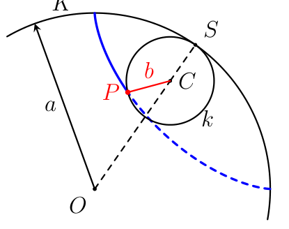
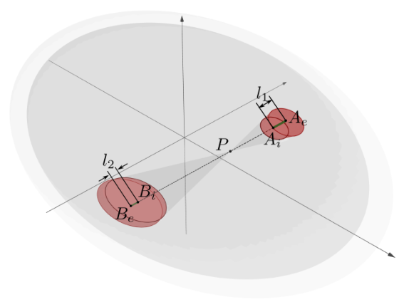

[[Състезания/esenno/st/2025|◂ 2025]] | [[Състезания/esenno/st-r/2026|решения]]

**Задача 1. Планетарни тунели** \[10 т.\]

В тази задача се разглежда кълбовидна еднородна планета с център т. O, радиус R и гравитационно ускорение на повърхността g. Пренебрегват се силите на триене/съпротивление и влиянието на изкопаните тунели върху гравитационното поле на планетата.

**Част А – Прави тунели**

**А.1** \[1,0 т.\] Между две диаметрално противоположни точки A, B на повърхността на планетата е прокопан тесен тунел по диаметъра на планетата AOB. Колко време $T_d$ ще отнеме на едно тяло да премине през тунела, ако започва в т. A без начална скорост?

**А.2** \[1,0 т.\] Между две точки A, B на повърхността на планетата е прокопан тесен тунел по продължение на хордата AB. Тяло е пуснато да се хлъзга по тунела от т. A без начална скорост. Намерете времето $T_l(\theta)$, за което тялото ще стигне B, в зависимост от ъгъла $\theta := \angle AOB \in (0, \pi]$.

**Част Б – Оптимални тунели**

Тесен тунел свързва две точки A и B от повърхността на планетата на ъглово отстояние $\theta := \angle AOB \in (0, \pi]$. Каква е траекторията на оптималния тунел, който отвежда тяло, пуснато без начална скорост, от едната точка до другата за минимално време?

**Б.1** \[6,0 т.\] Докажете, че търсената траектория е хипоциклоида и определете радиусите a, b (фиг. 1) в термини на g, R, θ. *Подсказка: Потърсете аналогия с друга област от физиката.*

**Б.2** \[2,0 т.\] Намерете това минимално време $T(\theta)$ в зависимост от ъгъла θ.

**Полезна математика:**

Фигура 1: Хипоциклоида – крива, очертавана от определена точка P от периферията на малка окръжност k с център C и радиус b, която се търкаля без приплъзване по вътрешността на голяма окръжност K с център O и радиус $a > b$.

**Задача 2. Електростатика** \[10 т.\]

Във всяка подточка могат да се използват твърденията от предходните подточки дори ако не са доказани!

Елипсоид с полуоси a, b, c е тяло, чиито вътрешност и повърхност се задават от:

$$\text{повърхност:}\ \left(\frac{x}{a}\right)^2 + \left(\frac{y}{b}\right)^2 + \left(\frac{z}{c}\right)^2 = 1, \qquad \text{вътрешност:}\ \left(\frac{x}{a}\right)^2 + \left(\frac{y}{b}\right)^2 + \left(\frac{z}{c}\right)^2 \le 1$$

Хомоеоид е елипсоидна черупка с външна повърхност елипсоид с полуоси a, b, c и вътрешна повърхност елипсоид с полуоси ma, mb, mc, за $0 < m < 1$.

**Част А – Електростатика на елипсоиди и хомоеоиди**

**А.1** \[0,5 т.\] Покажете, че $\vec{E} = 0$ във вътрешността на дебела равномерно обемно заредена сферична черупка.

**А.2** \[1,9 т.\] Покажете, че $\vec{E} = 0$ във вътрешността на дебел равномерно обемно зареден хомоеоид. *Подсказка: Полезно е да се докаже, че $l_1 = l_2$ (вж. фиг. 1).*

Фигура 1: Разделяне на малки парчета, за които се оказва, че $A_iA_e = l_1 = l_2 = B_iB_e$.

Нека $\phi(\vec{r}; a, b, c)$ е потенциалът в точка $\vec{r}$, вътрешна за равномерно зареден елипсоид с полуоси a, b, c, ориентирани по осите x, y, z, и плътност на заряда ρ.

**А.3** \[1,0 т.\] Нека $F(\vec{r}; a, b, c) = \phi(\vec{r}; a, b, c) - \phi(0; a, b, c)$. Покажете, че ако $\vec{r}$ лежи на повърхността на елипсоида, то за всяко $0 < \alpha \le 1$:

$$F(\alpha\vec{r}; a, b, c) = F(\alpha\vec{r}; \alpha a, \alpha b, \alpha c) = \alpha^2 F(\vec{r}; a, b, c)$$

Оказва се, че ако $f(\alpha\vec{r}) = \alpha^2 f(\vec{r})$, $\forall \alpha \in [0,1]$, то¹:

$$f(x, y, z) = a_x x^2 + a_y y^2 + a_z z^2 + a_{xy}xy + a_{xz}xz + a_{yz}yz$$

за някакви константи $a_x, a_y, a_z, a_{xy}, a_{xz}, a_{yz}$.

¹ Тук тихомълком е прието, че функцията е два пъти непрекъснато диференцируема в 0.

**А.4** \[0,7 т.\] Покажете, че потенциалът във вътрешността на хомогенно зареден плътен елипсоид има вида:

$$\phi(x, y, z) = \phi_0 + Ax^2 + By^2 + Cz^2$$

**Част Б – Електростатика на тънък диск**

**Б.1** \[2,3 т.\] Определете капацитета C на тънък проводящ диск с радиус R.

**Б.2** \[3,6 т.\] Тънък проводящ диск с радиус R е заземен (има потенциал 0). Точков заряд Q е поставен на оста на диска на разстояние $L \gg R$ от него. По средата между заряда Q и диска е поставен още един заряд $-Q/2$. Определете общия заряд $q_{инд}$, индуциран върху диска. Представете резултата чрез най-ниската степен на R/L.

**Полезна математика:**

$$V_{елипсоид} = \frac{4}{3}\pi abc, \qquad \int_0^a \sqrt{a^2 - x^2}\,dx = \frac{\pi a^2}{4}$$

$$(1 + x)^\alpha \approx 1 + \alpha x,\ x \ll 1, \qquad \int \frac{dx}{\sqrt{a^2 - x^2}} = \arcsin\left(\frac{x}{a}\right) + C, \qquad \cos^2\theta = \frac{1 + \cos(2\theta)}{2}$$

**Задача 3. Старата квантова механика** \[10 т.\]

В началото на 20. век станало ясно, че природата се държи странно – това, което е било смятано за непрекъснато, се оказало дискретно на достатъчно малки мащаби.

Макс Планк (1900) и Алберт Айнщайн (1905) поставят основите на т.нар. „квантова хипотеза“, която гласи, че енергията се обменя (излъчва/отдава и поглъща) на дискретни порции, нар. кванти, вместо непрекъснато. Енергията на един квант монохроматична светлина (фотон) с честота ν (кръгова честота $\omega = 2\pi\nu$) се дава от $\varepsilon = h\nu = \hbar\omega$.

Тъй като преход между произволни две класически състояния би изисквал пренос на произволно количество енергия, се налага въвеждане на ad hoc правила за избиране на разрешените класически състояния, които биват номерирани/означени от набор цели числа, нар. квантови числа. Именно в това се състои „старата квантова теория“ – класическа теория + квантови правила. Това остава състоянието на теорията до Хайзенберговата матрична механика (1925 г.) и уравнението на Шрьодингер (1926 г.), които съставляват т.нар. „нова квантова теория“.

**Част А – Принцип на съответствието и атомен модел на Бор**

През 1913 г. Нилс Бор предлага своя модел на атома на база следните общи съображения:

(1) Преходът 1 → 2 между две състояния става мигновено и е съпроводен или от излъчване на фотон с енергия $\varepsilon = E_1 - E_2$ при $E_1 > E_2$, или от поглъщане на фотон с енергия $\varepsilon = E_2 - E_1$ при $E_2 > E_1$;

(2) Принцип на съответствието: При големи квантови числа (големи мащаби; високи енергии) системата се държи на практика класически. В тази граница, квантовото поведение се губи и се възстановява класическата динамика.

Първо да определим класическата динамика. Разглеждаме водородоподобен атом с неподвижно ядро със заряд +Ze и един електрон със заряд −e и маса m, който се движи по кръгова орбита около ядрото. В последващото използвайте означението $A = m k_C^2 e^4$.

**А.1** \[0,7 т.\] Изразете ъгловата скорост ω на електрона чрез пълната му механична енергия E и A, Z.

**А.2** \[0,2 т.\] Каква би била честотата ν на излъчената светлина в резултат на периодичното движение на електрона по своята орбита?

Сега, нека предположим, че енергиите $E_n$ на разрешените квантови състояния се определят от едно квантово число n, като $E_1$ е енергията на основното състояние (състоянието с най-ниска енергия) и енергиите са подредени във възходящ ред ($E_1 < E_2 < E_3 < \dots$).

**А.3** \[1,4 т.\] Покажете, че за големи квантови числа n е изпълнено $E_n \approx -CZ^2/n^2$ и изразете C чрез A, ℏ. Пресметнете стойността на C в единици eV. *Подсказка: Използвайте $f(x) - f(x-1) \approx f'(x)$.*

Бор предположил, че зависимостта е валидна за всички n, а не само за големи n.

**А.4** \[0,5 т.\] Покажете, че моментът на импулса също се квантува като $L_n = n\hbar$.

**Част Б – Съотношения на дьо Бройл и стоящи вълни**

През 1924 г. Луи дьо Бройл стигнал до извода, че щом вълните (светлината) имат свойства на частици (фотони), то и частиците трябва да проявяват вълнови свойства. Той предположил, че във всяка частица с маса m има някаква вътрешна осцилация, която води до тези вълнови свойства. В отправна система K′, свързана с частицата, тази осцилация има фаза $\varphi = \omega_0 t'$ и кръгова честота $\omega_0$, която удовлетворява връзката на Планк, т.е. $E_0 = mc^2 = \hbar\omega_0$.

Нека частицата има скорост $\vec{v}$ спрямо лабораторната отправна система K. При движението на частицата нейният вътрешен осцилатор описва вълна с честота ω и вълнов вектор $\vec{k}$ ($\vec{k}$ сочи по посока на разпространение на вълната; $\vec{k} \perp$ вълнов фронт и $|\vec{k}| = k = 2\pi/\lambda$), за която $\varphi = \omega t - \vec{k}\cdot\vec{r}$. За преминаване между отправните системи, използвайте Лоренцовите трансформации:

$$t' = \gamma\left(t - \frac{\vec{v}\cdot\vec{r}}{c^2}\right), \qquad \vec{r}' = \vec{r}_\perp + \gamma\left(\vec{r}_\parallel - \vec{v}t\right), \qquad \gamma = \sqrt{\frac{1}{1 - v^2/c^2}}$$

където $\vec{r}_\parallel$, $\vec{r}_\perp$ са съответно компонентите на $\vec{r}$ успоредни и перпендикулярни на скоростта $\vec{v}$.

**Б.1** \[0,7 т.\] Изведете съотношенията на дьо Бройл $\mathcal{E} = \hbar\omega$ и $\vec{p} = \hbar\vec{k}$, където $\mathcal{E}$ е пълната релативистка енергия, а $\vec{p}$ е релативисткият импулс на частицата.

**Б.2** \[0,3 т.\] Покажете, че условието на Бор $L_n = n\hbar$ е еквивалентно на това дължината на вълната на електрона в разрешена орбита да се нанася цял брой пъти върху обиколката на орбитата, т.е. вълната да интерферира конструктивно със себе си.

Последното свойство позволява да се даде по-общо условие за квантуване – разрешените затворени орбити са тези, при които вълната на частицата се затваря върху орбитата и интерферира със себе си конструктивно.

**Б.3** \[0,7 т.\] Покажете, че за затворени орбити условието за квантуване по-горе се свежда до:

$$\oint_{\text{орбита}} \vec{p}\cdot d\vec{r} = nh$$

където n е цяло число.

**Част В – Условие за квантуване на Уилсън-Бор-Зомерфелд и фина структура**

Оказва се, че полученото горе условие е по-слабо и на база други съображения може да се получи, че за равнинна централна задача от типа на тази за водородоподобен атом са валидни следните условия за квантуване на Уилсън-Бор-Зомерфелд (1916 г.):

$$\oint_{\text{период}} p_r\,dr = n_r h, \qquad \oint_{\text{период}} p_\theta\, r\,d\theta = \ell h$$

където $n_r = 0, 1, 2, \dots$, $\ell = 1, 2, 3, \dots$ и $p_r$, $p_\theta$ са съответно радиалната и азимуталната компонента на импулса.

**В.1** \[0,4 т.\] Покажете, че условията (1) и (2) водят до условието, получено в Б.3.

**В.2** \[0,4 т.\] Покажете, че условие (2) е еквивалентно на условието $L = \ell\hbar$.

**В.3** \[1,0 т.\] Покажете, че условие (1) се свежда до:

$$2\int_{r_-}^{r_+} \sqrt{2m(E - U(r)) - \frac{L^2}{r^2}}\,dr = n_r h$$

където E е енергия на орбитата, а U(r) е потенциалната енергия на взаимодействието, а $r_-$, $r_+$ са съответно най-малкото и най-голямото отстояние от центъра на силата.

**В.4** \[1,2 т.\] Покажете, че при $U(r) = -k_C e^2 Z/r$ получаваме отново $E_{n_r,\ell} = -CZ^2/n^2$, където $n = n_r + \ell$ се нарича главно квантово число.

Вижда се, че за всяка стойност на главното квантово число n има n на брой възможни орбити ($\ell = 1, 2, \dots, n$) с еднаква енергия $E_n$. Оказва се обаче, че все пак енергията зависи слабо и от ℓ, което води до разцепване на спектралните линии, наречено фина структура.

**В.5** \[2,5 т.\] Разглеждайки задачата релативистки, покажете, че енергията $E = \mathcal{E} - mc^2$ на състоянието (n, ℓ) (отново $n = n_r + \ell$) се дава от:

$$E_{n,\ell} = mc^2\left[\frac{1}{\sqrt{1 + \left(\dfrac{\alpha Z}{(n-\ell) + \sqrt{\ell^2 - \alpha^2 Z^2}}\right)^2}} - 1\right]$$

където $\alpha = k_C e^2/(\hbar c) \approx 1/137$ е т.нар. константа на фината структура, а $\mathcal{E}$ е пълната релативистка енергия. *Подсказка: Съставете интеграл, подобен на този от В.3, като пригодите подинтегралната величина за релативистка частица.*

Забележка: Полученият израз в В.5 е известен като формула на Зомерфелд за водородния атом. Оказва се, че тази формула дава правилните енергии на нивата във водородния атом, които се получават строго в рамките на релативистката квантова механика. Това е интересно, имайки предвид, че физическата картина, предложена от Зомерфелд, е всъщност грешна – липсва една важна характеристика …

**Полезна математика:**

$$\int_a^b \frac{\sqrt{(r-a)(b-r)}}{r}\,dr = \pi\left[\frac{a+b}{2} - \sqrt{ab}\right], \qquad \oint_{\text{период}} f\,dx \equiv \int_a^b f\,dx \ \text{върху един период на } x(t)$$

**Справочни данни**

| | |
| --- | --- |
| $c = 2{,}998\cdot 10^8\ \text{m/s}$ | $e = 1{,}602\cdot 10^{-19}\ \text{C}$ |
| $\hbar = 1{,}055\cdot 10^{-34}\ \text{J·s}$ | $m_e = 9{,}109\cdot 10^{-31}\ \text{kg}$ |
| $k_C = 8{,}986\cdot 10^9\ \text{N·m}^2/\text{C}^2$ | $1\ \text{eV} = 1{,}602\cdot 10^{-19}\ \text{J}$ |
