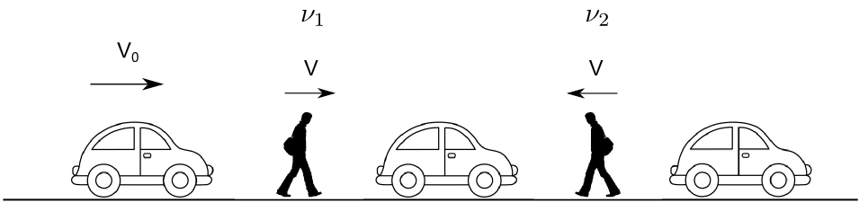
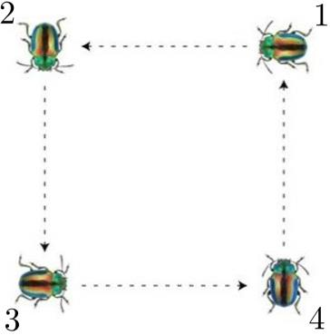

[[Състезания/proletno/10/2016|◂ 2016]] | [[Състезания/proletno/10r/2017|решения]] | [[Състезания/proletno/10/2018| 2018 ▸]]

Задача 1. Кинематика

Част 1

Двама души се движат по шосе със скорост V в противоположни посоки. По шосето се движат коли на равни разстояния една от друга в една и съща посока със скорост $V_0$. Нека с $\nu_1$ и $\nu_2$ означим честотите на преминаване на колите край пешеходците.

а) Намерете съотношението $\nu_1$ / $\nu_2$ . \[4 т.\]

Част 2

Четири бръмбара са наредени във върховете на квадрат със страна a. Всеки се движи към свой съсед със скорост V, както е показано на фигурата. Да се определи:

а) качествено чрез чертеж видът на траекторията, която описва всеки бръмбар; \[2 т.\]

б) относителната скорост на бръмбар 1 спрямо бръмбар 2 по посока на бръмбар 2; \[2 т.\]

в) след колко време ще се срещнат два съседни бръмбара; \[1 т.\]

г) разстоянието, което ще измине всеки бръмбар до срещата си със свой съсед. \[1 т.\]

Задача 2. Електричество

На фиг. 3 са показани 6 резистора, амперметър и 2 ключа, означени с $k_1$ и $k_2$.
Намерете еквивалентното съпротивление RAB между точките A и В в следните случаи:

а) $k_1$ и $k_2$ са отворени; \[1 т.\]

б) $k_1$ и $k_2$ са затворени; \[3 т.\]

в) $k_1$ е затворен, а $k_2$ е отворен. \[3 т.\]

г) Батерия с напрежение U е свързана към точки А и В. Намерете тока през амперметъра за затворени $k_1$ и $k_2$. \[3 т.\]

Задача 3. Оптика

Част 1

Слънчевата константа k характеризира количеството слънчево лъчение, което пада върху перпендикулярна на слънчевите лъчи повърхност с площ $1\ \text{m}^2$ за време $1$ s на разстояние $1$ AU (средното разстояние между Земята и Слънцето, $1,5\cdot 10^{8}$ km.) от Слънцето. Намерете:

а) стойността на k в единици $\text{W/m}^2$. Слънцето излъчва с мощност $P_S = 4\cdot 10^{26}$ W. \[2 т.\]

б) равновесната температура T на Земята. Приемете, че Земята поглъща изцяло слънчевата светлина и излъчва като абсолютно черно тяло според закона на Стефан-Болцман ($\sigma = 5,67\cdot 10^{-8}\ \text{W/m}^2/\text{K}^4)$ и че температурата е една и съща навсякъде по повърхността ѝ. Приемете, че отсъства парников ефект и че единственият източник на топлина за Земята е слънчевото лъчение. \[3 т.\]

Част 2

Човек се опитва да запали лист хартия на пълнолуние, като за целта използва сферична събирателна леща с диаметър d и фокусно разстояние f. Намерете:

в) интензитета на отразената лунна светлина, измерен от наблюдател на Земята, ако звездната величина на Луната при пълнолуние е m$M \approx$ -13 . Използвайте стойността за слънчевата константа от част 1 а). \[2т.\]

г) съотношението d / f , при което може да се запали хартията, ако температурата на запалване е $T_0 = 233\ ^{\circ}\text{C}$ (506 K). Ъгловият диаметър на Луната е $\alpha = 0,5^{\circ}$. \[3 т.\]

Упътване: Звездната величина е астрономическа мярка за яркостта на небесните обекти.
Слънцето има звездна величина m$S \approx$ -27 , а обекти със звездна величина 6 се считат за невидими за невъоръжено човешко око. Звездната величина се пресмята по следната формула:

$m_1 - m_2 = -2,5\log_{10}\left(\frac{I_1}{I_2}\right)$,

където $I_1$ и $I_2$ са интензитетите (количеството лъчение) за два различни източника на светлина (мерени във $\text{W/m}^{2}$ ), $a m_1$ и $m_2$ са съответните звездни величини.
Забележка: Приемете, че хартията излъчва като абсолютно черно тяло в
полупространството от страна на лещата и не взаимодейства топлинно с други тела.

Приемете, че лещата не отразява светлина.

Помислете: Можем ли наистина да запалим хартия на лунна светлина?