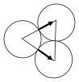
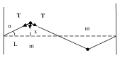
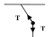
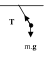

[[Състезания/proletno/10/2005|условия]] | [[Състезания/proletno/10/2006| 2006 ▸]]
 
**Задача 1.**

а) При отклонението, представено на фиг.1 може да се използва аналогия с математичко махало, но в този случай ролята на земното ускорение $g$ ще играе случаят ролята на земното ускорение $g$ ще играе отношението $T/m$ (1 точ.), като отметка за честотата $\nu = \frac{1}{2\pi}\sqrt{\frac{T}{m.L}}$ (1 т.).

б) Отчертва се вижда, че възвръщащата сила е $F=2.T.\sin\alpha$ (1 точ.). Ъгълът $\alpha$ може да се представи от $\tan\alpha=x/L$ (1 точ.), и за малки ъгли $\sin\alpha \approx \tan\alpha$ откъдето получаваме за възвръщащата сила $F=(2.T/L).x$ (1 точ.), което съвпада с израза за хармонична сила $F=k.x$ при $k=(2.T/L)$ (1 точ.). Окончателно за честотата получаваме
$\nu = \frac{1}{2\pi}\sqrt{\frac{2T}{m.L}} \quad (1 \text{ точ.})$

в) При произволно малко отклонение, движението ще бъде суперпозиция от две трептения. Периодите на трептенията определяме от $T_{har} = 1/\nu$. Оттук получаваме $T_1/T_2=\sqrt{2}$ (1 точ.)-- те имат най-малък общо кратен и следователно движението няма да бъде хармонично (1 точ.), нито периодично (1 точ.).

**Задача 2.**

а) От законите за запазване на импулсът и енергията, при централен удар на две еднакви тела се обменят скоростите (1 точ.) -- оттук следва, че първото и второто тяло ще останат неподвижни (1 точ.), а третото тяло ще придобие скорост $u$ (1 точ.).

б) От отделната симетрия спрямо оста, по която се движи първото тяло, следва че компонентите на скоростта на 2-то и 3-то тела по тази ос ще имат една и съща стойност, а перпендикулярно на нея -- равни по големина, но противоположни по знак (1 точ.)

1) ${u} = {v}_{1x} + {v}_{2x} + {v}_{3x}$  (1 точ.)
 2) $v_{2y} = - v_{3y}$  (1 точ.)
3) $u^2 = v_1^2 + v_2^2 + v_3^2$  (1 точ.)
4) $v_2^2 = v_{2x}^2 + v_{2y}^2$  (същото е в сила и за $v_3$) (1 точ.)
5) $v_{2x} = v_{3x}$  (1 точ.)

Но горните уравнения не позволяват да се определи отношението между $x$ и $y$ у компонентите на скоростта за 2-та и 3-та частица. Това може да направим от модел на удара, при който центровете на трите диска по време на удара са разположени на върховете на равностранен триъгълник. При този модел следва, че

$v_{2x} = v_2 \cos(30^\circ) = v_2\sqrt{3}/2 \quad \text{и}$
$v_{2y} = v_2 \sin(30^\circ) = v_2 / 2 \quad (1 \text{ точ.})$
откъдето получаваме
$u = v_1 + v_2\sqrt{3}$
$u^2 = v_1^2 + 2.v_2^2$

откъдето получаваме

$$v_1 = -\frac{u}{5} \quad (1 \text{ точ.}) \quad \text{и} \quad v_2 = \frac{2\sqrt{3}.u}{5} \quad (1 \text{ точ.})$$

**Задача 3.**

а) От разликите в моментните скорости се вижда, че от $v=12.8829$ те намаляват и следователно ускорението е отрицателно $S=33,9506$ до $S=40,2849$ (1 точ.)

б) За да определим ускорението от табличните стойности използваме връзката:

$\Delta v / \Delta s = (\Delta v / \Delta t) / (\Delta s / \Delta t) = a/v$
$a = v.(\Delta v / \Delta s) \quad (1 \text{ точ.})$

За по-голяма точност на определянето на ускорението е необходимо отношението $\Delta v / \Delta s$ да бъде изчислено както от дясно, така и от ляво на текущата стойност на $v$ и след това да се вземе средната стойност от двете.

| $S \text{ ( m )}$ | $v \text{ (m/s)}$ | $a \text{ (m/s}^2\text{)}$ | $S \text{ ( m )}$ | $v \text{ (m/s)}$ | $a \text{ (m/s}^2\text{)}$ |
| ----------------- | ----------------- | -------------------------- | ----------------- | ----------------- | -------------------------- |
| 27.6029           | 12.3008           | 2.40                       | 35.2377           | 12.8511           | -0.558                     |
| 28.8442           | 12.5163           | 1.91                       | 36.5192           | 12.7719           | -1.02                      |
| 30.1045           | 12.6827           | 1.41                       | 37.7906           | 12.6470           | -1.47                      |
| 31.3791           | 12.7993           | 0.916                      | 39.0472           | 12.4786           | -1.89                      |
| 32.6627           | 12.8659           | 0.417                      | 40.2849           | 12.2695           | -2.28                      |
| 33.9506           | 12.8829           | -0.0756                    |                   |                   |                            |

Стойностите на ускорението са дадени с три значещи цифри. Оценяването зависи от точността, която са постигнали учениците. Ако първите две значещи цифри съвпадат, а третата се различава с не-повече от 2 единици ( т.е. $+/- 002$) -- 1 точ. за всяка изчислена стойност. При точност $+/- 005$ -- по 0,5 точ. В противен случай -- 0 т. Общият брой точки по условия а) и б) на задача 3 не може да бъде повече от 10!

