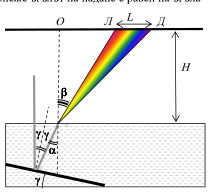

[[Състезания/proletno/10/2006|◂ 2006]] | [[Състезания/proletno/10/2009|условия]] | [[Състезания/proletno/10/2010| 2010 ▸]]

Задача 1. а) При равноускорително движение с нулева начална скорост са в сила следните
закони за скоростта и за пътя:
(1) $v = at$

(2) $s = \frac{at^2}{2}$ 

Така определяме:

$(3)\quad t_1 = \frac{v}{a} = 5$ s 1 т

$(4)\quad s_1 = \frac{v^2}{2a} = 25$ m 1 т

б) Графиките на скоростите на двата автомобила са дадени по-долу:

(Фиг.: графики v(t) на първия (№1) и втория (№2) автомобил)

За правилно начертана графика и означени моменти от време: \[1 т.\]
- за първия автомобил: \[1 т.\]
- за втория автомобил \[1 т.\]

в) Двата автомобила продължават да се движат с еднакви скорости след момента t = 6 s. \[1 т.\]

За това време първият автомобил изминава път $s_1 = 25\text{ m}$ за първите $t_1 = 5\text{ s}$ и допълнителен път:

(5) $s_2 = v(t - t_1) = 10\text{ m/s}\cdot 1\text{ s} = 10\text{ m}$ \[1 т.\]

за следващата $t_2$ = 1 s, през която се движи равномерно. За същото време първият автомобил е
неподвижен в продължение на 1 s и се движи равноускорително в продължение на 5 s, т.е.
изминава път $s_1' = 25\text{ m}$. Следователно след шестата секунда разстоянието между автомобилите е:

(6) $H = h + (s_1 + s_2) - s_1' = h + s_2 = 11\text{ m}$. \[1 т.\]

г) В първата колона на таблицата са дадени разстоянията s, на които се намират различните по ред автомобили от светофара. Във втората колона са дадени съответните моменти на тръгване tт, а в третата колона - времето tд, нужно на дадения автомобил да достигне светофара, след като потегли:

(7)

$$t_\text{д} = \begin{cases}\sqrt{\frac{2s_1}{a}}&\text{ако }s\leq s_1\\ t_1+\frac{s-s_1}{v}&\text{ако }s>s_1\end{cases}$$

1т

| № | s (m) | tт (s) | tд (s) | t (s) |
|---|---|---|---|---|
| 1 | 0 | 0 | 0,0 | 0,0 |
| 2 | 4 | 1 | 2,0 | 3,0 |
| 3 | 8 | 2 | 2,8 | 4,8 |
| 4 | 12 | 3 | 3,5 | 6,5 |
| 5 | 16 | 4 | 4,0 | 8,0 |
| 6 | 20 | 5 | 4,5 | 9,5 |
| 7 | 24 | 6 | 4,9 | 10,9 |
| 8 | 28 | 7 | 5,3 | 12,3 |
| 9 | 32 | 8 | 5,7 | 13,7 |
| 10 | 36 | 9 | 6,1 | 15,1 |
| 11 | 40 | 10 | 6,5 | 16,5 |
| 12 | 44 | 11 | 6,9 | 17,9 |

В последната колона е дадено общото време t = tт + tд от светването на зелен сигнал до достигане на светофара. Преминават само тези автомобили, за които

t $\le$ T = 15 s. \[1 т.\]

От таблицата се вижда, че това са:

(8) N = 9 автомобила. \[1 т.\]

Задача 2. а) Периодът на математично махало с дължина L е:

(1) $T = 2\pi\sqrt{\frac{L}{g}}$ \[0,5 т.\]
Понеже разстоянието а между топчетата е много по-малко от дължината на нишките, приемаме, че в момента на удара нишката на първото топче е практически вертикална. Докато достигне вертикално положение,.първото топче извършва четвърт период на хармонично трептене:

(2)

$$t_1 =\frac{T}{4}=\frac{\pi}{2}\sqrt{\frac{L}{g}}$$

1,0 т

След заместване с числените данни намираме:

(3) $t_1 \approx 0,50\text{ s}$ \[0,5 т.\]

б) След отклонение на ъгъл $\alpha$ първото топче се издига на височина:

(4) $h = L(1 - \cos\alpha)$

над равновесното си положение и придобива потенциална енергия:

(5) $E_p = mgh = mgL(1 - \cos\alpha)$ \[1,0 т.\]

При достигане на равновесното положение потенциалната енергия изцяло се трансформира в кинетична енергия:

(6) $\frac{mv^2}{2} = mgh$ \[1,0 т.\]

Следователно:

(7) $v = \sqrt{2gL(1 - \cos\alpha)}$ \[0,5 т.\]

или

(8) $v \approx 0,55\text{ m/s}$ \[0,5 т.\]

в) При удар кинетичната енергия на движещото се топче се предава изцяло на следващото
топче. Това означава, че след последния удар N-тото топче ще има същата кинетична енергия,
като тази на първото топче преди първия удар и ще се издигне на същата височина, от която
първото топче е започнало своето движение:

(9) $h = L(1 - \cos\alpha) = 1,52\text{ cm}$ \[1,0 т.\]

г) Последното топче достига от равновесно положение до крайно дясно положение също за
време $t_1$ = 1/4T. 0,5 т
В общото време обаче се включва и времето $t_2$ , за което протичат всички удари. Времето между два последователни удара е:

(10) $\Delta t = \frac{a}{v}$ \[0,5 т.\]

Понеже между N топчета протичат N - 1 удара, получаваме:

(11) $t_2 = (N-1)\Delta t = \frac{(N-1)a}{v}$ \[1,0 т.\]

Следователно:

(12) $t = 2t_1 + \frac{(N-1)a}{v}$ \[1,0 т.\]
(13) t = 1,18 s. 1,0 т

Задача 3. а) Лъчът пада върху огледалото под ъгъл $\gamma$. Понеже ъгълът на падане е равен на ъгъла на отражение, отразеният лъч пада под ъгъл

(1) $\alpha = 2\gamma$ \[1 т.\]

върху водната повърхност. Максималният ъгъл на наклон се определя от условието за пълно вътрешно отражение:

(Фиг.: огледало под ъгъл $\gamma$, водна повърхност на дълбочина H, ъгли $\alpha$ и $\beta$, разстояния ЛО, ДО и L на дъното)

(2) $\sin(2\gamma_{max}) = \frac{1}{n} = 0,75$ \[1 т.\]

От таблицата виждаме, че най-близката до 0,75 стойност на синуса, без да я превишава, съответства на ъгъл $\alpha = 48^\circ$. Следователно:

(3) $\gamma_{max} = 24^\circ$ \[1 т.\]

б) Светлинните вълни от различните части на спектъра падат под един и същ ъгъл $\alpha = 2\gamma$ върху водната повърхност. От тук следва, че най-голям ъгъл на пречупване $\beta$ съответства на светлинната вълна, за която показателят на пречупване на водата е най-голям. \[1 т.\]

Следователно десният край на спектъра е оцветен във виолетово, а левият – в червено. \[1 т.\]

в) От закона на Снелиус:

(4) $\sin\beta = n\sin\alpha = n\sin(2\gamma)$ \[1 т.\]

намираме за ъглите на пречупване $\beta_1$ и $\beta_2$ съответно на червената и на виолетовата светлина:

(5) $\sin\beta_1 = 1{,}330\cdot\sin 30^\circ = 0,665$ \[0,5 т.\]

(6) $\sin\beta_2 = 1{,}344\cdot\sin 30^\circ = 0,672$ \[0,5 т.\]

От чертежа се вижда, че:

(7) $LO = H\tg\beta_1$

(8) $DO = H\tg\beta_2$

(9) $L = DO - LO = H(\tg\beta_2 - \tg\beta_1)$ \[1 т.\]

От връзката $\tg\beta = \frac{\sin\beta}{\sqrt{1-\sin^2\beta}}$ намираме:

(10) $\tg\beta_1 = 0,890$, $\tg\beta_2 = 0,907$ \[1 т.\]

Следователно:

(11) $L = 3\text{ m}\cdot(0,907 - 0,890) = 0,051\text{ m} = 5,1\text{ cm}$ \[1 т.\]
