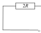
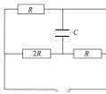

[[Състезания/proletno/10/2012|◂ 2012]] | [[Състезания/proletno/10/2013|условия]] | [[Състезания/proletno/10/2014| 2014 ▸]]

Задача 1. Електрическа верига

а) Веднага след включване на външното напрежение кондензаторът се държи като
проводник. \[1 т.\] Ако ключът е в отворено положение, еквивалентната схема е изобразена на фиг. 1. Съпротивлението на успоредно свързаните резистори 1 и 2 е $R_{12} = \frac{2R}{3}$. \[0,5 т.\] Следователно падът на напрежението върху резисторите 1 и 2 е $U_{12} =\frac{2U}{5}$ \[0,5 т.\], а върху резистор 3 - $U_3 =\frac{3U}{5}$ . \[0,5 т.\] Токовете, които протичат през съответните резистори, са: $I_1=\frac{ 2U}{5R}=$ 2 mA \[0,5 т.\], $I_2 = \frac{U}{5R}= 1 mA$ \[0,5 т.\] и $I_3 = \frac{3U}{5}= 3 mA$ . \[0,5 т.\]

б) След като източникът на напрежение е бил включен за достатъчно дълъг период от време, кондензаторът е зареден и не пропуска ток. \[1 т.\] Зарядът на кондензатора при отворено положение на ключа е q = CU L , където U L е напрежението върху левия резистор на фиг. 2 \[1 т.\]. Крайният отговор е: q $=\frac{ 2CU}{ 3}=$ 3,3 $\mu$C . \[1 т.\]

в) Отново кондензаторът е зареден и не пропуска ток. \[1 т.\] Зарядът на кондензатора при затворено положение на ключа е q = CU R , където U R е напрежението върху десния резистор на фиг. 3. \[1 т.\] Крайният отговор е: q $=\frac{ CU}{ 3}=$ 1,7 $\mu$C . \[1 т.\]

Задача 2. Електромагнитна индукция

а) При движението на пръчката магнитният поток през контура се увеличава. Следователно посоката на индуцирания ток трябва да е такава, че магнитното му поле да е насочено противоположно на външното магнитно поле. По правилото на дясната ръка следва, че посоката на тока ще бъде по часовниковата стрелка. \[1 т.\]

б) Големината на индуцираното напрежение е: $E_I = \frac{\Delta \Phi}{\Delta t} = \frac{\Delta S \Delta S}{\Delta t}$. \[1 т.\] Получава се, че 
$E_I = \frac{B}{\Delta t} \frac{l}{\sin \alpha} \Delta x \sin \alpha$. \[1 т.\] В крайна сметка $E_I = Blv = 0,175 \text{ V.}$ \[1 т.\]

в) Сумарното съпротивление на контура е: $R_S = R + \frac{\lambda l}{\sin \alpha}$. \[1 т.\] Големината на индуцирания ток е: $I = \frac{U \sin \alpha}{R \sin \alpha + \lambda l} = \frac{Blv \sin \alpha}{R \sin \alpha + \lambda l}$. \[1 т.\] Мощността, която се отделя в резистора, е: $P = I^2 R = \frac{B^2 l^2 v^2 R \sin^2 \alpha}{(R \sin \alpha + \lambda l)^2} = 5,3 \text{ mW.} \text{ [1 т.]}$

г) Посоката на външната сила $\vec{F}_{\text{ext}}$, необходима за поддържане на движението на пръчката, е показана на фиг. 4. \[1 т.\] Големината й е:
$F_{\text{ext}} = \frac{BIl}{\sin \alpha} = \frac{B^2 l^2 v}{R \sin \alpha + \lambda l} = 17 \text{ mN.} \text{ [2 т.]}$

Задача 3. Люлеещо се топче

 а) Схемата с посоките на всички сили, които действат върху топчето, е изобразена на фиг. 5. \[1 т.\] В приближение на малко $\alpha$ $F_E\approx \frac{kqQ}{l^2}$ \[1 т.\], $G = mg$ , а $T \approx \frac{kqQ}{l^2} + mg$. \[2 т.\]

 б) Големината на силата, която е приложена в точката на окачване на нишката, е $T \approx \frac{kqQ}{l^2} + mg$ \[1 т.\], тъй като нишката е безмасова.
 
 в) Резултантната сила F , която действа върху топчето при движението
 FE
 qq му, е тангенциална на траекторията му и има квазиеластичен характер. \[1 т.\] Нейната големина е: $F \approx - mg \sin \alpha - \frac{kqQ}{l^2} \sin \alpha$ . \[1 т.\] Като се използват свойствата на тригонометричните функции за малки ъгли, се получава $F \approx -( mg + \frac{ 2kqQ }{ l^2 }) \sin \alpha$ . \[1 т.\] Големината на силата може да се представи по следния начин: $F \approx -(\frac{mg}{l} + \frac{2kqQ }{ l^3}) x = - kx$ \[1 т.\], където x е перпендикулярното отклонение на топчето от вертикалата, минаваща през точката на окачване на нишката. За периода се получава: $\displaystyle T =\frac{ 2\pi}{\sqrt{ \frac{g}{l} + \frac{2kqQ}{ml^3}}}= 1,\!5\ \mathrm s$ . \[1 т.\]
