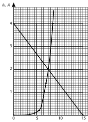
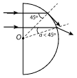
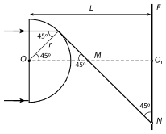
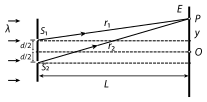

[[Състезания/proletno/10/2013|◂ 2013]] | [[Състезания/proletno/10/2014|условия]] | [[Състезания/proletno/10/2015| 2015 ▸]]

Задача 1. А) Волтамперната характеристика на варистора е нелинейна. При малки напрежения през него практически не тече ток, което означава, че съпротивлението на варистора е много голямо. Когато напрежението върху варистора нараства, неговото съпротивление намалява и токът започва бързо да нараства. При големи напрежения съпротивлението на варистора става много малко - той дава "на късо" консуматора, към който е свързан успоредно. 1 точка

 От фиг. 1 определяме, че през варистора тече ток 4 А при напрежение 8,5 V. Следователно прекъсвачът ще прекъсне веригата преди да е достигнато максималното допустимо напрежение 9 V върху консуматора 1 точка
 
Б) Напрежението върху варистора е $U_в = U = 6$ V (успоредно свързване) 0,5 точки

От графиката (фиг. 1) определяме, че при напрежение 6 V през варистора тече ток $I_В = 0,4$ A 0,5 точки

Токът през резистора е $I = \frac{U}{R_0} + I_B = 1$ A 1 точка

 Фиг. 1.

Електродвижещото напрежение на източника е

$\varepsilon = IR + U_В = 12$ V 1 точка

В) В този случай $\varepsilon_1 = RI + U_B = R\left(\frac{U_B}{R} + I_B\right) + U_B$, откъдето изразяваме тока през варистора

$I_{BВ} = \frac{\varepsilon_1}{R} - \left(\frac{1}{R_0} + \frac{1}{R}\right)U$ 1 точка
 В това линейно уравнение има две неизвестни (Uв и IB). Ние разполагаме с графика на зави-
симостта IB(Uв) и затова трябва да решим задачата графично. Построяваме графика на получената
линейна зависимост. Тя е права линия: при $U_В = 0$: $I_В = \frac{\varepsilon_1}{R} = 4$ A; при $I_В = 0$: $U_В = 15$ V.

 Правата линия е показана на фиг. 1 2 точки
 Търсеното решение е пресечната точка на двете графики. 1 точка
Нейните координати са $U_В = 7,5$ V и $I_В = 2$ A.

Следователно при електродвижещо напрежение на източника $\varepsilon_1 = 24$ V напрежението върху консуматора е $U = U_В = 7,5$ V, 0,5 точки

а токът през варистора е $I_В = 2$ A 0,5 точки

 1

Задача 2. А) От равенството $\sin\alpha_{гр} = \frac{1}{n}$ определяме граничния ъгъл на пълно вътрешно отражение: $\alpha_{гр} = 45^{\circ}$ 1 точка
 При $\alpha$ < $\alpha$гр , т.е. при $\alpha$ < 45О, лъчът се пречупва от сферичната повърхност
и напуска кълбото (фиг. 2) 1 точка

 Б) При $\alpha$ = $\alpha$гр = 45О лъчът се плъзга по сферичната повърхност (фиг. 2) 1 точка

 В) При $\alpha$ > $\alpha$гр ($\alpha$ > 45О ) лъчът претърпява неколкократно (многократно) пълно вътрешно
отражение от сферичната повърхност, пречупва се от плоската повърхност на полусферата и я
напуска (фиг. 3) 1 точка
 Всички ъгли на падане и отражение от сферичната повърхност са равни на $\alpha$ 0,5 точки

 Фиг. 2. Фиг. 3. Фиг. 4.

Броят на отраженията е $k$ — цялата част на числото $\frac{90^{\circ} + \alpha}{180^{\circ} - 2\alpha}$ 0,5 точки
 Лъчът пада върху плоската повърхност на полукълбото под ъгъл $\gamma$. От чертежа се вижда
(фиг. 3), че $\beta > \alpha > 45^{\circ}$. Следователно $\gamma = 90^{\circ} - \beta < 45^{\circ}$, т.е. ъгълът на падане е по-малък от граничния
ъгъл. Затова лъчът напуска полукълбото 1 точка

Г) Поради пълното вътрешно отражение от полукълбото ще излязат само лъчите, които па-
дат върху сферичната му повърхност под ъгъл $\alpha < \alpha_{гр} = 45^{\circ}$ 1 точка

Радиусът на светлото петно се определя от лъча, падащ под граничния ъгъл $\alpha = \alpha_{гр} = 45^{\circ}$ (фиг. 4) 1 точка

От чертежа на фиг. 4 определяме:

$OM = r\sqrt{2}$; $R = NO_1 = MO_1 = L - r\sqrt{2} \approx 2,2$ cm 2 точки

 Задача 3. А) От двата правоъгълни триъгълника на фиг. 5 изразяваме разстоянията $r_1$ и $r_2$:

 Фиг. 5.

$r_1 = \sqrt{L^2 + (y - d/2)^2} \approx L(1 + \frac{(y - d/2)^2}{2L^2})$; \hfill 1 точка
$r_2 = \sqrt{L^2 + (y + d/2)^2} \approx L(1 + \frac{(y + d/2)^2}{2L^2})$. \hfill 1 точка

Разликата в ходовете на вълните две вълни е

$\Delta r = r_2 - r_1 \approx L + \frac{(y + d/2)^2}{2L} - \left( L + \frac{(y - d/2)^2}{2L} \right) = \frac{d}{L}y$ 1 точка

Б) $\Delta r = r_2 - r_1 = \frac{d}{L}y = m\lambda. \quad (m = 0, \pm 1, \pm 2, \dots)$ - условие за максимум 1 точка

$\Delta r = r_2 - r_1 = \frac{d}{L}y =(m + \frac{1}{2})\lambda. \quad(m = 0, \pm 1, \pm 2, \dots)$ - условие за минимум 1 точка

В) $\lambda = \frac{d}{m L} y$ 1 точка

$\lambda = 500 \text{ nm}$ 1 точка

Г) $\Delta y = y_{m+1} - y_m = (m + 1)\frac{\lambda L}{d} - m\frac{\lambda L}{d} = \frac{\lambda L}{d} = 1 \text{ cm}$ 1 точка

Разстоянието между светлите ивици не зависи от y, т.е. в централната част на екрана интерференчните ивици са разположени на еднакви разстояния една от друга 0,5 точки

Разстоянието между ивиците нараства, ако намаляваме разстоянието d между процепите
или ако отдалечаваме екрана (увеличаваме L) 0,5 точки

Д) От условието за максимум изразяваме разстоянията y, на които са разположени светлите ивици на двете интерференчни картини:

$y_{m_1} = \frac{m \lambda_1 L}{d}$; $y_{m_2} = \frac{m_2 \lambda_2 L}{d}$.

За съвпадащите ивици $\frac{m_1 \lambda_1 L}{d} = \frac{m_2 \lambda_2 L}{d}$, откъдето получаваме

$\frac{m_2}{m_1} = \frac{\lambda_1}{\lambda_2} = \frac{550 \text{ nm}}{450 \text{ nm}} = \frac{11}{9}$ 0,5 точки

Първите съвпадащи ивици на двете картини са разположени от центъра на екрана на разстояние $y_{m=9} = \frac{9 \lambda_1 L}{d} = 9,9 \text{ cm}$ 1 точка
 Тъй като $y_9 < < L$, можем да използваме направеното в началото приближение за
разликата в оптичните ходове на вълните от двата процепа, отнасящо се само за централната
част от екрана 0,5 точки
