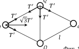
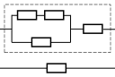

[[Състезания/proletno/10/2015|◂ 2015]] | [[Състезания/proletno/10/2016|условия]] | [[Състезания/proletno/10/2017| 2017 ▸]]

Задача 1. Електростатика.
 а) Системата е симетрична спрямо вертикалната
 Q
 T' T' права, минаваща през средните заряди, и
 хоризонталната права, минаваща през крайните
 T' T '
 два заряда. Tърсената сила на опън означаваме с
 $\sqrt$3T '
 q q T. Силата на опън на останалите четири нишки е с
 една и съща големина T ' . \[0,5 т.\] От условието за
 T' l равновесие на системата следват две независими
 Q Фиг. 1 уравнения, които свързват големините на силите
 на опън с големините на Кулоновите сили, които
действат на зарядите. На левия заряд действат две сили на опън с големина T ' , които
сключват ъгъл 60$^\circ$ помежду си, както е показано на фиг. 1. Тяхната геометрична сума е
вектор, насочен хоризонтално надясно, с големина $\sqrt$3T ' , което може да се получи, като
се използва Питагоровата теорема. \[0,5 т.\] По аналогичен начин векторната сума на
силите, с които горният и долният заряди действат на левия заряд, дава сила с
 $\sqrt$3kqQ
големина , насочена хоризонтално наляво. \[1 т.\] На левия заряд действа също така
 $l_2$
 kq 2
и десният заряд със сила с големина $3 \text{l}^{2}$ , насочена хоризонтално наляво. \[0,5 т.\] За

получаване на тази сила използваме, че разстоянието между крайните заряди е
$2 \sqrt l 2$ $- l_2 / 4$ = $\sqrt$3l. \[0,5 т.\] От условието за равновесие на левия заряд имаме, че
kq 2 $\sqrt$3kqQ
 + 2 = $\sqrt$3T ' . \[0,5 т.\] На горния заряд действа силата на опън на централната
3l 2 l
нишка с големина T, насочена вертикално надолу, и две сили на опън с големина T ' ,
които сключват ъгъл 120$^\circ$ помежду си, както е показано на фиг. 1. Тяхната геометрична
сума е вектор, насочен вертикално надолу, с големина T ' . \[0,5 т.\] По аналогичен начин
векторната сума на силите, с които левият и десният заряди действат на горния заряд,
 kqQ
дава сила с големина $l_2$ , насочена вертикално нагоре. \[1 т.\] На горния заряд действа
 kQ 2
също така и долният заряд със сила с големина $l_2$ , насочена вертикално нагоре. [0,5
 kQ 2 kqQ
т.] От условието за равновесие на горния заряд следва, че $l_2$ $+ l_2$ = T + T ' . \[0,5 т.\]
Като изразим T ' от уравнението, което дава условието за равновесие на левия заряд, и
 kQ 2 $\sqrt$3kq 2
го заместим в последното уравнение, получаваме T $= l_2$ $- 9 \text{l}^{2}$ . \[1 т.\]
б) Потенциалът в средата на централната нишка е алгебрична сума от потенциалите на
 4kQ 4$\sqrt$3kq
четирите заряда в тази точка: U = l + 3l . \[2 т.\]
в) Интензитетът на много голямо разстояние от центъра на системата от заряди ще
приеме вида на интензитета, създаван от един заряд с големина, равна на сумата от
 2k(q+Q)
големините на зарядите на системата, т.е. $E \approx d_2$ . \[1 т.\]
Задача 2. Електрическа верига.
 а) Еквивалентната схема на
 Фиг. 2
 свързване е представена на фиг. 2.
 \[1 т.\] Съпротивлението, което ще се
 измери между точките A и B, е
 21R
 RAB = 8 . \[2 т.\]

 A v B б) Даденият в условието ток I
 протича през двата най-горни
 $\mathcal E$ 8$\mathcal E$
резистора на еквивалентната схема. \[0,5 т.\] Токът през цялата схема е IAB = R = 21R.
 AB
 5R
\[0,5 т.\] Съпротивлението на оградената с пунктирна линия част от схемата е R ' = 3 .
 R 3
Следователно през тази част от схемата протича ток I ' = R+R' IAB = 8 IAB . \[1 т.\]
Съпротивлението на успоредно свързаните резистори в частта оградена с пунктирна
 2R
линия е R '' = 3 . Напрежението върху тези успоредно свързани резистори е I ' R '' = 2IR.
 $\mathcal E$
\[1 т.\] От последното уравнение следва, че R $= 21 I \approx 1,7 \Omega$. \[1 т.\]
 11R
в) В този случай съпротивлението между точките A и B ще бъде RAB
 '
 = . \[1,5 т.\]
 4
 $\mathcal E$2 4$\mathcal E$ 2 84I$\mathcal E$
Мощността, която се отделя във веригата, e P = R' = 11R $= 11 \approx 11 W$. \[1,5 т.\]
 AB

а) Нека да отчитаме разстоянията спрямо положението на задния автомобил в момента, когато предният
автомобил започва да се движи равнозакъснително. Скоростта на предния автомобил като функция на
изминалото време от този момент е $v_1 = v_0 - a_1 t$ \[0,5 т.\], а скоростта на задния автомобил е
$v_2 = v_0 - a_2(t - t_0)$. \[0,5 т.\] Автомобилите се намират най-близо един от друг, когато относителната
скорост на предния автомобил спрямо задния стане равна на нула, т.е. $v_1 - v_2 = a_2(t - t_0) - a_1 t = 0$. \[0,5 т.\]
Това става при време $t_{min} = \frac{a_2 t_0}{a_2 - a_1}$. \[0,5 т.\] Положението на предния автомобил като функция на
изминалото време е $x_1 = l_0 + v_0 t - a_1 t^2/2$. \[0,5 т.\] Задният автомобил се движи равномерно за време $t_0$
и след това започва да се движи равнозакъснително. Следователно неговото положение се дава с
$x_2 = v_0 t_0 + v_0(t - t_0) - a_2(t - t_0)^2/2 = v_0 t - a_2(t - t_0)^2/2$. \[1 т.\] Разстоянието между
автомобилите по време на тяхното движение е $l = x_1 - x_2 = l_0 - a_1 t^2/2 + a_2(t - t_0)^2/2$. \[0,5 т.\]
Минималното разстояние между тях се реализира при t = $t_{min}$, т.е.
$l_{min} = l_0 - a_1 t_{min}^2/2 + a_2(t_{min} - t_0)^2/2 = l_0 - \frac{a_1 a_2 t_0^2}{2(a_2 - a_1)}$. \[0,5 т.\]
Следователно $l_0 = l_{min} + \frac{a_1 a_2 t_0^2}{2(a_2 - a_1)} = 237,5$ m. \[0,5 т.\]

б) Автомобилите ще се намират отново на разстояние $l_0$ един от друг, когато
$a_1 t^2 = a_2(t - t_0)^2$ \[0,5 т.\], т.е. при $t = \frac{\sqrt{a_2}}{\sqrt{a_2} - \sqrt{a_1}} t_0$. \[0,5 т.\] Търсеното време е
$t - t_{min} = \frac{\sqrt{a_1 a_2}}{a_2 - a_1} t_0 \approx 8,7$ s. \[1 т.\]

в) Предният автомобил спира да се движи при $t_1 = \frac{v_0}{a_1}$, а задният автомобил спира при
$t_2 = t_0 + \frac{v_0}{a_2}$. \[0,5 т.\] Следователно $2t_0 = |t_1 - t_2| = |\frac{v_0}{a_1} - \frac{v_0}{a_2} - t_0|$. \[0,5 т.\]
От това уравнение получаваме, че $v_0 = \frac{3a_1 a_2 t_0}{a_2 - a_1} = 22,5$ m/s. \[1 т.\]

г) Разстоянието между автомобилите след тяхното спиране е
$x_1(t_1) - x_2(t_2) = l_0 + \frac{v_0^2}{2a_1} - v_0 t_0 - \frac{v_0^2}{2a_2} = l_0 + \frac{3a_1 a_2 t_0^2}{2(a_2 - a_1)} =$
$l_{min} + \frac{2a_1 a_2 t_0^2}{a_2 - a_1} = 350$ m. \[1 т.\]
