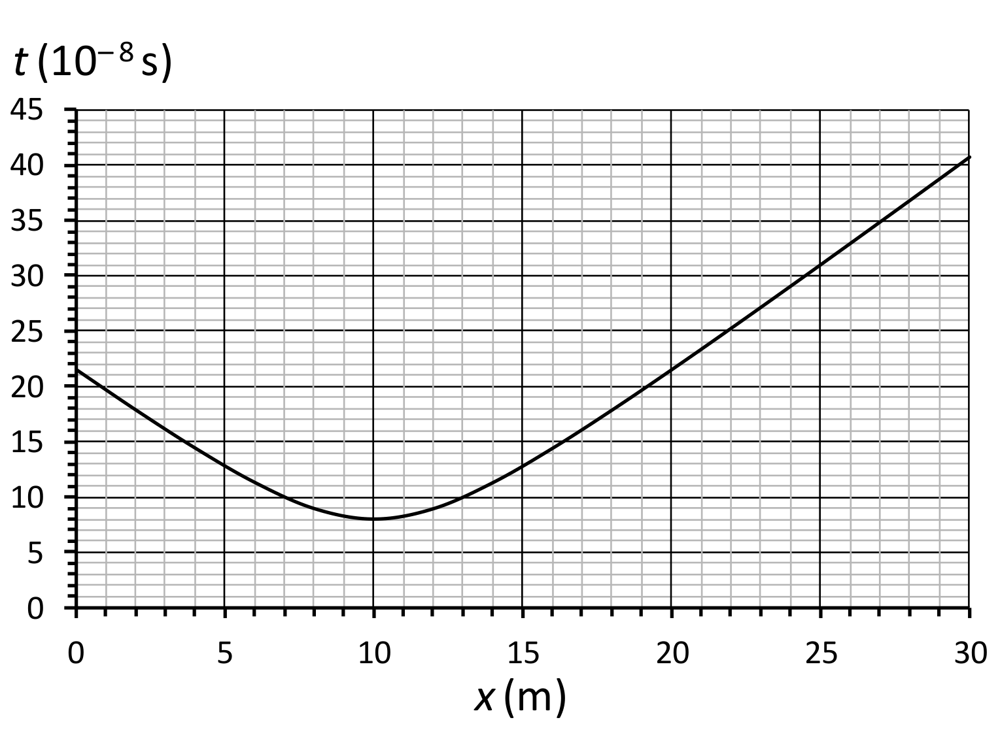
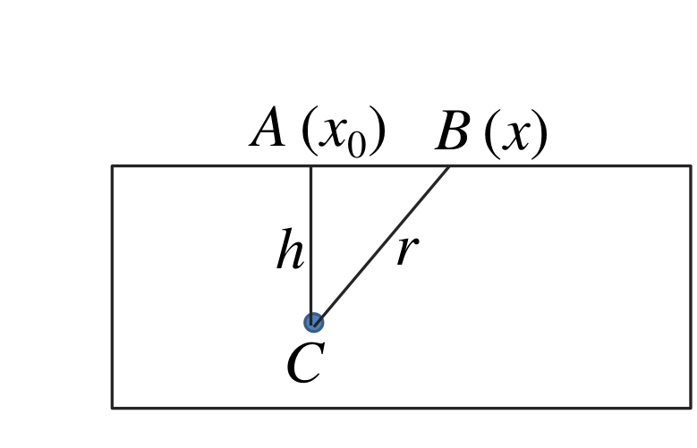
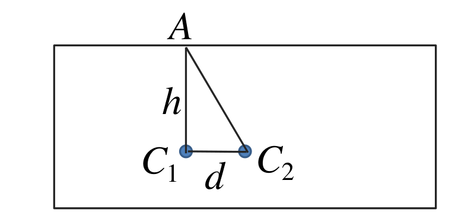

[[Състезания/proletno/10/2018|◂ 2018]] | [[Състезания/proletno/10/2019|условия]] | [[Състезания/proletno/10/2021| 2021 ▸]]

Задача 1. Опити с монета

а) За да замръзне изцяло в леда, монетата трябва да разтопи лед с обем, равен на
обема на монетата. Следователно масата на разтопения лед е:

$$m_1 = \rho_1 S d \qquad [1 \text{ т}]$$

където $S$ е площта на основата на монетата. За разтапянето на тази маса лед е нужно
количество топлина:

$$Q = \lambda m_1 = \lambda \rho_1 S d \qquad [1 \text{ т}]$$

Топлината, нужна за разтапяне на леда, се получава при охлаждането на монетата до
температура $t_0$ = 0$^\circ$С. Следователно:

$$Q = cm(t_1 - t_0) = c\rho S d (t_1 - t_0) \qquad [1 \text{ т}]$$

Оттук получаваме:

$$t_1 = t_0 + \frac{\lambda \rho_1}{c \rho} = \frac{3{,}33\cdot10^5 \text{ J/kg}\cdot 900 \text{ kg/m}^3}{450 \text{ J/(kg.K)}\cdot 7000 \text{ kg/m}^3} \approx 95{,}1^\circ\text{С} \qquad [1 \text{ т}]$$

б) Монетата подскача поради разликата в налягането $p$ на въздуха вътре в бутилката и
налягането $p_0$ на външния въздух. В момента на подскачането се уравновесяват три сили,
действащи по една права – натискът на въздуха в бутилката, насочен нагоре, и силата на
тежестта и натискът на външния въздух, насочени надолу:

$$pS = mg + p_0 S \qquad [1 \text{ т}]$$

Като вземем предвид, че $m = \rho S d$, получаваме:

$$p = \rho g d + p_0 \qquad [1 \text{ т}]$$

Въздухът в бутилката се нагрява до абсолютна температура $T$ при постоянен обем. От
уравнението за изохорен процес имаме:

$$\frac{p}{T} = \frac{p_0}{T_0}, \qquad [1 \text{ т}]$$

където $T_0$ = 293 K е началната абсолютна температура на въздуха в бутилката.

Следователно:

$$p = \frac{p_0 T}{T_0}. \qquad [1 \text{ т}]$$

Като заместим израза за налягането в условието за уравновесяване на силите, получаваме:

$$\frac{p_0 T}{T_0} = \rho g d + p_0, \qquad [1 \text{ т}]$$

откъдето намираме търсеното повишение на температурата на въздуха в бутилката:

$$\Delta T = T - T_0 = \frac{T_0 \rho g d}{p_0} = \frac{293 \text{ K}\cdot 7000 \text{ kg/m}^3\cdot 9{,}8 \text{ m/s}^2\cdot 1{,}35\cdot10^{-3} \text{ m}}{1{,}00\cdot10^5 \text{ Pa}} \approx 0{,}27^\circ\text{С}. \qquad [1 \text{ т}]$$

Задача 2. Земен радар

а) Когато радарът се намира в точка $B$ на разстояние $r$ от кабела $C$, радиосигналът
изминава общ път $s = 2r$ от излъчването до приемането и се движи време:

$$t = \frac{2r}{u}. \qquad [0{,}5 \text{ т}]$$

Сигналът изминава най-кратък път $s_0 = 2h$, когато радарът се намира в т. $A$, вертикално
над кабела, т.е. на разстояние $x_0$ = 10 m от края на двора. В този случай времето на
разпространение е:

$$t_0 = \frac{2h}{u} = 8{,}0\cdot10^{-8} \text{ s}. \qquad [0{,}5 \text{ т}]$$

Нека т. $B$ се намира на разстояние $x$ от края на двора. От Питагоровата теорема следва, че
разстоянието от т. $B$ до кабела е:

$$r = \sqrt{AB^2 + AC^2} = \sqrt{(x - x_0)^2 + h^2}, \qquad [1 \text{ т}]$$

а съответното време за разпространение на сигнала за тази точка е:

$$t = \frac{2\sqrt{(x - x_0)^2 + h^2}}{u}.$$

От получените съотношения следва, че:

$$\frac{t}{t_0} = \frac{\sqrt{(x - x_0)^2 + h^2}}{h} = \sqrt{\left(\frac{x - x_0}{h}\right)^2 + 1}. \qquad [1 \text{ т}]$$

Следователно, ако определим от графиката времето за разпространение $t$ за конкретна
стойност на $x$, можем да намерим дълбочината на кабела:

$$h = \frac{|x - x_0|\, t_0}{\sqrt{t^2 - t_0^2}} = \frac{|x - x_0|}{\sqrt{(t/t_0)^2 - 1}}. \qquad [0{,}5 \text{ т}]$$

Ако разгледаме например точка с координата $x$ = 13 m, от графиката определяме времето
за разпространение: $t$ = 10·10$^{-8}$ s = 10$^{-7}$ s. Тогава за дълбочината намираме:

$$h = \frac{3 \text{ m}\cdot 8\cdot10^{-8} \text{ s}}{6\cdot10^{-8} \text{ s}} = 4{,}0 \text{ m}. \qquad [0{,}5 \text{ т}]$$

За скоростта на радиовълните в почвата съответно намираме:

$$u = \frac{2h}{t_0} = \frac{2\cdot 4{,}0 \text{ m}}{8{,}0\cdot10^{-8} \text{ s}} = 1{,}0\cdot10^8 \text{ m/s}. \qquad [0{,}5 \text{ т}]$$

б) Вълните, отразени от двата кабела ($C_1$ и $C_2$) са кохерентни, защото са породени от една
и съща падаща вълна, излъчена в т. $A$. Двете отразени вълни интерферират, като се
усилват или гасят в дадена точка според разликата в пътищата, които изминават до нея. В
случая приемникът не регистрира отразен сигнал, защото се намира в точка,
съответстваща на интерференчен минимум. [1 т]

Условието за интерференчен минимум е:

$$\Delta = s_2 - s_1 = (k + 1/2)\lambda; \qquad k = 0, \pm 1, \pm 2, \ldots \qquad [1 \text{ т}]$$

където $s_1$ и $s_2$ са пътищата, изминати от двете вълни от излъчвателя до съответния кабел и
обратно до приемника. Както се вижда от фигурата:

$$s_1 = 2|C_1 A| = 2h = 8 \text{ m} \qquad [0{,}5 \text{ т}]$$

и

$$s_2 = 2|C_2 A| = 2\sqrt{h^2 + d^2} \approx 8{,}062 \text{ m}. \qquad [0{,}5 \text{ т}]$$

От друга страна дължината на вълната е свързана с търсената честота на вълната чрез
съотношението:

$$\lambda = u/\nu. \qquad [0{,}5 \text{ т}]$$

От условието за интерференчен минимум намираме възможните стойности на честотата,
при които се наблюдава минимум:

$$\nu = \frac{(2k + 1)u}{2(s_2 - s_1)} = (2k + 1)\times 8{,}06\cdot10^8 \text{ Hz}. \qquad [1 \text{ т}]$$

От условието знаем обаче, че $10^7 \text{ Hz} \le \nu \le 2{,}5\cdot10^9$ Hz. Стойностите на $k$, за които
честотата попада в този интервал, са $k$ = 0 и $k$ = 1. Следователно възможните стойности на
честотата на радара са:

$$\nu_0 \approx 8{,}06\cdot10^8 \text{ Hz (806 MHz)} \text{ и } \nu_1 \approx 2{,}42\cdot10^9 \text{ Hz (2{,}42 GHz)}. \qquad [1 \text{ т}]$$

*За верни се приемат отговори, различаващи се до 5% от посочените.*

Задача 3. Трупчета и пружини

а) Когато трупчетата са отклонени на еднакви разстояния в една и съща посока, средната
пружина не се деформира. [0,5 т] Следователно връщащата сила, действаща на лявото
(дясното) трупче се дължи на деформацията само на лявата (дясната) пружина. Тогава
двете трупчета може да бъдат разглеждани като две невзаимодействащи пружинни махала
с еднакви периоди:

$$T = 2\pi\sqrt{\frac{m}{k}}. \qquad [0{,}5 \text{ т}]$$

От връзката $\nu$ = 1/$T$ следва:

$$\nu = \frac{1}{2\pi}\sqrt{\frac{k}{m}} = \frac{1}{2{,}314}\sqrt{\frac{100 \text{ N/m}}{0{,}1 \text{ kg}}} \approx 5{,}0 \text{ Hz}. \qquad [1 \text{ т}]$$

От закона за запазване на механичната енергия, за кое да е от двете махала, следва:

$$\frac{m v_{\max}^2}{2} = \frac{k x^2}{2}, \qquad [0{,}5 \text{ т}]$$

откъдето намираме:

$$v_{\max} = x\sqrt{\frac{k}{m}} \approx 0{,}32 \text{ m/s}. \qquad [1 \text{ т}]$$

б) Да разгледаме едно от двете трупчета, например лявото. Лявата пружина е свита с
$\Delta l_1 = x$ и следователно действа на трупчето със сила:

$$F_1 = kx, \qquad [0{,}5 \text{ т}]$$

насочена надясно. Тъй като трупчетата са отместени в противоположни посоки на еднакво
разстояние $x$, средната пружина е разтегната с $\Delta l_2 = 2x$ и действа на лявото трупче със
сила:

$$F_2 = 2kx, \qquad [1 \text{ т}]$$

също насочена надясно. Следователно равнодействащата сила, приложена върху лявото
трупче, е:

$$F = F_1 + F_2 = 3kx. \qquad [0{,}5 \text{ т}]$$

Вижда се, че равнодействащата сила удовлетворява закона на Хук, все едно трупчето е
закрепено на пружина с „еквивалентен“ коефициент на еластичност:

$$k_{\text{екв}} = 3k. \qquad [0{,}5 \text{ т}]$$

Следователно трупчето ще трепти хармонично с период:

$$T = 2\pi\sqrt{\frac{m}{k_{\text{екв}}}} = 2\pi\sqrt{\frac{m}{3k}} \qquad [0{,}5 \text{ т}]$$

и съответно с честота:

$$\nu = \frac{1}{2\pi}\sqrt{\frac{3k}{m}} = \frac{1}{2{,}314}\sqrt{\frac{3\cdot 100 \text{ N/m}}{0{,}1 \text{ kg}}} \approx 8{,}7 \text{ Hz}. \qquad [1 \text{ т}]$$

Общата начална потенциална енергия на трите деформирани пружини е:

$$E_{\text{п}} = \frac{kx^2}{2} + \frac{k(2x)^2}{2} + \frac{kx^2}{2} = 3kx^2. \qquad [0{,}5 \text{ т}]$$

Тъй като трупчетата трептят с еднаква честота и съответно еднакъв период, те
едновременно достигат равновесното си положение с максимална скорост. Общата
кинетична енергия на трупчетата в този момент е:

$$E_{\text{к}} = 2\frac{m v_{\max}^2}{2} = m v_{\max}^2. \qquad [0{,}5 \text{ т}]$$

От закона за запазване на енергията следва:

$$m v_{\max}^2 = 3kx^2. \qquad [0{,}5 \text{ т}]$$

Следователно:

$$v_{\max} = x\sqrt{\frac{3k}{m}} \approx 0{,}55 \text{ m/s}. \qquad [1 \text{ т}]$$
