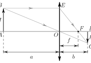
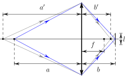

[[Състезания/proletno/10/2019|◂ 2019]] | [[Състезания/proletno/10/2021|условия]] | [[Състезания/proletno/10/2022| 2022 ▸]]

Решение: 1.1. За да докажем връзката между f , a и b, ще използваме подобните
триъгълници 4AOB и 4DOC (фиг. вляво), от които може да получим, че H/a =
h/b. А от подобните триъгълници 4OF E и 4DF C имаме H/f = h/(b - f ). От

 B E a' b'

 H
 F D
 l
 A O h f
 f
 C
 a b a b

последните две съотношения изключваме H и h и получаваме $\frac{1}{f} = \frac{1}{a} + \frac{1}{b}$. (1 т.)
Решение: 1.2. Разстоянието между лещата на обектива и лентата може да се
изрази чрез увеличението на образа: b = ah/H $= 250 \cdot 24 / 96 \text{mm}$ = 62.5 mm. (0.5 т.)
Решение: 1.3. Фокусното разстояние е f = ab/(a+b) $= 250 \cdot 62.5 /( 250 + 62.5) \text{mm}$ =
50 mm. (1 т.)
Решение: 1.4. Ако преместим жичката с 5 cm назад, тя ще се намира на разстояние
$a_0$ = (25 + 5) cm = 30 cm от лещата, тогава образът ѝ ще се намира на разстояние
$b_0$ = $a_0$ f /($a_0$ - f ) = 60 mm зад лещата. (0.5 т.) Нека диаметърът на апертурата е D,
а ширината на образа върху филма е l (виж фигурата горе вдясно), тогава имаме
следната връзка $D / b_0$ = l/(b - $b_0$ ), (1.5 т.) откъдето за диаметъра на апертурата
получаваме D = $b_0$ l/(b - $b_0$ ) = 60 $\cdot$ 1.5/(62.5 - 60) mm = 36 mm. (0.5 т.)
Решение: 1.5. Относителната апертура е $f / D \approx 1.4$. (0.5 т.)
Решение: 1.6. За да изразим $\Delta$a като функция на a, D, f и d, ще разгледаме точков
източник, който е фокусиран когато се намира на разстояние a пред обектива.
Както видяхме в подусловие 1.4. когато преместим източника на разстояние $a_0$ > a
точката ще се фокусира пред лентата, а върху лентата ще се вижда петно с
определен диаметър. Когато преместим източника на разстояние $a_00$ < a образът
ѝ ще се фокусира зад лентата и отново ще виждаме петно с краен размер. Нека
подберем разстоянията $a_0$ и $a_00$ такива, че и в двата случая диаметърът на петното,
което се вижда на лентата, не превишава d. В този случай дълбочината на фокуса
ще е $\Delta$a $= a_0$ $- a_00$ . За определянето на $a_0$ може да използваме подусловие 1.4.,
където вместо l ще използваме d. Така може да запишем: d/D $= b / b_0$ - 1, където
b = af /(a - f ), а $b_0$ = $a_0$ f /($a_0$ - f ). Изключвайки b и $b_0$ от последните равенства за
$a_0$ получаваме:
 af D
 $a_0$ = . (1 т.)
 f D - (a - f )d
 стр. 1 от 4
Аналогично може да запишем d/D = 1 $- b / b_00$ , (0.5 т.) където $b_00$ = $a_00$ f /($a_00$ - f )
или:
 af D
 $a_00$ = . (1 т.)
 f D + (a - f )d
Окончателно за дълбочината на фокуса се получава:

 2af D(a - f )d 2af D(a - f )d 2a(a - f )d
 $\Delta$a $= a_0$ $- a_00$ $= \approx$ = , (1 т.)
 (f D)2 - (a $- f) 2 d_2( f D$)2 fD

 2 $\cdot$ 250(250 - 50) $\cdot$ 0.03
 $\Delta$a $= \text{mm} \approx 6.7 \text{mm}$. (0.5 т.)
 $50 \cdot 9$

Решение: 2.1. До момента на срещата децата се движат едно и също време tкр .
(0.3 т.) Първото дете изминава път $s_1$ $= v_1 t$кр , (0.2 т.) а второто път $s_2$ $= v_2 t$кр ,
(0.2 т.) като $s_1$ $+ s_2$ = 2($d_1$ + $d_2$ ). (0.3 т.) Така може да получим $s_1$ = 2($d_1$ +
$d_2) v_1 /( v_1$ + $v_2$ ) $= 2 \cdot 9.5 \cdot 1 / 2.5 m$ = 7.6 m. (0.5 т.) Оста Ox е ориентирана по стената
$d_1$ , тогава координатите на срещата ще са xкр $= d_1$ = 5 m и yкр $= s_1$ $- d_1$ = 2.6 m.
(0.5 т.)
Решение: 2.2. Дължината на ластика L се определя от положенията на децата.
Нека означим координатите на първото дете с (x1 , $y_1$ ), а на p второто с (x2 , $y_2$ ). От
Питагоровата теорема за L може да запишем, че L = (x2 - x1 )2 + ($y_2$ - $y_1$ )2 .
(0.5 т.)
 Да разгледаме моментите от време, в които става промяна на начина, по който
се изменят координатите на децата. Второто дете се движи с по-голяма скорост и
първоначално е до по-късата стена, т.е. то ще стигне първо до съседния му ъгъл с
координати (0, $d_2$ ) в момента $t_1$ $= d_2 / v_2$ = 3.0 s. Първото дете ще стигне съседния
му ъгъл с координати ($d_1$ , 0) в момента $t_2$ $= d_1 / v_1$ = 5.0 s. Второто дете ще стигне
в ($d_1$ , $d_2$ ) в момента $t_3$ = ($d_2$ + $d_1$ )/$v_2$ = 19/3 s = 6.3 s. Двете деца ще се срещнат в
т. (xкр , yкр ) в момента tкр $= s_1 / v_1$ = 7.6 s. От всичко това L(t) може да се запише
по следния начин:

$$L(t) = \left\{
\begin{array}{ll}
\sqrt{(v_1 t)^2 + (v_2 t)^2} = t \sqrt{v_1^2 + v_2^2}, & t \in [0, t_1); \quad \mathbf{(0.5 \, \text{т.})} \\
\sqrt{(v_2 t - d_2 - v_1 t)^2 + d_2^2}, & t \in [t_1, t_2); \quad \mathbf{(0.5 \, \text{т.})} \\
\sqrt{(v_2 t - d_2 - d_1)^2 + (d_2 - v_1 t + d_1)^2}, & t \in [t_2, t_3); \quad \mathbf{(0.5 \, \text{т.})} \\
\sqrt{[d_2 - (v_2 t - d_2 - d_1) - (v_1 t - d_1)]^2} = |2(d_1 + d_2) - (v_1 + v_2)t|, & t \in [t_3, t_{\text{кр}}]. \quad \mathbf{(0.5 \, \text{т.})}
\end{array}
\right.$$

$$L(t) = \left\{
\begin{array}{ll}
1.8t, & t \in [0.0, 3.0) \, \text{s}; \quad \mathbf{(0.5 \, \text{т.})} \\
\sqrt{0.25 t^2 - 4.5t + 40.5}, & t \in [3.0, 5.0); \quad \mathbf{(0.5 \, \text{т.})} \\
\sqrt{3.25 t^2 - 47.5t + 180.5}, & t \in [5.0, 6.3); \quad \mathbf{(0.5 \, \text{т.})} \\
19 - 2.5t, & t \in [6.3, 7.6]. \quad \mathbf{(0.5 \, \text{т.})}
\end{array}
\right.$$

Решение: 2.3. От предното подусловие се вижда, че дължината на ластика нарас-
тва линейно с времето през първите три секунди. След това $L_2$ (t) е квадратична
функция от вида a$t_2$ + bt + c. При a > 0 функцията е намаляваща в интервала
 b b
 -$\infty$, - 2a . (1 т.) В конкретния случай - 2a = 9 s, така че в интервала t $\in$ [3.0, 5.0)
$L_2$ (t) ще намалява, съответно L(t) също ще намалява. (1 т.) Така максималната
дължина на ластика ще е при t = tm = 3 s, а Lm = 1.8tm = 5.4 m. (1.5 т.)

Решение: 3.1. Тяло 2 има по-голям обем в сравнение с тяло 1, така че на него
ще му действа по-голяма изтласкваща сила и теглото му ще намалее повече в
сравнение с това на тяло 1. (0.5 т.) Тъй като телата все още са закачени в краищата
на лоста, то тяло 2 ще се вдигне нагоре, а тяло 1 ще падна надолу, тоест лостът се
завърта по посока на часовниковата стрелка. (0.5 т.)
Решение: 3.2. Да въведем следните означения:

$P_1$ - теглото на тяло 1 във въздух;

$P_2$ - теглото на тяло 2 във въздух;

P - теглото на изместената от тяло 1 вода;

$l_1$ - разстояние от тялото 1 до опорната точка, когато лостът е във въздуха;

$l_2$ - разстояние от тялото 2 до опорната точка, когато лостът е във въздуха;

$d_1$ - разстояние от тялото 1 до опорната точка, когато лостът е във водата.

По условие знаем, че ако потопим тяло 1 във вода то теглото му $P_1$ ще намелее
с 14.1%. От друга страна, това е теглото на изместената от тялото вода или
P $= 0.141 P_1$ = mв g = $\rho$в $V_1 g$, откъдето за теглото на тяло 1 получаваме

 $P_1$ = $\rho$в $V_1 g / 0.141$ $=( 1000 \cdot 200\cdot 10^{-6} \cdot 10 / 0.141) N \approx 14.2 N$. (1 т.)

При уравновесен във въздуха лост може да запишем, че $P_1 l_1$ $= P_2 \text{l}^{2}$ . (0.5 т.) От
тук може да изразим теглото на тяло 2, за което получаваме

 $P_2$ $= P_1 l_1 / \text{l}^{2}$ $=( 14.2 \cdot 0.7 / 1) N$ = 9.9 N,(0.5 т.)

съответно масите на телата са

 $m_1$ = $\rho$в V1 /0.141 $\approx$ 1.42 kg (0.5 т.) и $m_2$ = $\rho$в $V_1 g$$l_1 /( 0.141 \text{l}^{2}) \approx 0.99 \text{kg}$. (0.5 т.)

Когато лостът е уравновесен във вода имаме:

 (P1 - P )d1 = (P2 - 3P )l2 . (1 т.)

След като вече знаем теглата на двете тела, от горното равенство може да изразим
$d_1$ , а разстоянието d може да получим, като $l_1$ $- d_1$

 d $= l_1$ - (P2 $- 3 P) \text{l}^{2} /( P_1$ - P ) $\approx$ 0.38 m. (0.5 т.)

 стр. 3 от 4
Решение: 3.3. Нека означим дължината на лоста с l $= l_1$ $+ l_2$ . В десния край
на лоста ще действа сила $P_1$ , а в левия сила $P_2$ $- P_3 / 2$, тъй като тяло 3 е зака-
чено на подвижната макара. (1.5 т.) За да е в равновесие лостът трябва да е
изпълнено следното условие (P2 - P3 /2)x = P1 (l - x), (0.5 т.) откъдето определяме
разстоянието x
 x = P1 l/(P1 $+ P_2$ $- P_3 / 2) \approx 1.15 m( 0.5$ т.)

Решение: 3.4. Може да разгледаме "тежкия" лост като лост с пренебрежима
маса, в центъра на който е закачено тяло с маса равна на масата на лоста и тегло
P л = 6.8 N. (0.5 т.) Да разгледаме два случая. В първия случай опорната точка
се намира по-близо до десния край, на разстояние x от центъра на лоста. При
равновесие ще е изпълнено: P1 (l/2 - x) = P3 (l/2 + x) + Pл x откъдето получаваме:
x = (P1 $- P_3) l /( P_1$ $+ P_3$ + Pл ) = 0.5 m. Във втория случай опорната точка ще е по-
близо до левия край на лоста: P1 (l/2 + x) + Pл x = P3 (l/2 - x) откъдето получаваме:
x = -(P1 $- P_3) l /( P_1$ $+ P_3$ + Pл ) което е отрицателно число, т.е. опорната точка не
може да бъде от тази страна на лоста. (1.5 т.)

 стр. 4 от 4
