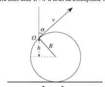

[[Състезания/proletno/11/2009|◂ 2009]] | [[Състезания/proletno/11/2010|условия]] | [[Състезания/proletno/11/2011| 2011 ▸]]

Задача 1. Велосипед в калта

а) Задното колело на велосипеда винаги се насочва към мястото, където предното колело
докосва земята. Ето защо допирателната към следата, оставена от задното колело, винаги ще
преминава през следата на предното колело на велосипеда. Докато предното колело на
велосипеда не проявява тази геометрична собственост. Имайки предвид горното съждение, не е
трудно да се убедим, че плътната следа е оставена от предното колело, а пунктираната
следа е оставена от задното колело на велосипеда. \[3т\]

б) Знаейки вече, че пунктираната следа е оставена от задното колело, можем да изберем две
произволни точки върху пунктираната следа и да прекараме допирателна през тях, както е
показано на Фигура 1. Понеже разстоянието между двете колела (BC,EF) остава постоянно, то от
Фигура 1 лесно се вижда, че посоката на движение на велосипеда е от ляво на дясно
(показана е със стрелки на Фигура 1) \[3т\]

 Фигура 1

в) Кал, отделяща се от различни точки на задното колело, ще достигне до различни височини, в
зависимост от първоначалната височина R + h и ъгъл на изхвърляне $\alpha$ (виж Фигура 2).

 Фигура 2

Записвайки закона за запазване на енергията имаме:

$$mg h_0 = \frac{mv^2}{2}\cos^2\alpha \Rightarrow h_0 = \frac{v^2}{2g}\cos^2\alpha,$$

където $h_0$ е височината, на която излита калта над точката O. Височината, на която се издига
калта спрямо земята е

$$H = R + h + h_0 = R + R\sin\alpha + \frac{v^2}{2g}\cos^2\alpha.$$

Оттук задачата може да се реши по два начина:

Начин 1. (решение без използване на производни)

Функцията $H = R + R\sin\alpha + \frac{v^2}{2g}\cos^2\alpha$ разписваме като $H = R + R\sin\alpha + \frac{v^2}{2g}(1 - \sin^2\alpha)$, което
уравнение е квадратично спрямо $\sin\alpha$. Тогава максималната височина на издигане се достига
при $\sin\alpha_0 = \frac{Rg}{v^2}$ и тя е:

$$H = R + R\sin\alpha_0 + \frac{v^2}{2g}(1 - \sin^2\alpha_0) = R + \frac{v^2}{2g} + \frac{gR^2}{2v^2} \quad \text{[2т]}$$

Имаме и друго максимално решение на уравнението $H = R + R\sin\alpha + \frac{v^2}{2g}(1 - \sin^2\alpha)$, и това е
случаят, в който квадратното уравнение се редуцира до линейно уравнение ($\alpha = \pi/2$). Този
случай отговаря на максимална височина на издигане H = 2R \[2т\] само когато $v^2 \leq gR$.

Начин 2. (решение с използване на производни)

Функцията $H = R + R\sin\alpha + \frac{v^2}{2g}\cos^2\alpha$ изследваме за максимум, като за целта търсим ъглите $\alpha$,
при които:

$$\frac{dH}{d\alpha} = 0 \Rightarrow R\cos\alpha - \frac{v^2}{g}\sin\alpha\cos\alpha = 0.$$

Имаме две решения за горното уравнение. Първото решение е $\cos\alpha = 0$ ($\alpha = \pi/2$). Този случай
отговаря на максимална височина на издигане H = 2R \[2т\] само когато $v^2 \leq gR$ (понеже тогава
имаме $\frac{d^2H}{d\alpha^2} < 0$). Ако $v^2 > gR$, то максималното решение се дава от другото решение:

$\sin\alpha_0 = \frac{Rg}{v^2}$ и тогава максималната височина на издигане спрямо земята е:

$$H = R + R\sin\alpha_0 + \frac{v^2}{2g}(1 - \sin^2\alpha_0) = R + \frac{v^2}{2g} + \frac{gR^2}{2v^2} \quad \text{[2т]}$$

Задача 2. Фотоелектричен ефект

а) Електрони няма да се излъчват от катода когато: работата, необходима да се избие електрон от
повърхността на метала (A) е по-голяма от енергията, която електронът получава при
поглъщането на фотон. Тогава граничната дължина, при която все още ще имаме излъчени
електрони, определяме от уравнението на Айнщайн за фотоефекта:

$$0 = \frac{hc}{\lambda_0} - A \quad \text{[0.5т]} \Rightarrow \lambda_0 = \frac{hc}{A} \quad \text{[1т]}$$

б) Максималната скорост, с която фотоелектроните напускат катода се определя от уравнението
на Айнщайн за фотоефекта:

$$\frac{mV_1^2}{2} = \frac{hc}{\lambda} - A \quad \text{[0.5т]}$$

където m е масата на електрона, h е константата на Планк, c е скоростта на светлината във
вакуум $\Rightarrow$

$$V_1 = \sqrt{\frac{2hc}{\lambda m} - \frac{2A}{m}} \quad \text{[1т]}$$

в) Максималната скорост, с която електроните удрят анода, можем да изразим лесно от Закона за
запазване на енергията, приложен за потенциалната разлика между двата електрода:

$$\frac{mV_2^2}{2} - \frac{mV_1^2}{2} = eU \quad \text{[1т]} \Rightarrow V_2 = \sqrt{\frac{hc}{2\lambda m} - \frac{A}{2m} + \frac{eU}{2m}} \quad \text{[2т]}$$

г) Радиусът на петното, в което попадат електроните върху анода, се определя от електроните,
чиято скорост при излъчването от катода е успоредна на повърхността на катода. Времето T за
полет на такива електрони от катода до анода е равно на:

$$T = \sqrt{\frac{2L}{a}} \quad \text{[1т]}$$

където a е ускорението на електроните между двата електрода и се дава с:

$$a = \frac{eE}{m} = \frac{eU}{mL} \quad \text{[1т]}.$$

Тогава радиусът на петното върху анода, образуван от електроните, е:

$$R = V_1 T = 2L\sqrt{\frac{hc}{\lambda eU} - \frac{A}{eU}} \quad \text{[2т]}$$

Задача 3. Мънисто върху тел

а) Понеже няма триене между мънистото и телта, то енергията се запазва $\Rightarrow$

$$mgy_0 = \frac{mv^2}{2} + mgy \Rightarrow v = \sqrt{2g(y_0 - y)}.$$

$\Rightarrow$ за най-ниската точка от пътя си (x = 0, y = 0), топчето ще има скорост $v = \sqrt{2gy_0}$ \[2т\]

б) Скоростта v на мънистото е винаги насочена по допирателната към телта, тоест допирателна
към окръжността, която се дава с функцията $(y - R)^2 + x^2 = R^2$ $\Rightarrow$ можем да разложим v на две
компоненти $v_y$ и $v_x$ по следния начин:

$$v_y = v\sin\alpha, \qquad v_x = v\cos\alpha,$$

където $\sin\alpha = \frac{\sqrt{2Ry - y^2}}{R}$ и $\cos\alpha = \frac{R-y}{R}$ $\Rightarrow$

$$v_y = \sqrt{\frac{2g}{R^2}(y_0 - y)(2Ry - y^2)} \quad \text{[2т]}$$

$$v_x = \frac{(R-y)}{R}\sqrt{2g(y_0 - y)} \quad \text{[2т]}$$

в) Когато телта се върти, то енергията на топчето е:

$$E = mgy - \frac{m\omega^2 x^2}{2} = mgy - \frac{m\omega^2}{2}(2yR - y^2).$$

Това е квадратично уравнение по y и $\Rightarrow$ устойчивото равновесно положение е в минимума на
параболата:

$$y_0 = R - \frac{g}{\omega^2} \quad \text{[2т]}$$

$$x_0 = \sqrt{2Ry_0 - y_0^2} = \sqrt{R^2 - \frac{g^2}{\omega^4}} \quad \text{[2т]}$$

