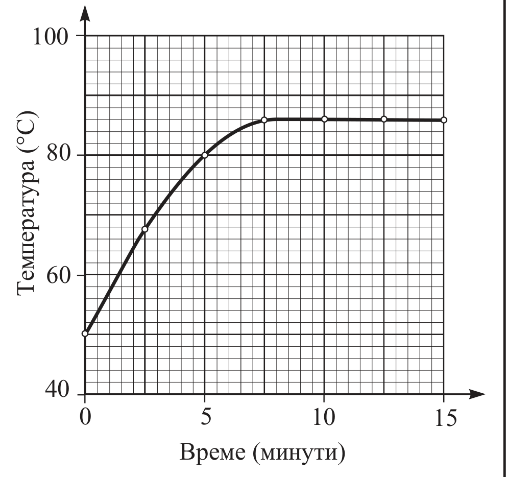
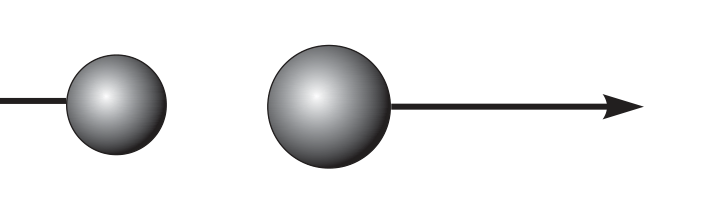
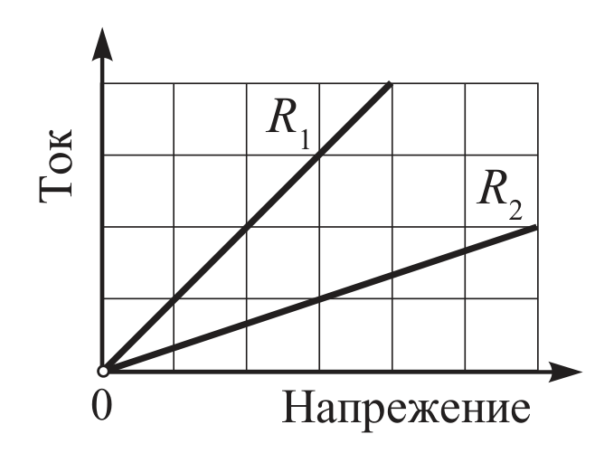
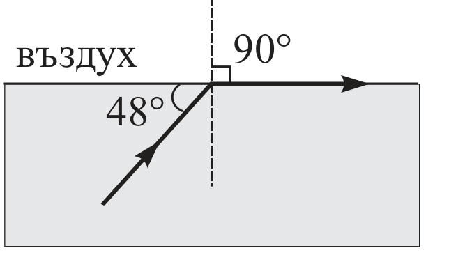
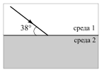
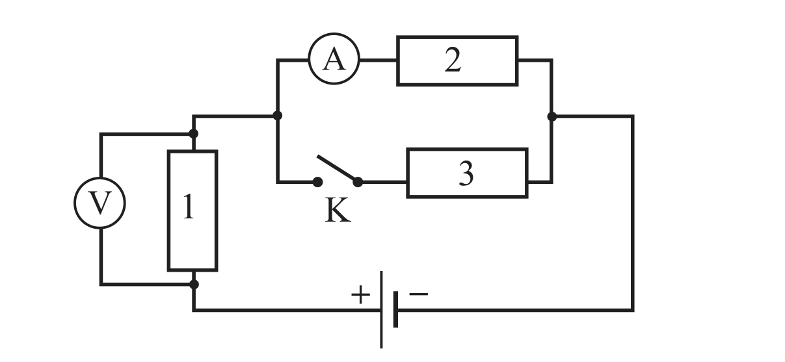

[[Състезания/proletno/7r/2010|решения]] | [[Състезания/proletno/7/2011| 2011 ▸]]

Задача 1. Тест (Посочете верния отговор. Всеки верен отговор се оценява с 1 точка.)

1. Разстоянието между две станции на метрото е 1800 m. С каква постоянна скорост трябва да се движи влакът, за да измине това разстояние за 3 минути?
   а) 24 km/h    б) 36 km/h    в) 42 km/h    г) 54 km/h

2. Масата на 5 литра атмосферен въздух е 6 g. Колко е плътността на въздуха?
   а) 12 kg/m³    б) 3 kg/m³    в) 0,3 kg/m³    г) 1,2 kg/m³

3. Графиката показва как се изменя температурата на течност при нагряване. Колко е температурата на кипене на течността?
   а) 50 °C    б) 83 °C    в) 86 °C    г) 100 °C

4. Дифузията се дължи на:
   а) движението на молекулите    б) действието на архимедова сила
   в) действието на силата на тежестта    г) температурното разширение на газовете и течностите

5. Когато дървено трупче плава във вода, водата му действа с изтласкваща сила 1 N. Колко е изтласкващата сила, ако трупчето плава в течност, чиято плътност е с 20% по-голяма от плътността на водата?
   а) 0,8 N    б) 1 N    в) 1,2 N    г) 1,4 N

6. Книга е поставена върху хоризонтална опора. Силата, с която книгата натиска опората, се нарича:
   а) тегло на книгата    б) налягане на книгата
   в) сила на тежестта на книгата    г) сила на реакция на опората

7. Две еднородни кубчета с ръб $a$ и $2a$ са направени от един и същ материал. Кубчетата са поставени едно до друго върху хоризонтална опора. Налягането на малкото кубче върху опората е $p$. Колко е налягането на голямото кубче върху опората?
   а) $p$    б) $2p$    в) $4p$    г) $8p$

8. Върху топчетата от схемата са приложени две сили с еднакви големини и противоположни посоки. Уравновесяват ли се тези сили?

   а) да, защото са с еднакви големини    б) да, защото са с противоположни посоки
   в) не, защото са приложени към различни тела    г) не, защото топчетата имат различни маси

9. На графиката е показана зависимостта на тока от напрежението за два проводника. Първият проводник е със съпротивление $R_1 = 3\ \Omega$. Колко е съпротивлението $R_2$ на втория проводник?

   а) 1 Ω    б) 3 Ω    в) 6 Ω    г) 9 Ω

10. На фигурата е показан ходът на светлинен лъч в стъклена пластинка. Колко е граничният ъгъл на пълно вътрешно отражение на границата стъкло–въздух?

   а) 138°    б) 90°    в) 48°    г) 42°

Задача 2. Задача „три в едно“. (Трите части на задачата са независими.)

2.1. На фигурата е показан светлинен лъч, който пада върху плоската граница на две прозрачни среди. Наблюдават се явленията отражение и пречупване на светлината.
Начертайте хода на отразения и на пречупения лъч, ако е известно, че двата лъча са взаимно перпендикулярни. Определете ъглите на падане, отражение и пречупване. В коя от двете среди светлината се разпространява с по-голяма скорост? Обяснете. (3 точки)

2.2. Между двата края на проводник е приложено напрежение $U = 5$ V. Колко електроенергия $E$ се преобразува в топлинна енергия, когато през проводника премине заряд $q = 10$ C? (3 точки)

2.3. Консуматори със съпротивление $R$ и $nR$ са свързани последователно към батерия. Колко пъти ще се увеличи токът през батерията, ако двата консуматора се свържат успоредно?
Начертайте схеми. (4 точки)

Задача 3. Електрическа верига

Напрежението на източника от електрическата верига, показана на фигурата, е $U = 120$ V. Съпротивленията на консуматорите 1 и 2 са $R_1 = 20\ \Omega$ и $R_2 = 60\ \Omega$. Ключът K е отворен.

а) Колко ампера е токът $I$, който измерва амперметърът? (2 точки)

б) Колко волта е напрежението $U_1$, което измерва волтметърът? (1 точка)
   При затворен ключ K амперметърът измерва ток $I_2 = 1$ A.

в) Колко волта е напрежението $U_1$, което измерва волтметърът при затворен ключ K? (2 точки)

г) Колко ома е съпротивлението $R_3$ на консуматор 3? (3 точки)

д) Колко пъти електричната мощност $P$, която се консумира от цялата верига при затворен ключ K, е по-голяма от мощността $P_0$, консумирана от веригата при отворен ключ K? (2 точки)
