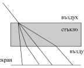
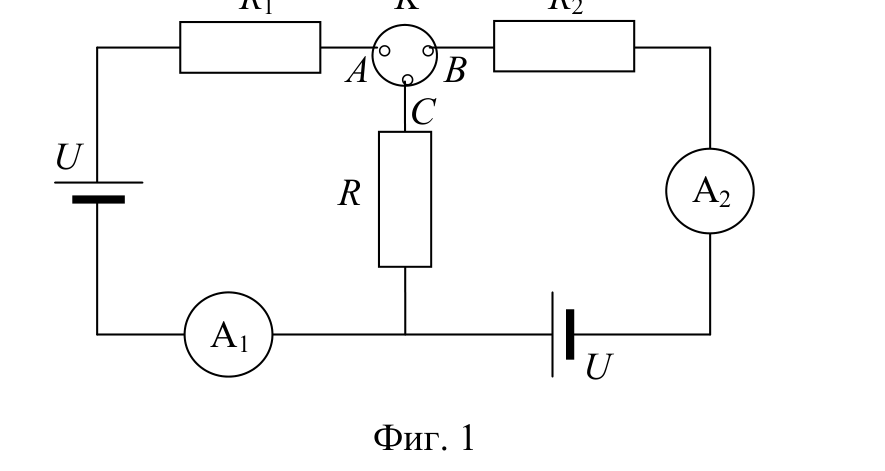
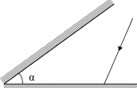
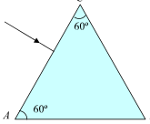

[[Състезания/proletno/7/2012|◂ 2012]] | [[Състезания/proletno/7r/2013|решения]] | [[Състезания/proletno/7/2014| 2014 ▸]]

Задача 1. Тест
1. След претегляне със силомер се установява, че две тела имат еднакво тегло.

Кой от следните изводи е верен?

 А) Телата имат еднаква плътност.

 Б) Телата имат еднакъв обем.

 В) Телата имат еднаква маса.

 Г) Телата имат еднаква форма

2. Върху хоризонтална опора са поставени три кубчета с еднакви маси -
алуминиево (1), желязно (2) и дървено (3). С кое съотношение са свързани
наляганията им върху опората ?

А) $p_1 > p_2 > p_3$

Б) $p_3 > p_2 > p_1$

В) $p_2 > p_3 > p_1$

Г) $p_2 > p_1 > p_3$

3. В съд с течност, чиято плътност е $\rho$, има две тела с плътности съответно $\rho_1$ и
$\rho_2$ . При какво условие тялото 1 плава, а тялото 2 е на дъното на съда?

 А) $\rho_1$ > $\rho_2$ > $\rho$

 Б) $\rho$ > $\rho_2$ > $\rho_1$

 В) $\rho_1$ < $\rho$ < $\rho_2$

 Г) $\rho_2$ < $\rho$ < $\rho_1$

4. Какъв вид енергия преобразуват акумулаторите в електроенергия?

 А) енергия на движение

 Б) светлинна енергия

 В) химична енергия

 Г) топлинна енергия

5. Как ще се промени токът в електрическа верига, когато увеличим
напрежението 3 пъти, а съпротивлението на веригата намалим 2 пъти?

 А) Ще се увеличи 6 пъти.

 Б) Ще се увеличи 3 пъти.

 В) Ще се увеличи 1,5 пъти.

Г) Ще се намали 1,5 пъти.

6. Еквивалентното съпротивление на участъка АВ е 240 $\Omega$. Колко е
съпротивлението $R_1$ на първия проводник?

(проводниците имат съпротивления $R_1 = 4R$ и $R_2 = 6R$, свързани успоредно между точките A и B)

А) 40 $\Omega$

Б) 96 $\Omega$

В) 144 $\Omega$

Г) 400 $\Omega$

7. Колко е отношението $R_1$ $/ R_2$ между съпротивленията на лампите?

(ламбите с мощности $P_1 = 40\text{ W}$ и $P_2 = 60\text{ W}$ са свързани успоредно към източник на напрежение U)

А) 9 / 4

Б) 3 / 2

В) 2 / 3

Г) 4 / 9

8. Два последователно свързани консуматора със съпротивления
$R_1$ = 20 $\Omega$ и $R_2$ = 60 $\Omega$ са включени към източник на напрежение. Напрежението
в краищата на първия консуматор е 80 V. Колко е токът през втория
консуматор?

 А) 1 А Б) 1,3 А

 В) 4 А Г) 5,3 А

9. Какво количество електроенергия изразходва поялник с мощност 1,2 kW за 5
минути?

 А) 6 kWh Б) 1 kWh

 В) 0,24 kWh Г) 0,1 kWh

10. В коя точка от екрана ще попадне светлинният лъч след пречупване от
стъклената пластина?

А) т. А. Б) т. B. В) т. C. Г) т. D.

Всеки правилен отговор се оценява с 1 точка.

Задача 2. Електрическа верига
На фиг. 1 е показана схема на електрическа верига, в която резисторите имат
съпротивления $R_1$ = 100 $\Omega$ , $R_2$ = 40 $\Omega$ , а съпротивлението R е неизвестно.

Двата източника във веригата имат едно и също напрежение U. Когато ключът
K е поставен в положение, което свързва точките А и С, амперметърът 1 отчита
ток $I_1$ = 0,15 A . При положение на ключа K, когато той свързва точките В и С,
амперметърът 2 отчита ток I 2 = 0,25 A .

 а) Определете съпротивлението R . \[3,5 т.\]

 б) Намерете напрежението U. \[1 т.\]

 в) Какви ще са показанията на амперметрите 1 и 2 при положение на
ключа K, когато той свързва точките А и В? \[3 т.\]

 г) Сравнете отношенията на мощностите на резисторите $P_1$ / P и $P_2$ / P
при първите две положения на ключа K. Зависят ли тези отношения от
напрежението на източниците? \[2,5 т.\]

Задача 3. Отражение на светлината (задачите А и Б са независими)

А) Две отразяващи равнини образуват ъгъл $\alpha$ (фиг. 2). Върху едната от тях пада
лъч, който лежи в равнина (равнината на листа), перпендикулярна на ръба на
ъгъла.

Фиг. 2

а) Начертайте хода на лъча, изпитващ еднократно отражение от двете
равнини. \[2 т.\]

 б) Намерете ъгъла $\varphi$ , който сключват посоката на падащия лъч и
посоката на отразения от двете равнини лъч. \[4 т.\]

Б) Върху стената AC на правилна стъклена призма пада перпендикулярно
светлинен лъч (фиг. 3). Граничият ъгъл на пълно вътрешно отражение на
границата стъкло - въздух е $\alpha_{гр} = 45^\circ$. Начертайте хода на лъча и определете
през коя от стените и под какъв ъгъл той ще напусне призмата. Обосновете
отговора си. \[4 т.\]

Фиг. 3
Лист за отговори на теста

|  | А | Б | В | Г |
|---|---|---|---|---|
| 1 |  |  |  |  |
| 2 |  |  |  |  |
| 3 |  |  |  |  |
| 4 |  |  |  |  |
| 5 |  |  |  |  |
| 6 |  |  |  |  |
| 7 |  |  |  |  |
| 8 |  |  |  |  |
| 9 |  |  |  |  |
| 10 |  |  |  |  |

Верният отговор се загражда с кръгче.

Не се допуска поправка на отбелязан вече отговор!
