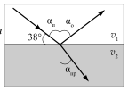

[[Състезания/proletno/7/2006|◂ 2006]] | [[Състезания/proletno/7/2010|условия]] | [[Състезания/proletno/7/2011| 2011 ▸]]

Задача 1. Верни отговори на тестовите задачи. Еквивалентното съпротивление при успо-
 редно свързване е
 1 2 3 4 5 6 7 8 9 10 1 1 1 nR .
  ; $R_2$ 
 б г в а б а б в г г $R_2 R n$R $n_1$

 През батерията тече ток

Задача 2. $I_2$ 

 U (n 1)U ...............................1 точка
 
2.1. За правилен $\alpha$п $\alpha$о $R_2 n$R
чертеж .......1 точка $v_1$ Търсеното отношение на токовете е
 38$^\circ$

 I 2 (n 1)2
 $v_2$  .......................................1 точка
 $I_1 n$
 $\alpha$пр
 U

 Задача 3. а) I   1, 5 A. ........... 2 точки
 $R_1 R_2$
 $\alpha$п = 90$^\circ$ - 38$^\circ$ = 52$^\circ$ .......................0,5 точки

 б) $U_1$ = $R_1$I = 30 V..............................1 точка
 $\alpha$о = $\alpha$п = 52$^\circ$ ....................................0,5 точки
 $\alpha$пр = 90$^\circ$ - $\alpha$о = 38$^\circ$ .........................0,5 точки в) Напрежението върху двата успоредно
 Пречупеният лъч се приближава към пер- свързани консуматора е
пендикуляра ($\alpha$пр< $\alpha$п), което показва, че свет- $U_2$ $= R_2 I_2$ = 60 V.................................1 точка
лината навлиза в оптически по-плътна среда, Волтметърът измерва напрежението върху
където се разпространява с по-малка скорост консуматор 1, което е
($v_2$ < $v_1$)................................................ 0,5 точки $U_1$ = U $- U_2$ = 60 V............................1 точка
2.2. Преобразуваната електроенергия може да г) Токът през консуматор 1 е

се изрази с формулата E = UIt.............1 точка $U_1$
 $I_1 3 A$. ..................................... 1 точка
 Електричният заряд, преминал по проводни- $R_1$
ка за време t, e q = It..............................1 точка Токът през консуматор 3 е
 Заместваме It във формулата за E и получа- $I_3$ $= I_1$ $- I_2$ = 2 A..................................1 точка
ваме E = Uq = (5 V)(10 C) = 50 J..........1 точка Съпротивлението му е
 $U_2$
 $R_3 30 7$. ................................... 1 точка
2.3. $I_3$

 д) При отворен ключ от източника се
 черпи ток I = 1,5 А, а при затворен ключ - два
 U U пъти по-голям ток ($I_1$ = 3 A). Следователно
 консумираната мощност P = UI след затваряне
последователно свърз- успоредно свързване на ключа нараства 2 пъти......................2 точки
ване ............0,5 точки ..................0,5 точки До същия извод стигаме, ако пресметнем
 Еквивалентното съпротивление при после- еквивалентното съпротивление на веригата с
дователно свързване е отворен ключ (80 $\Omega$) и със затворен ключ (40 $\Omega$).

 $R_1$ = R + nR = (n + 1)R. Еквивалентното съпротивление R намалява
 През батерията тече ток 2 пъти. Следователно консумираната от
 $U U U_2$

 I   .....................1 точка веригата мощност P  нараства 2 пъти.
 1
 $R_1( n 1) R R$
