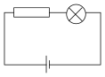
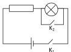
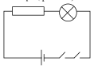
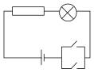

[[Състезания/proletno/7/2010|◂ 2010]] | [[Състезания/proletno/7/2011|условия]] | [[Състезания/proletno/7/2012| 2012 ▸]]

Задача 1. а) От закона на Джаул-Ленц имаме:

$P_0 = \frac{U_0^2}{R_0}$ , \[1 т\]
откъдето намираме:

$R_0 = \frac{U_0^2}{P_0} = 10 \Omega$ . \[1 т\]

б) Ако лампата и резисторът са свързани успоредно, напрежението върху лампата ще бъде 12 V и тя ще изгори. Следователно лампата и резисторът трябва да са свързани
последователно. \[1 т\]

За правилно нарисувана схема \[1 т\] Фиг. 1.1

При нормална работа през лампата тече ток:

$I_0 = \frac{U_0}{R_0} = 0,4\text{ A} . \quad [0,5\text{ т}]$

Същият ток тече и през резистора. Следователно еквивалентното съпротивление на веригата е:

$R_e = \frac{U}{I_0} = \frac{12\text{ V}}{0,4\text{ A}} = 30\ \Omega . \quad [0,5\text{ т}]$

При последователно свързване еквивалентното съпротивление е:

$R_e = R_0 + R_x , \quad [0,5\text{ т}]$
където $R_x$ е неизвестното съпротивление на резистора. Оттук намираме:

$R_x = R_e - R_0 = 20\ \Omega . \quad [0,5\text{ т}]$

Следователно към лампата трябва да бъде включен резисторът $R_2$.

в) Двата ключа трябва да са свързани последователно на лампата и резистора (фиг. 1.2).

г) Двата ключа трябва да са свързани успоредно по между си и последователно на лампата и резистора (фиг. 1.3)..

\[1 т\] \[1 т\]

д) Ключът К1 е свързан последователно на лампата и резистора, а К2 - успоредно на
лампата. За да тече ток през веригата е нужно К1 да е затворен. Ако К2 е отворен, токът
протича през лампата и резистора, като лампата свети нормално. Ако К2 е затворен,
напрежението върху лампата е нула и тя няма да свети. Токът ще протича през ключа К2 и
резистора. \[1 т\]

\[1 т\]

Задача 2. а) Двата амперметъра измерват еднакви токове:

$I_1 = I_2 =\frac{U}{R_0}=\frac{12 V}{50 \Omega}= 0,24\ \mathrm A$ . \[1 т\]

Токът в общата част на веригата е:

$I = I_1 + I_2 = 0,48\ \mathrm A$ , \[1 т\]
а еквивалентното съпротивление на веригата:

$R_e =\frac{ U}{ I}= 25\ \Omega$ . \[1 т\]

Същият резултат се получава при прилагане на формулата за еквивалентно съпротивление при успоредно свързване.

б) I начин
При едно и също преместване на плъзгачите съпротивлението на първия реостат
намалява с толкова, с колкото се увеличава съпротивлението на втория реостат. \[1 т\]

Например, нека новите съпротивления на реостатите са $R_1$ = 40 $\Omega$ и $R_2$ = 60 $\Omega$ . Тогава
еквивалентното съпротивление на веригата е:

$Re = 1 2 = \frac{ RR 40 \Omega \cdot 60 \Omega}{ R1 + R2 40 \Omega + 60 \Omega} = 24 \Omega$ . \[1 т\]

Следователно при преместване на плъзгачите в противоположни посоки еквивалентното съпротивление на веригата намалява. \[1 т\]

II начин
Известно е, че при успоредно свързване еквивалентното съпротивление на веригата
е по-малко от съпротивленията на двата консуматора поотделно. \[1 т\]

Понеже съпротивлението на резистора 1 намалява, \[1 т\]
следва:

Еквивалентното съпротивление на веригата намалява. \[1 т\]

в) Съпротивленията на двата реостата в този случай са:

$R_1 = \frac{ U 12 V U 12 V}{ I1 0,2 A I 2 0,4 A} =$ = 60 $\Omega$ \[1 т\] и $R_2$ = = == 30 $\Omega$ . \[1 т\]

Следователно еквивалентното съпротивление е:

$R_e = \frac{R_6 R_2}{R_6 + R_2} = \frac{60 \, \Omega \cdot 30 \, \Omega}{60 \, \Omega + 30 \, \Omega} = 20 \, \Omega \,,$
а мощността:

$P = \frac{U^2}{R_e} = \frac{(12 \, \text{V})^2}{20 \, \Omega} = 7,2 \, \text{W} \, .$

Задача 3. а) Масата на водата е:

$m = \rho_1 V_0 = 100 \, \text{g}$

б) При новата температура водата заема обем:

$V = \frac{m}{\rho_1}$
или
$V = \frac{100 \, \text{g}}{0,9998 \, \text{g/cm}^3} = 100,02 \, \text{cm}^3 \, .$

Това означава, че в тръбичката налива вода с обем
$V_1 = V - V_0 = 0,02 \, \text{cm}^3 \, .$

От друга страна:

$V_1 = S H_1 \, .$

Следователно:

$H_1 = \frac{V_1}{S} = 0,4 \, \text{cm}$

в) За всяка от посочените температури отчитаме съответната плътност от графиката и
пресмятаме височината на водния стълб по метода от т. б). Удобно е (но не е
задължително) да въведем помощтни колони към таблицата.

 t ($^\circ$C) $\rho$ ($\text{g/cm}^{3}$) m $V_1$ = V $- V_0( \text{cm}^{3}) V_1$

 V= ($\text{cm}^{3}$) H= (cm)
 $\rho$ S
 20 0,998 100,2 0,2 4
 30 0,996 100,4 0,4 8
 40 0,992 100,8 0,8 16
 50 0,988 101,2 1,2 24
 60 0,983 101,7 1,7 34

За всяка правилно отчетена стойност на плътността ($pm$ $0,001 \text{g/cm}^{3}$) \[0,5 т\]

За всяка правилно пресметната височина ($pm$ 0,5 cm) \[0,5 т\]

Максимален резултат по точка в) \[5 т\]

г) Обемът на водата при тази температура е:

 $V_2$ $= V_0$ + SH 2 $= 101 \text{cm}^{3}$ , \[0,5 т\]
а плътността й:

 $\rho_2 = \frac{ m 100}{ V2 101} =$ $= 0,99 \text{g/cm}^{3}$ . \[0,5 т\]

От графиката определяме, че водата има такава плътност при температура:

 $t_2$ = 45 $^\circ$C (за верни се приемат стойности от 44 до 46 $^\circ$C). \[1 т\]
 3
