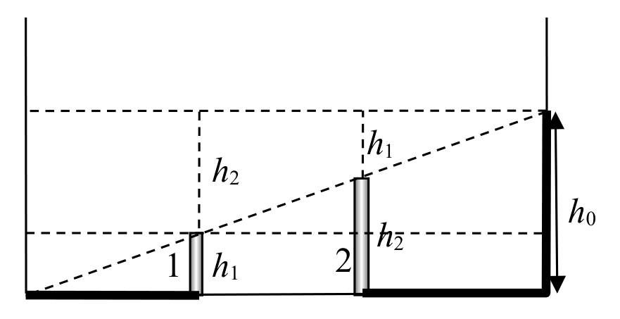

[[Състезания/proletno/7/2011|◂ 2011]] | [[Състезания/proletno/7/2012|условия]] | [[Състезания/proletno/7/2013| 2013 ▸]]

**Задача 1. Електрическа запалка**

А) От условието на задачата и от закона на Джаул-Ленц следва:

$I_1^2 R_1 = I_2^2 R_2$. \[1 т\]

Следователно:

$\left(\frac{I_1}{I_2}\right)^2 = \frac{R_2}{R_1} = 4$. \[1 т\]

Така намираме, че търсеното отношение е:

$\frac{I_1}{I_2} = 2$. \[1 т\]

Б) Когато между контактите е свързана запалка, еквивалентното съпротивление на веригата е

$R = R_1 + R_0$ \[0,5 т\]

а токът във веригата:

$I_1 = \frac{U}{R_1 + R_0}$. \[0,5 т\]

Аналогично, когато във веригата е свързана прахосмукачка, токът във веригата е:

$I_2 = \frac{U}{R_2 + R_0}$. \[1 т\]

От получения в т. А резултат намираме:

$\frac{R_2 + R_0}{R_1 + R_0} = 2$. \[1 т\]

Решаваме уравнението спрямо $R_0$:

$R_2 + R_0 = 2R_1 + 2R_0$,

откъдето намираме:

$R_0 = R_2 - 2R_1 = 2\ \Omega$. \[1 т\]

В) Като използваме израза за тока $I_2$ от т. Б, пресмятаме:

$I_2 = \frac{12\text{ V}}{4\ \Omega + 2\ \Omega} = 2\text{ A}$. \[1 т\]

От закона на Джаул-Ленц, намираме:

$P = I_2^2 R_2 = (2\text{ A})^2 \cdot 4\ \Omega = 16\text{ W}$. \[1 т\]

Г) Верен е отговорът 2) "Двата уреда ще работят с по-малки мощности, отколкото биха работили поотделно". \[1 т\]

Когато уредите са свързани успоредно, тяхното еквивалентно съпротивление е по-малко от съпротивленията им, взети поотделно. Това означава, че когато са свързани последователно към резистора $R_0$, напрежението върху тях ще бъде по-малко, отколкото когато работят поотделно.

**Задача 2. Вечеря на свещи**

А) Използва се законът за праволинейно разпространение на светлината. \[1 т\]

В момента $t = 40$ min положението на свещите и на техните сенки е показано на фигурата. Оценяват се следните елементи на чертежа:

Краищата на сенките и на свещите лежат на една права. \[0,5 т\]

Височината на свещта 2 е два пъти по-голяма от височината на свещта 1. \[0,5 т\]

Б) От чертежа следва, че:

$h_1 + h_2 = h_0$. \[1 т\]

и

$h_2 = 2h_1$. \[1 т\]

Следователно:

$h_1 = 10\text{ cm}$; \[1 т\]

$h_2 = 20\text{ cm}$. \[1 т\]

В) За време $t$ от свещта 1 изгаря дължина:

$s_1 = h_0 - h_1 = 20\text{ cm}$, \[0,5 т\]

а от свещта 2:

$s_2 = h_0 - h_2 = 10\text{ cm}$. \[0,5 т\]

Следователно свещта 1 гори със скорост:

$v_1 = \frac{s_1}{t} = 0{,}5\text{ cm/min}$, \[0,5 т\]

а свещта 2:

$v_2 = \frac{s_2}{t} = 0{,}25\text{ cm/min}$. \[0,5 т\]

Следователно свещите ще изгорят съответно за времена:

$t_1 = \frac{h_0}{v_1} = 60\text{ min} = 1\text{ h}$. \[1 т\]

и $t_2 = \frac{h_0}{v_2} = 120\text{ min} = 2\text{ h}$. \[1 т\]

**Задача 3. Козметично огледало**

А) Огледалото е вдлъбнато, защото изпъкналите огледала винаги дават умален образ. \[2 т\]

Б) Нека $AH \perp X_1X_2$ и $BC \perp X_1X_2$. По условие $HM = a$, $MC = b$ и $BC = 2AH$. Следователно, ако построим права, минаваща през т. $A$ и успоредна на $X_1X_2$, тя ще пресича $BC$ в т. $E$, като $BE = EC$. Лъч, падащ перпендикулярно на огледалото, след отражение ще премине през оптичния център $O$. Следователно точките $O$, $A$ и $B$ лежат на една права. Тогава триъгълниците $OHA$ и $AEB$ са еднакви и $OH = AE = HC$. Така, за радиус $r$ на огледалото получаваме $r = OM = OH + HM = HC + HM = a + b + a = 2a + b$. Лъчът $AG$, след отражение от огледалото, преминава през фокуса $F$. Понеже триъгълниците $FMG$ и $GEB$ са еднакви, то $f = FM = GE = MC = b$. Тъй като за огледалата $r = 2f$, получаваме, че $2a + b = 2b$, следователно $b = 2a = 20\text{ cm}$. \[2 т\]

В) Фокусното разстояние $f$ на огледалото е $f = b = 20\text{ cm}$. \[1 т\]

Г) Радиусът $r$ на огледалото е $r = 2f = 40\text{ cm}$. \[1 т\]

Д) Определяме положенията на оптичния център $O$ на огледалото, върха $M$ на огледалото (точката, в която главната оптична ос пресича огледалото) и неговия фокус $F$ чрез следните построения:

1. Построяваме правата $AB$. Тя пресича $X_1X_2$ в т. $O$ – оптичния център. \[1 т\]

2. Построяваме т. $D$, огледална на т. $B$ спрямо $X_1X_2$. Построяваме правата $AD$. Нека тя пресича $X_1X_2$ в т. $M$. Тъй като триъгълниците $MCD$ и $MCB$ са еднакви, то правите $AD$ и $BM$ сключват равни ъгли с $X_1X_2$. Следователно т. $M$ е връх на огледалото. \[2 т\]

3. Фокусът $F$ може да се построи по два начина – или като среда на отсечката $OM$, или като пресечна точка на правата $BG$ с $X_1X_2$. \[1 т\]
