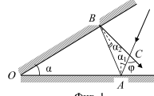
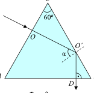

[[Състезания/proletno/7/2012|◂ 2012]] | [[Състезания/proletno/7/2013|условия]] | [[Състезания/proletno/7/2014| 2014 ▸]]

Задача 1. Тест
 1В, 2Г, 3В, 4В, 5А, 6Г, 7Б, 8В, 9Г, 10Б
 Всеки верен отговор се оценява с 1 точка

Задача 2. Електрическа верига
 а) Когато ключът K е в положение АС, общото съпротивление в
затворената верига е $R_1 + R$ (0,5 т.) и от закона на Ом имаме

$U = I_1(R_1 + R)$. (0,5 т.)
Аналогично, когато ключът K е в положение ВС, общото съпротивление в
затворената верига е $R_2 + R$ и от закона на Ом имаме

$U = I_2(R_2 + R)$. (0,5 т.)
Тъй като левите страни на двете равенства съвпадат, можем да запишем
$I_1(R_1 + R) = I_2(R_2 + R)$, (0,5 т.)

откъдето следва

$R = \frac{I_1 R_1 - I_2 R_2}{I_2 - I_1} = 50\ \Omega$. (1,5 т.)
 б) За напрежението на всеки един от източниците намираме
$U = I_1(R_1 + R) = 22,5$ V. (1 т.)
 в) Когато ключът K е в положение АВ, общото съпротивление в
затворената верига е $R_1$ $+ R_2$ и в нея има два еднакви източника на напрежение,
свързани последователно (0,5 т.). Те могат да бъдат заменен от един източник с
напрежение
$U_1 = 2U$. (1 т.)

Тогава за тока във веригата I от закона на Ом имаме

$I = \frac{2U}{R_1 + R_2} \approx 0,32$ A. (1 т.)

Амперметрите 1 и 2 са свързани последователно и двата ще отчитат ток $I$. (0,5
т.)
 г) При първото положение на ключа K имаме

$\frac{P_1}{P} = \frac{I_1^2 R_1}{I^2 R} = \frac{R_1}{R}$, (0,5 т.)

а при второто -

$\frac{P_2}{P} = \frac{R_2}{R}$. (0,5 т.)

Тъй като $R_1 > R_2$ (0,5 т.), намираме

$\frac{P_1}{P} > \frac{P_2}{P}$. (0,5 т.)
Тези отношения не зависят от напрежението на източниците, а само от
съпротивленията във веригата (0,5 т.).

 1
Задача 3. Отражение на светлината
 А) а) Направеният чертеж се оценява максимално с 2 точки.

 В

 $\alpha_2$
 $\alpha_1$ С
 $\alpha \varphi$
 О
 А
 Фиг. 1
б) Нека означим с $\alpha_1$ и $\alpha_2$ ъглите на падане. Тогава $\angle OAB = \frac{\pi}{2} - \alpha_1$ (ъгълът
на отражение е равен на $\alpha_1$) (0,5 т.) и $\angle ABO = \frac{\pi}{2} - \alpha_2$ (0,5 т.). Понеже сумата
от ъглите в един триъгълник е равна на $\pi$ (0,5 т.), за $\triangle OAB$ имаме

$\alpha + \left(\frac{\pi}{2} - \alpha_1\right) + \left(\frac{\pi}{2} - \alpha_2\right) = \pi$, (0,5 т.)

откъдето следва

$\alpha = \alpha_1 + \alpha_2$. (0,5 т.)

От друга страна търсеният ъгъл $\varphi$ е външен за $\triangle ACB$ (0,5 т.). Ето защо имаме

$\varphi = 2\alpha_1 + 2\alpha_2 = 2\alpha$. (1 т.)
Б) Тъй като падащият върху стената AC лъч е перпендикулярен на нея, той не
се пречупва (0,5 т.). Лъчът достига стената BC, като пада върху нея под ъгъл
$\alpha = 60^{\circ}$ (0,5 т.). Стъклото е оптически по-плътна среда от въздуха (0,5 т.) и
понеже $\alpha > \alpha_{гр} = 45^{\circ}$ (0,5 т.) се наблюдава пълно вътрешно отражение (0,5 т.).
Освен това $\angle BO'D = 30^{\circ}$ (0,5 т.). Ето защо намираме, че лъчът пада
перпендикулярно на стената AB ($\angle ABC = 60^{\circ}$) (0,5 т.) и излиза през нея без да
се пречупва (0,5 т.).

 С

 60$^\circ$

 О
 О\Rightarrow
 $\alpha$

 А - В
 D
 Фиг. 2

 2
