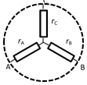

[[Състезания/proletno/7/2015|◂ 2015]] | [[Състезания/proletno/7/2016|условия]] | [[Състезания/proletno/7/2017| 2017 ▸]]

Задача 1. "Черни кутии" с електрически схеми.
a) За да намерим съпротивлението $R_{\text{AB}}$, разсъждаваме така: $r_{\text{CA}}$ и $r_{\text{BC}}$ са последователно свързани. Тяхното общо (еквивалентно) съпротивление е $r_{\text{ACB}} = r_{\text{CA}} + r_{\text{BC}} = 50\,\Omega + 30\,\Omega = 80\,\Omega$. \[0.5 т.\] Това общо съпротивление $r_{\text{ACB}}$ и резисторът $r_{\text{AB}}$ са успоредно свързани. Следователно омметърът ще измери съпротивление $R_{\text{AB}} = \frac{r_{\text{ACB}} \cdot r_{\text{AB}}}{r_{\text{ACB}} + r_{\text{AB}}} = \frac{80 \cdot 20}{80 + 20} = 16\,\Omega.$ \[0.5 т.\]

Аналогично за втория случай, $r_{\text{BAC}} = r_{\text{AB}} + r_{\text{CA}} = 20\,\Omega + 50\,\Omega = 70\,\Omega$, \[0.5 т.\] $R_{\text{BC}} = \frac{r_{\text{BAC}} \cdot r_{\text{BC}}}{r_{\text{BAC}} + r_{\text{BC}}} = \frac{70 \cdot 30}{70 + 30} = 21\,\Omega.$ \[0.5 т.\] За третия случай, $r_{\text{CBA}} = r_{\text{AB}} + r_{\text{BC}} = 20\,\Omega + 30\,\Omega = 50\,\Omega$. \[0.5 т.\] $R_ {\text{CA}} = \frac{r_{\text{CBA}} \cdot r_{\text{CA}}}{r_{\text{CBA}} + r_{\text{CA}}} = \frac{50 \cdot 50}{50 + 50} = 25\,\Omega.$ \[0.5 т.\]

б) Тъй като между всеки две извода на схемата има по два последователно свързани резистора, то: $r_{\text{A}} + r_{\text{B}} = X_{\text{AB}}$, $r_{\text{B}} + r_{\text{C}} = X_{\text{BC}}$, $r_{\text{C}} + r_{\text{A}} = X_{\text{CA}}$. \[1 т.\] Ако съберем първото и третното равенство и от получения новото равенство извадим второто, получаваме $r_{\text{A}} = \frac{X_{\text{AB}} + X_{\text{CA}} - X_{\text{BC}}}{2} = \frac{16 + 25 - 21}{2} = 10\,\Omega.$  \[1 т.\] По същия начин $r_{\text{B}} = \frac{X_{\text{BC}} + X_{\text{AB}} - X_{\text{CA}}}{2} = \frac{21 + 16 - 25}{2} = 6\,\Omega$  \[1 т.\] и  $r_{\text{C}} = \frac{X_{\text{CA}} + X_{\text{BC}} - X_{\text{AB}}}{2} = \frac{25 + 21 - 16}{2} = 15\,\Omega.$  \[1 т.\]

в) При даване "накъсо" на точките A и C в схемата "тригълник" от Фиг. 1a, съпротивлението $Y_{\text{AB}}$ ще е това, което се получава от успоредното свързване на $r_{\text{AB}}$ и $r_{\text{BC}}$, т.е. $Y_{\text{AB}} = \frac{r_{\text{AB}} \cdot r_{\text{BC}}}{r_{\text{AB}} + r_{\text{BC}}} = \frac{20 \cdot 30}{20 + 30} = 12\,\Omega.$  \[1 т.\]

г) При даване "накъсо" на точките A и C в схемата "звезда" от Фиг. 1b, съпротивлението $Z_{\text{AB}}$ ще е това, което се получава от успоредното свързване на $r_{\text{A}}$ и $r_{\text{C}}$, и последователното на тях $r_{\text{B}}$,  \[1 т.\] т.е.:
$Z_{\text{AB}} = \frac{r_{\text{A}} \cdot r_{\text{C}}}{r_{\text{A}} + r_{\text{C}}} + r_{\text{B}} = \frac{10 \cdot 15}{10 + 15} + 6 = 6 + 6 = 12\,\Omega.$  \[1 т.\]

Задача 2. Колона от слоеве течности.

 а) Течностите трябва да се наредят така, че всяка една да има по-малка плътност
от тази под нея и по-голяма плътност от тази над нея. Отдолу нагоре те ще се наредят
така: пчелен мед, кленов сироп, глицерин, веро, вода, олио, спирт за горене. \[3 т.\]
(отнема се по 0.5 т. за всяка течност, която не е поставена "на мястото си")

б) Масата на цялото количество течност в цилиндъра е равна на сумата от
масите на отделните слоеве: $M$ = $m_1 + m_2 + m_3 + m_4 + m_5 + m_6 + m_7$ =
$\rho_1$ V + $\rho_2$ V + $\rho_3$ V + $\rho_4$ V + $\rho_5$ V + $\rho_6$ V + $\rho_7$ V = ($\rho_1$ + $\rho_2$ + $\rho_3$ + $\rho_4$ + $\rho_5$ + $\rho_6$ + $\rho_7$ )V \[1 т.\] = (1,42 + 1,37 + 1,26 + 1,06 + 1,00 + 0,92 + 0,71) $\text{g/cm}^3\cdot 100\ \text{cm}^3 = 782$ g. \[2 т.\]

в) Телата ще застанат в такова положение, че да плават в течност с плътност, по-
голяма от тази на тялото, но да са потънали в течност с плътност, по-малка от тази на
тялото. Сравнявайки плътностите на телата и течностите можем да заключим, че:
стоманената гайка ще потъне на дъното на цилиндъра, \[1 т.\]
гуменото топче ще плава на границата между пчелния мед и кленовия сироп \[1 т.\],
пластмасовото зарче ще плава на границата между глицерина и верото \[1 т.\],
а парчето дърво ще плава на горната повърхност на спирта за горене. \[1 т.\]

Задача 3. Движение по река. (Две независими подзадачи)

A. Първа подзадача

а) Скоростта vТ на течението на реката е $v_Т = \frac{s}{t} = \frac{300\ \text{km}}{100\ \text{h}} = 3$ km/h. \[1 т.\]

б) Скоростта на кораба спрямо брега, когато се движи по течението, е сума на
скоростта му спрямо повърхността на реката и скоростта на течението. \[1 т.\]

Следователно $v_К + v_Т = v_К + \frac{3\ \text{km}}{\text{h}} = \frac{300\ \text{km}}{12\tfrac{1}{2}\ \text{h}} = 24$ km/h. \[1 т.\] $v_К = 21$ km/h. \[1 т.\]

в) Скоростта на кораба спрямо брега, когато се движи срещу течението, е
разлика на скоростта му спрямо повърхността на реката и скоростта на течението. \[1 т.\]

Следователно корабът ще пътува от Русе до Видин за време $t_{Р-В} = \frac{300\ \text{km}}{21\ \frac{\text{km}}{\text{h}} - 3\ \frac{\text{km}}{\text{h}}} = 16$ h $40$ min \[1 т.\]

Б. Втора подзадача

г) Връзките между разстояние, скорост и време в двете посоки са $v_H + v_P = \frac{l}{t_1}$ (1), $v_H - v_P = \frac{l}{t_2}$ (2). \[1 т.\] Ако веднъж съберем, а после извадим уравнения (1) и (2), получаваме $v_H = \frac{l}{2} \left( \frac{1}{t_1} + \frac{1}{t_2} \right)$, $v_P = \frac{l}{2} \left( \frac{1}{t_1} - \frac{1}{t_2} \right)$. \[1 т.\] За отношението им получаваме $\frac{v_H}{v_P} = \frac{t_2 + t_1}{t_2 - t_1}$. \[1 т.\]

д) Замествайки числените резултати, получени в първите 3 подусловия, във формулата, получена в предното подусловие, получаваме $\frac{v_H}{v_P} = \frac{21\text{km/h}}{3\text{km/h}} = 7 = \frac{t_2 + t_1}{t_2 - t_1} = \frac{16\frac{2}{3}\text{h} + 12\frac{1}{2}\text{h}}{16\frac{2}{3}\text{h} - 12\frac{1}{2}\text{h}} = 7$. \[1 т.\]