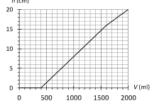
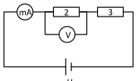
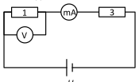
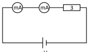
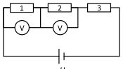
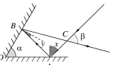

[[Състезания/proletno/7/2019|◂ 2019]] | [[Състезания/proletno/7/2021|условия]] | [[Състезания/proletno/7/2022| 2022 ▸]]

Задача 1

1.1. Пълнене на съд

Нивото на водата в съда започва да се повишава, когато обемът на налятата вода стане по-голям от 400 ml. Тогава водата изпълва изцяло чашата и започва да прелива в съда. Следователно вместимостта на чашата е:

$V_1 = 400\text{ cm}^3$ \[1,0 т.\]

След това водата започва да изпълва пространството между чашата и стените на съда. То има пръстеновидна основа с площ:

$S = S_2 - S_1$ \[1,0 т.\]

и обем $V - V_1$. Следователно височината на водата в съда е:

$h = \frac{V - V_1}{S_2 - S_1}$ \[1,0 т.\]

От графиката отчитаме, че при $V = 1000\text{ cm}^3$ например височината на водата е $h = 8\text{ cm}$. Следователно получаваме:

$S_2 - S_1 = \frac{V - V_1}{h} = \frac{1000\text{ cm}^3 - 400\text{ cm}^3}{8\text{ cm}} = 75\text{ cm}^2$ \[1,0 т.\]

Когато водата достигне височина 16 cm, наклонът на графиката намалява, т.е. едно и също количество налята вода води до по-малко повишаване на нивото на течността в съда. Това съответства на момента, когато водата в съда достига ръба на чашата и започва да изпълва цялото напречно сечение на съда. Следователно височината на чашата е:

$h_1 = 16\text{ cm}$ \[1,0 т.\]

Като знаем вместимостта на чашата, намираме площта на дъното ѝ:

$S_1 = \frac{V_1}{h_1} = \frac{400\text{ cm}^3}{16\text{ cm}} = 25\text{ cm}^2$ \[1,0 т.\]

Така намираме и площта на дъното на съда:

$S_2 = 75\text{ cm}^2 + S_1 = 100\text{ cm}^2$ \[1,0 т.\]

1.2. Хоризонтална и вертикална скорост

От определението за вертикална скорост следва, че самолетът ще достигне земята след време:

$t = \frac{H}{v_в}$ \[0,5 т.\]

Разстоянието до пистата съответства на пътя, който самолетът изминава в хоризонтална посока за това време:

$L = v_x t = \frac{v_x H}{v_в}$ \[0,5 т.\]

За да пресметнем L, скоростите във формулата трябва да бъдат изразени с еднакви единици. Нека например изразим хоризонталната скорост в метри в секунда:

$v_x = 270\frac{\text{km}}{\text{h}} = 270\frac{1000\text{ m}}{3600\text{ s}} = 75\text{ m/s}$ \[1,0 т.\]

*Ако ученикът раздели 270 на 3,6 по памет, без доказателство, се дават само 0,5 т.*

Следователно:

$L = \frac{75\text{ m/s}\cdot 2000\text{ m}}{3\text{ m/s}} = 50\,000\text{ m (50 km)}$ \[1,0 т.\]

Задача 2. Странно свързване

1) Положение mA–V

В този случай мултицетът М1 има нулево съпротивление и "дава накъсо" резистора 1. Тогава веригата е еквивалентна на следната:

(Фиг.: амперметър mA, резистори 2 и 3, волтметър V над резистор 2, източник $U_0$) \[0,5 т.\]

Показанието на мултицета 1 съответства на тока през резистора 2:

(1) $I = 12\text{ mA} = 0,012\text{ A}$ \[0,5 т.\]

а на мултицета 2 – на напрежението върху резистора 2:

(2) $U = 7,2\text{ V}$ \[0,5 т.\]

Следователно съпротивлението на резистора 2 е:

(3) $R_2 = \frac{U}{I} = 600\ \Omega$ \[0,5 т.\]

2) Положение V–mA

Сега веригата е еквивалентна на следната:

(Фиг.: резистор 1, волтметър V над него, амперметър mA, резистор 3, източник $U_0$) \[0,5 т.\]

Показанието на мултицета 1 съответства на напрежението върху резистора 1:

(4) $U = 4\text{ V}$ \[0,5 т.\]

а на мултицета 2 – на тока през резистора 1:

(5) $I = 20\text{ mA} = 0,02\text{ A}$ \[0,5 т.\]

Следователно съпротивлението на резистора 1 е:

(6) $R_1 = \frac{U}{I} = 200\ \Omega$ \[0,5 т.\]

3) Положение mA–mA

Еквивалентната верига е:

(Фиг.: два амперметра mA и резистор 3 в последователно свързана верига с източник $U_0$) \[0,5 т.\]

И двата мултицета отчитат тока през резистора 3:

(7) $I_3 = 30\text{ mA} = 0,03\text{ A}$ \[0,5 т.\]

Напрежението върху резистора 3 е съответно $U_0$. Следователно:

(8) $U_0 = R_3 I_3 = (0,03\text{ A})\cdot R_3$ \[0,5 т.\]

4) Положение V–V

В този случай и трите резистора са свързани последователно:

(Фиг.: резистори 1, 2 и 3 в последователно свързана верига с източник $U_0$; волтметрите V отчитат напреженията върху резисторите 1 и 2) \[0,5 т.\]

Двата мултицета измерват напрежението съответно върху резисторите 1 и 2:

(9) $U_1 = 2\text{ V}$ \[0,5 т.\]

(10) $U_2 = 6\text{ V}$ \[0,5 т.\]

През резисторите тече един и същ ток:

(11) $I = \frac{U_1}{R_1} = \frac{U_2}{R_2} = 0,01\text{ A (10 mA)}$ \[0,5 т.\]

Напрежението върху резистора 3 е:

(12) $U_3 = U_0 - (U_1 + U_2) = U_0 - 8\text{ V}$ \[0,5 т.\]

Следователно:

(13) $U_0 - 8\text{ V} = I R_3 = (0,01\text{ A})\cdot R_3$ \[0,5 т.\]

От уравненията (8) и (13) имаме:

(14) $0,03R_3 - 8 = 0,01R_3$ \[0,5 т.\]

откъдето намираме съпротивлението $R_3$:

(15) $R_3 = 400\ \Omega$ \[0,5 т.\]

За напрежението на източника от формула (8) получаваме:

(16) $U_0 = (0,03\text{ A})\cdot 400\ \Omega = 12\text{ V}$ \[0,5 т.\]

Задача 3.

а) Въру чертежа са означени следните точки и ъгли:

А и В – точки на падане на светлината върху долното и горното огледало съответно;
С – пресечна точка на падащия и отразения лъч;
О – точка, в която се допират двете огледала;
x и y – ъгли на падане съответно върху долното и върху горното огледало.

За чертеж, на който са означени ъглите на падане върху двете огледала: \[1,0 т.\]

(Фиг.: двете огледала с ъгъл $\alpha$, падащият лъч, отражените лъчи и ъглите x, y, $\beta$)

Тъй като ъгълът на падане е равен на ъгъла на отражение, ъгълът между падащия и отразения лъч от първото огледало е:

(1) $\angle CAB = 2x$ \[1,0 т.\]

Съответно след второто отражение:

(2) $\angle ABC = 2y$ \[1,0 т.\]

Ясно е, че:

(3) $\angle BCA = \beta$

Така за триъгълника АВС получаваме:

(4) $2x + 2y + \beta = 2(x+y) + \beta = 180^\circ$ \[1,0 т.\]

За триъгълника АОВ имаме:

(5) $\angle OAB = 90^\circ - x$ \[1,0 т.\]

(6) $\angle OBA = 90^\circ - y$ \[1,0 т.\]

и

(7) $\alpha + (90^\circ - x) + (90^\circ - y) = 180^\circ$

Откъдето:

(8) $x + y = \alpha$ \[1,0 т.\]

Като заместим в уравнение (4), получаваме окончателно:

(9) $\beta = 180^\circ - 2\alpha$ \[1,0 т.\]

б) При увеличаване на ъгъла $\alpha$, ъгълът $\beta$ между лъчите става все по-малък, а пресечната точка C е все по-далече от точката на падане. Затова лъчите се разпространяват в противоположни посоки и не се пресичат, ако:

(10) $\beta = 0^\circ$ \[1,0 т.\]

От уравнение (9) следва, че това условие е в сила, ако:

(11) $\alpha = 90^\circ$ \[1,0 т.\]
