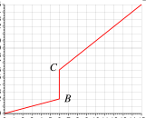

[[Състезания/proletno/7/2023|◂ 2023]] | [[Състезания/proletno/7/2024|условия]] | [[Състезания/proletno/7/2025| 2025 ▸]]

Задача 1. Не разчитай на случайност!

Въпрос 1. Дадени са четири смеси, състоящи се от дребни частици (стружки) на различни
материали. В кои/коя от смесите:

а) алуминий и желязо; б) алуминий и дърво; в) дърво и желязо; г) мед и алуминий

материалите може да бъдат разделени чрез магнит?

Верните отговори са а) \[1 т\] и в) \[1 т\]. От всички споменати материали, единствено
желязото се привлича към магнит. \[1 т\]

Въпрос 2. Вода и спирт се загряват от 0$^\circ$С до температура 10$^\circ$С. Коя графика показва
зависимостта на плътността от температурата за водата и коя - за спирта? \[4 т\]

а) б) в) г)

На спирта съответства графика б) \[1 т\], а на водата - г) \[1 т\]. Спиртът се разширява при
загряване, т.е. обемът му се увеличава \[0,5 т\]. Това означава, че при загряване плътността
на спирта намалява. При загряване от 0$^\circ$С до 4$^\circ$С водата се свива \[0,5 т\], а от 4$^\circ$С до 10$^\circ$С -
се разширява \[0,5 т\]. Следователно от 0$^\circ$С до 4$^\circ$С плътността на водата се увеличава, а от
4$^\circ$С до 10$^\circ$С - намалява \[0,5 т\].

Въпрос 3. Дадена е електрическа верига, която се състои от източник с напрежение U = 12 V и две еднакви лампи, Л1 и Л2, свързани последователно към източника (схемата вляво). Как ще се промени силата на светене на лампите, ако към лампата Л2 бъде свързана успоредно трета лампа Л3 от същия вид?

а) Силата на светене на Л1 и Л2 няма да се промени.

б) Л1 ще светне по-силно, а Л2 - по-слабо.

в) Л1 ще светне по-слабо, а Л2 - по-силно.

г) И Л1, и Л2 ще светнат по-слабо.

Верният отговор е б) \[1 т\]. Сумата от напреженията на лампите 1 и 2 винаги е равна на
12 V \[0,5 т\]. Следователно преди включване на третата лампа, върху всяка от лампите
напрежението е 6 V \[0,5 т\]. След включване на Л3, токът през Л2 става два пъти по-малък
от тока през Л1 \[0,5 т\]. При същото сумарно напрежение, напрежението върху Л1 ще стане
повече от 6 V, т.е. Л1 ще светне по-силно, а върху Л2 - по-малко от 6 V, т.е. Л2 ще светне
по-слабо. \[0,5 т\].

Задача 2. Космически доставки

а) Понеже совалките тръгват през еднакви интервали Т1, разстоянието между две
последователни совалки, пътуващи към кораба, е:

$d_1 = v_c T_1$ (1) \[1 т\]

Когато дадена совалка достигне кораба, следващата се намира на разстояние $d_1$ зад него.

Задната совалка трябва да настигне кораба точно за време $T_0$. Това означава, че за един
месец тя трябва да измине разстоянието $d_1$ плюс разстоянието $v_k T_0$, което изминава корабът до следващата доставка. Следователно:

$v_c T_0 = v_c T_1 + v_k T_0$ (2) \[1 т\]

Оттук намираме:

$T_1 = \left(1 - \frac{v_k}{v_c}\right) T_0 = \frac{1}{2} \text{ година} = 6 \text{ месеца}$ (3) \[1 т\]

б) Разстоянието между совалките на връщане към Земята е:

$d_2 = v_c T_2$ (4) \[1 т\]

Това разстояние е равно на пътя, изминат от предната совалка за един месец, плюс пътя,
изминат от кораба за месец:

$v_c T_2 = v_c T_0 + v_k T_0$ (5) \[1 т\]

Следователно:

$T_2 = \left(1 + \frac{v_k}{v_c}\right) T_0 = 1,5 \text{ години} = 1 \text{ година и 6 месеца}$ (6) \[1 т\]

в) Корабът се движи със скорост, 15 пъти по-малка от скоростта на светлината:

$v_k = \frac{c}{15}$ (7)

Следователно корабът ще пристигне на планетата след 15 години и за това време трябва да
бъдат направени 15 доставки. \[0,5\] Ще съставим "разписание" на совалките, показващо
времето на тръгване от Земята, пристигане/тръгване от кораба и връщане на Земята в
години, като за нулев е приет моментът на тръгване на кораба от Земята:

| Тръгване от Земята (година) | Пристигане/тръгване от кораба (година) | Пристигане на Земята (година) | Совалка № |
|---:|---:|---:|---:|
| 0,5 | 1 | 1,5 | 1 |
| 1 | 2 | 3 | 2 |
| 1,5 | 3 | 4,5 | 1 |
| 2 | 4 | 6 | 3 |
| 2,5 | 5 | 7,5 | 4 |
| 3 | 6 | 9 | 2 |
| 3,5 | 7 | 10,5 | 5 |
| 4 | 8 | 12 | 6 |
| 4,5 | 9 | 13,5 | 1 |
| 5 | 10 | 15 | 7 |
| 5,5 | 11 | 16,5 | 8 |
| 6 | 12 | 18 | 3 |
| 6,5 | 13 | 19,5 | 9 |
| 7 | 14 | 21 | 10 |
| 7,5 | 15 | 22,5 | 4 |

Една и съща совалка може да направи няколко доставки, стига времето на пристигане на
Земята да е преди или да съвпада със следващото време на тръгване към кораба. В
последната колона пътуванията, които може да бъдат извършени с една и съща совалка, са
номерирани с еднакъв номер. Вижда се, че совалка 1 може да направи общо 3 доставки
[0,5 т], совалки с номера от 2 до 4 - по две доставки \[0,5 т\], а останалите совалки с номера
от 5 до 10 - само по една доставка \[0,5 т\]. Следователно всички доставки може да бъдат
направени с най-малко 10 совалки \[1 т\].

г) Можем да сведем задачата до вече решеното подусловие б), като намерим съответствие
между величините в двата случая. Радиосигналите, предаващи първата и последната буква
на изречението, тръгват от кораба през време $T_3$, съответстващо на времето $T_0$, през което
совалките тръгват от кораба към Земята. \[0,2 т\] Сигналите се движат със скоростта на
светлината с, съответстваща на скоростта на совалките. \[0,2 т\] Времетраенето $T_4$ на
изречението, прието на Земята, съответства на времето $T_2$, през което се връщат
последователните совалки. \[0,2 т\] Следователно:

$T_4 = \left(1 + \frac{v_k}{c}\right) T_3 = 3,2\text{ s}$ (8) \[0,4 т\]

Задача 3. Електромагнитно реле

а) При първите две батерии токът във веригата е по-малък от минималния ток, при който
се включва релето. Следователно прекъсвачът в релето е отворен и токът минава само през
намотката и първия резистор. \[0,5 т\]

Веригата е еквивалентна на следната:

за еквивалентна схема: \[0,5 т\]

Като изпозваме данните за първата или за втората батерия, намираме съпротивлението на
резистора 1:

$R_1 = \frac{U}{I} = \frac{1,5\text{ V}}{0,05\text{ A}}$ (или $\frac{4,5\text{ V}}{0,15\text{ A}}$) $= 30\ \Omega$ (1) \[1 т\]

При третата батерия се вижда, че токът във веригата е по-голям от тока, при който релето
се задейства. \[0,5 т\] Следователно при третата батерия прекъсвачът е затворен и токът
тече и през двата резистора. \[0,5 т\]

Схемата е еквивалентна на следната:

за еквивалентна схема: \[0,5 т\]

През първия резистор тече ток:

$I_1 = \frac{U}{R_1} = \frac{9\text{ V}}{30\ \Omega} = 0,3\text{ A}$ (2) \[1 т\]

Понеже резисторите са свързани успоредно, токът през втория резистор е:

$I_2 = I - I_1 = 0,9\text{ A} - 0,3\text{ A} = 0,6\text{ A}$ (3) \[1 т\]

Напрежението върху втория резистор е равно на напрежението на източника.

Следователно съпротивлението на втория резистор е:

$R_2 = \frac{U}{I_2} = \frac{9\text{ V}}{0,6\text{ A}} = 15\ \Omega$ (4) \[1 т\]

 4

б) Примерната графика е дадена по-долу.

Графиката се оценява, както следва:

По абсцисата е означено напрежението и е записана единицата V \[0,2 т\]

По ордината е означен токът и е записана съответната единица - A или mA \[0,2 т\]

По абсцисата са нанесени стойности на напрежението \[0,3 т\]

По ордината са нанесени стойности на тока \[0,3 т\]

Графиката е начупена линия, която се състои от три части. Координатите на
означените точки са съответно:

А: 0 V; 0 A \[0,5 т\]

B: 6 V; 0,2 A \[0,5 т\]

C: 6 V; 0,6 A (т.е. отсечката ВС е вертикална) \[1,0 т\]

D: 15 V; 1,5 A \[0,5 т\]

 5
