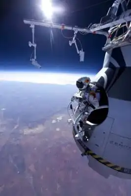
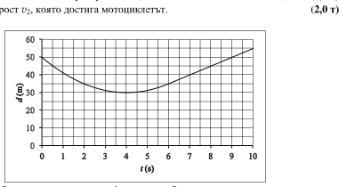
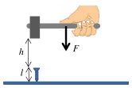

[[Състезания/proletno/8/2014|◂ 2014]] | [[Състезания/proletno/8r/2015|решения]] | [[Състезания/proletno/8/2016| 2016 ▸]]

Задача 1. Скок от Космоса

На 14 октомври 2012 г. австрийският екстремен спортист Феликс Баумгартнер се издигна с балон на височина 39 000 m, която дотогава никой друг човек не е достигал с балон. Оттам той скочи и по време на падането си достигна скорост, по-голяма от скоростта на звука. Наближавайки земята, той отвори парашута си и се приземи безопасно след общо 540 s падане. На фиг. 1 е показана графика на скоростта на спортиста по време на падането в зависимост от времето след скачането, която можете да използвате при отговор на следващите въпроси.

Земното ускорение е g $= 9,8 \left(\text{m/s}\right)^{2}$ , а масата на спортиста заедно с предпазния скафандър е m = 110 kg.

А) Колко е средната скорост vср на спортиста по време на цялото падане? (1,5 т)

Б) На голяма височина, поради ниската температура на въздуха, скоростта на звука е
u = 290 m/s. Ако приемете, че спортистът се движи равноускорително, докато достигне
тази скорост, намерете на каква височина $h_1$ той е преминал звуковата бариера. (2,5 т)

В) Сравнете ускорението a, с което се движи спортистът, докато достигне скоростта на
звука, със земното ускорение g и посочете поне една причина за разликата между тях.
 (1,5 т)

Г) На каква височина $h_2$ над земята се е отворил парашутът на спортиста. (2,5 т)

Д) Намерете силите $F_1$ и $F_2$ на съпротивление на въздуха, които действат на спортиста
съответно в момента, когато достига максималната си скорост и по време на падането с
парашута? (2,0 т)

Фиг. 1. Графика на скоростта на Феликс Баумгартнер по време на неговото падане.

Задача 2. Настигането невъзможно

Автомобил се движи с постоянна скорост $v_1$. На определено разстояние пред него от състояние на покой потегля мотоциклет. Първоначално мотоциклетът се движи равноускорително, докато достигне определена скорост $v_2$, след което продължава да се движи равномерно с тази скорост. Графиката на фиг. 2 показва зависимостта на разстоянието d между автомобила и мотоциклета от времето t. Моментът, в който
потегля мотоциклетът, съответства на време t = 0.

Като използвате данните от графиката определете:

А) минималното разстояние $d_1$, на което автомобилът се доближава до мотоциклета и
съответният момент $t_1$, в който става това; (1,0 т)

Б) скоростта $v_1$ на автомобила и ускорението a, с което потегля мотоциклетът; (7,0 т)

В) крайната скорост $v_2$, която достига мотоциклетът. (2,0 т)

Фиг. 2. Зависимост на разстоянието d между автомобила и мотоциклета от времето t.

Задача 3. Забиване на пирон

Дърводелец забива изцяло пирон в дъска само с един удар. За целта издига чука на височина h = 25 cm над главата на пирона и, докато чукът пада, му действа със сила F = 40 N, насочена надолу. По време на удара между чука и пирона, дърводелецът не упражнява сила върху чука. Масата на чука е m = 1 kg, а дължината на пирона l = 5 cm. Пиронът е вертикален по време на целия удар. Приемете, че земното ускорение е g = 10 m/s .

А) Намерете скоростта $v_0$ на чука непосредствено преди да удари пирона. (3,0 т)

Б) Определете силата P, с която чукът действа на пирона по време на удара. Приемете, че
силата е постоянна по време на удара. (4,0 т)

В) Пресметнете работата A, която извършва дърводелецът за един работен ден, ако през
това време забива N = 1000 пирона по описания начин. (3,0 т)