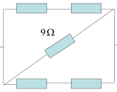
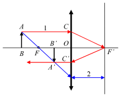
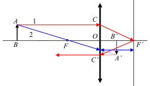
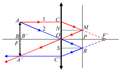

[[Състезания/proletno/8/2010|◂ 2010]] | [[Състезания/proletno/8/2011|условия]] | [[Състезания/proletno/8/2012| 2012 ▸]]

1. Между точките a и b в схемата показана на Фиг. 1, е приложено напрежение. Токът, който тече
между точките a и b е 1 А. Намерете:

a) еквивалентното съпротивление между точките a и b (3 точки)

б) напрежението между точките a и b (1 точка)

в) тока протичащ през всеки резистор (2 точки)

г) напрежението върху всеки резистор (2 точки)

д) в кой резистор се отделя най-много топлина за интервал от време $\Delta$t (2 точки)

 6$\Omega_3$$\Omega$

 a 9$\Omega$ b

 6$\Omega_3$$\Omega$

 Фиг. 1
 Решение на задача 1

a) еквивалентното съпротивление между точките a и b (3 точки)

Схемата на свързване може да бъде заменена с еквивалентна на нея , в която
 b

 $R_1$e$k R_9 \Omega R_2 e$k

 a
 Фиг.2

$R_{1ек} = 6\Omega + 3\Omega = 9\Omega$
$R_{2ек} = 6\Omega + 3\Omega = 9\Omega$
$\frac{1}{R_{екл}} = \frac{1}{R_{1ек}} + \frac{1}{R_{2ек}} + \frac{1}{9\Omega}$ $\Rightarrow$ $R_{екб} = 3\Omega$

б) напрежението между точките a и b (1 точка)
$U_{ab} = IR_{екб} = 3$ V

в) тока, протичащ през всеки резистор (2 точки)
$I = I_{6\Omega} = I_{3\Omega} = I_{9\Omega} = \frac{1}{3}$ A

г) напрежението върху всеки резистор (2 точки)
$U_{3\Omega} = I_{3\Omega}(3\Omega) = (\frac{1}{3}\text{A})(3\Omega) = 1$ V
$U_{6\Omega} = I_{6\Omega}(6\Omega) = (\frac{1}{3}\text{A})(6\Omega) = 2$ V
$U_{9\Omega} = I_{9\Omega}(9\Omega) = (\frac{1}{3}\text{A})(9\Omega) = 3$ V

д) в кой резистор се отделя най-много топлина за интервал от време $\Delta t$ (2 точки)
$Q_{max} = I^2 R_9 \Omega \Delta t$

2. Предмет се намира на разстояние a = 0,15 m от събирателна леща с фокусно разстояние
f = 0,10 m. От другата страна на лещата, успоредно на лещата, е поставено плоско огледало
минаващо през фокуса. Наблюдава се светлината, преминала през лещата, отразена от огледалото
и преминала отново през лещата.

а) Определете на какво разстояние от лещата и къде се получава образът на предмета. Сравнете
големината на образа и ориентацията му с тази на предмета. (3 точки)

б) Намерете разстоянието между образа и лещата, ако предметът се намира на разстояние
 a' = 0,25 m от събирателната леща? Сравнете големината на образа и оринтацията му с тази на
предмета. (4 точки)

в) Намерете мястото, големината и ориентацията на образа, ако предметът се намира на
разстояние a'' = 0,10 m от събирателната леща (в предния фокус), а огледалото е изместено на
0,05 m зад събирателната леща (между лещата и задния фокус)? (3 точки)

 Решение на задача 2

а) Определете на какво разстояние от лещата и къде се получава образът на предмета. Сравнете
големината на образа и ориентацията му с тази на предмета. (3 точки)

 За да намерим образа на върха на предмета (т. А), използуваме лъчите 1 и 2 (виж Фиг. 3).

Първият е успореден на оптичната ос. Вторият преминава през фокуса F на събирателната леща.

Лъчът 1 след пречупването си в лещата попада във фокуса F ' , където е поставено плоското
огледало. Ъгълът на падане на лъча 1 е равен на ъгъла му на отражение, поради което той попада
в точката C ' на лещата ( CO = C 'O ). Като лъч, който излиза от фокуса на лещата, след
пречупването си в нея, той се движи успоредно на главната оптична ос. След пречупването си в
лещата, лъчът 2 се движи успоредно на главната оптична ос, отразява се в огледалото и се връща
по същия оптичен път. Пресичането на двата лъча дава образа на върха на предмета.

 A 1 C

 B' O
 B F F'
 C'
 A'
 2

 Фиг.3

 2
Основата на предмета (т. В) е върху оптичната ос и остава върху нея. Тъй като триъгълниците
ABF и A'B'F са еднакви, то търсеното разстояние е:

 OB' = f - FB' = f - FB = f - ( BO - f ) = 2 f - BO = 0, 05m
Големината на образа е равна на големината на предмета. Образът е действителен и обърнат.

б) Намерете разстоянието между образа и лещата, ако предметът се намира на разстояние
a' = 0,25 m от събирателната леща? Сравнете големината на образа и ориeнтацията му с тази на
предмета. (4 точки)

 A 1 C

 2 O B'
 B F F'

 C' A'

 Фиг. 4
Образът A'B' на предмета AB се наблюдава там, където се пресичат лъчите, напуснали лещата,
или техните продължения. Построяваме лъч 1 (AC), успореден на оптичната ос (Фиг. 4). След
пречупване от лещата, той минава през задния фокус F', отразява се от огледалото и пречупвайки
се отново през лещата, той отново е успореден на оптичната ос. CO = C'O. Построяваме втори
лъч 2, минаващ през предния фокус F. След пречупване от лещата, той е успореден на оптичната
ос и отразявайки се от огледалото, се връща по същия път. Продълженията на лъчите 1 и 2 се
пресичат в точка A'. Тъй като AB=CO=C'O=A'B', триъгълниците ABF и A'B'F са еднакви.

Следователно BF=B'F. Тогава B'O = FB'- FO=BF - FO = (BO - FO) - FO= BO - 2f = 25 cm - 20
cm = 5 cm.

Следователно образът се намира на 5 cm зад лещата, точно по средата между лещата и
огледалото. Той е със същата големина и е обърнат и недействителен.

в) Намерете мястото, големината и ориентацията на образа, ако предметът се намира на
разстояние a'' = 0,10 m от събирателната леща (в предния фокус), а огледалото е изместено на
0,05 m зад събирателната леща (между лещата и задния фокус)? (3 точки)

 A 1 C
 2 N M
 B B' O P F'
 F
 S R
 A' C'

 Фиг. 5

Построяваме лъч 1 (AC), успореден на оптичната ос (Фиг. 5). След пречупване от лещата, той би
преминал през задния фокус F', но преди това се отразява от огледалото в т. M. Спускаме от т. М
перпендикуляр към лещата. Тъй като по условие OP=PF', триъгълниците CNM и MPF' са

 3
еднакви. Следователно MP = CN. Триъгълниците CNM и ONM също са еднакви, следователно ON
=CN = MP. Така доказваме, че т. О лежи на оптичната ос и е център на лещата. Следователно
лъчът MO не се пречупва.

Построяваме втори лъч 2, минаващ през центъра на лещата т.О. Той не се пречупва и достига
огледалото в т. R. Отразявайки се, той достига лещата в т. C'. Отново може да се докаже, че
триъгълниците OSR, C'SR и RPF' са еднакви, следователно продължението на C'R минава през
задния фокус F'. Тогава вторият лъч пречупвайки се втори път през лещата, става успореден на
оптичната ос. Двата лъча се пресичат в т. A'. Триъгълниците ACO, F'OC, F'OC' и A'C'O също са
еднакви така, че AC = A'C' и AB = CO = C'O = A'B'. Следователно образът е на същото
разтояние от лещата като предмета, обърнат е, има същата големина и е действителен.

3. Тяло, което се движи равноускорително, през първите 4 секунди на движението си изминава
24 m . През следващите 4 секунди тялото изминава път 64 m . Пресметнете:

a) ускорението на движение (4 точки)

б) началната скорост на движение (2 точки)

в) какъв път ще измине тялото през следващия трети интервал от 4 секунди (4 точки)

 Решение на задача 3

a) ускорението на движение (4 точки)

Прилагайки законите за пътя и скоростта на движение за първия участък от пътя получаваме:

$s_1 = v_0 t + \frac{at^2}{2} \Rightarrow 24 = 4v_0 + 8a$ (1 точка)
$v_1 = v_0 + at = v_0 + 4a$ (1 точка)

Прилагайки законите за пътя за втория участък от пътя получаваме:

$s_2 = v_1 t + \frac{at^2}{2} = (v_0 + 4a)t + \frac{at^2}{2} = 4v_0 + 24a \Rightarrow 64 = 4v_0 + 24a$ (1 точка)

Изваждайки $s_1$ от $s_2$ получаваме за ускорението:

$s_2 - s_1 = (4v_0 + 24a) - (4v_0 + 8a) = 16a$ (1 точка)
$\Rightarrow (64 - 24) = 16a \Rightarrow a = 2,5 \text{ m/s}^2$

б) началната скорост на движение (2 точки)

Използувайки стойността на ускорението и закона за пътя за първия участък от пътя получаваме:

$24 = 4v_0 + 8a \Rightarrow v_0 = 6 - 2a = 1 \text{ m/s}$ (2 точки)

в) какъв път ще измине тялото през следващия трети интервал от 4 секунди (4 точки)

Прилагайки закона за скоростта на движение за втория участък от пътя, получаваме скоростта в
края на втория участък от пътя, която е и началната скорост на движение за третия участък
получаваме:

$v_2 = v_1 + at = v_0 + at + at = 21 \text{ m/s}$ (2 точки)

Прилагайки закона за пътя за третия участък от пътя получаваме:

$s_3 = v_2 t + \frac{at^2}{2} = 84 + 20 = 104$ m (2 точки)
 2

 4
