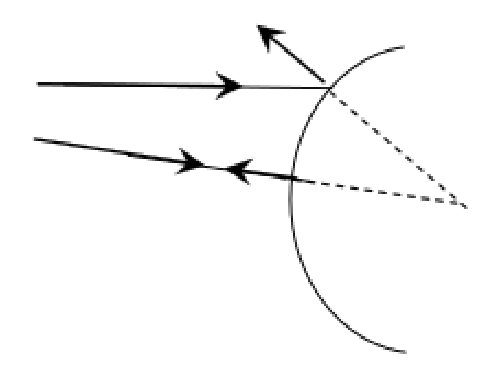
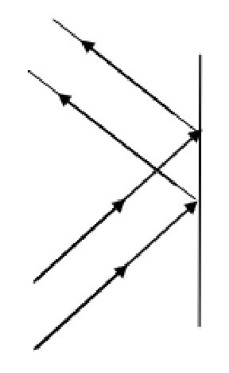
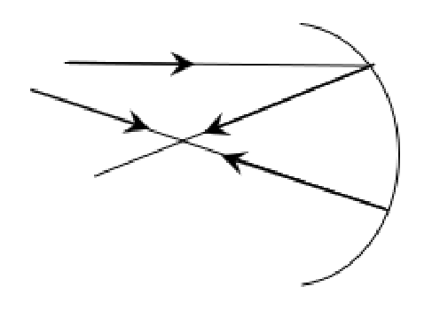
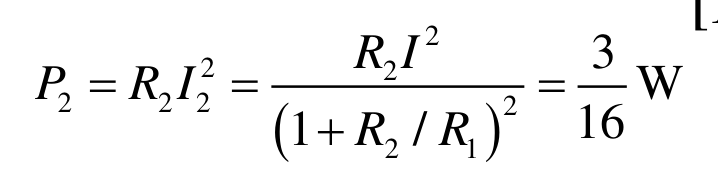

[[Състезания/proletno/8/2013|◂ 2013]] | [[Състезания/proletno/8/2014|условия]] | [[Състезания/proletno/8/2015| 2015 ▸]]

Задача 1: Тяло по наклонена равнина

а) Скоростта се определя от закона за запазване на енергията (ЗЗЕ): $\frac{mV^2}{2} = mgH$ \[1 т.\] $\Rightarrow$

$V = \sqrt{2gH} \approx 4,47$ m/s \[1 т.\].

б) За да приведе тялото в покой, силата на триене извършва работа, равна на потенциалната
енергия на тялото в началния момент: $kmgx_{max} = mgH$ \[2,5 т.\] $\Rightarrow$

$x_{max} = \frac{H}{k} \approx 1,43$ m \[1,5 т.\].

в) От енергетични съображения намираме началната скорост $V_0$ , при която тялото спира на
ръба на масата:

$\frac{mV_0^2}{2} + mgH = kmgL_2$ \[2 т.\] $\Rightarrow$

$V_0 = \sqrt{2g(kL_2 - H)} = 1$ m/s \[2 т.\].

Задача 2: Електрически схеми

а) Поради симетрията (фигура 2а) през резистора със съпротивление R / 2 не протича ток
\[1 т\]. Следователно можем да използваме еквивалентната схема във фигура 2б \[2 т\].

Лесно пресмятаме общото съпротивление между точки А и B
$R_{AB} = R = 1\ \Omega$ \[1 т.\].

б) Съпротивлението на цялата верига е

$R_{AB} = \frac{R_1 R_2}{R_1 + R_2} = \frac{1}{4}\ \Omega$ \[1 т.\].

Тогава за напрежението между точки А и В получаваме

$U = R_{AB} I = \frac{R_1 R_2}{R_1 + R_2}I = \frac{1}{4}$ V \[1 т.\].

Следователно за токовете през $R_1$ и $R_2$ имаме

$I_1 = \frac{U}{R_1} = \frac{R_2}{R_1 + R_2}I = \frac{1}{4}$ A \[1 т.\].

$I_2 = \frac{U}{R_2} = \frac{R_1}{R_1 + R_2}I = \frac{3}{4}$ A

в) (фигура 2а) Мощността, отделена от съпротивление $R/2$, е нула \[1 т.\]. Общата мощност на
веригата, която е $P = \frac{U^2}{R}$, се поделя по равно на всяко съпротивление R и е равна на

$\frac{1}{4}P = \frac{U^2}{4R} = \frac{1}{4}$ W \[1 т.\].

(фигура 2б) Мощностите за съпротивления $R_1$ и $R_2$ са съответно

$P_1 = R_1 I_1^2 = \frac{R_1 I^2}{(1 + R_1/R_2)^2} = \frac{1}{16}$ W \[1 т.\].

$P_2 = R_2 I_2^2 = \frac{R_2 I^2}{(1 + R_2/R_1)^2} = \frac{3}{16}$ W

Задача 3: Отражение и пречупване на светлината

а) Автомобилът се движи със скорост $\frac{V}{2} = 25$ m/s \[1 т.\];

б) Разстоянието между шофьора и образа на автомобила се изменя по закона

$L = 2\left(L_0 - \frac{V}{2}t + \frac{1}{2}at^2\right) = 200 - 50t + 4t^2$. \[1 т.\]

Скоростта (спрямо земята) се изменя по закона $U = \frac{V}{2} - at$ \[1 т.\]. Автомобилът спира в момента

$t_0 = \frac{V}{2a}$. Разстоянието между автомобила и образа е $2\left(L_0 - \frac{V^2}{8a}\right) = 43,75$ m \[1 т.\].

в) Оптичните елементи са показани във фигура 2: вдлъбнато огледало, двойно изпъкнала
леща, изпъкнало огледало и плоско огледало - по \[1.5 т\] на елемент.

 2

