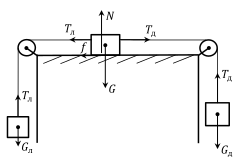

[[Състезания/proletno/8/2018|◂ 2018]] | [[Състезания/proletno/8/2019|условия]] | [[Състезания/proletno/8/2021| 2021 ▸]]

Задача 1. Кинематика
а) Изминатият от камиона път се изразява по следния начин: $s_к = \frac{at^2}{2}$ \[0,5 т.\], където t е
времето от тръгването на камиона. Автомобилът изминава път $s_а = v_0(t - t_0) + \frac{a(t-t_0)^2}{2}$ след
началната позиция на камиона. \[1 т.\] Условието за изпреварване е $s_к = s_а$, откъдето $\frac{at_{изп}^2}{2} =$
$v_0(t_{изп} - t_0) + \frac{a(t_{изп}-t_0)^2}{2}$. \[0,5 т.\] След опростяване на уравнението се получава, че $t_{изп} =$
$\frac{t_0(2v_0-at_0)}{2(v_0-at_0)} = 24$ s. \[2 т.\]

б) Изминатият от камиона път до мястото на изпреварването е $s_{изп} = s_к(t_{изп}) = \frac{at_{изп}^2}{2} =$
$\frac{at_0^2(2v_0-at_0)^2}{8(v_0-at_0)^2} = 288$ m. \[1 т.\]

в) В момента на изпреварването скоростта на камиона е $v_к = at_{изп} = \frac{at_0(2v_0-at_0)}{2(v_0-at_0)} = 24$ m/s \[1 т.\],
а на автомобила е $v_а = v_0 + a(t_{изп}-t_0) = v_0 - \frac{a^2t_0^2}{2(v_0-at_0)} = 26$ m/s. \[1 т.\]

г) Изпълнено е, че $v_а' = v_0 + a(t' - t_0) = 1,05at' = 1,05v_к'$ \[0,5 т.\], където t ' е времето от
момента на тръгване на камиона до момента, когато скоростта на автомобила vа' е с 5% по-
голяма от скоростта на камиона vк'. Получава се, че $t' = 20(v_0-at_0)/a$. \[1 т.\] Оттук,
преднината на автомобила $\Delta s = s_а(t') - s_к(t') = v_0(t'-t_0) + \frac{a(t'-t_0)^2}{2} - \frac{at'^2}{2} =$
$v_0(t'-t_0) - at_0t' + \frac{at_0^2}{2} = \frac{20v_0^2}{a} - 41v_0t_0 + \frac{41at_0^2}{2} = 32$ m. \[1,5 т.\]

Задача 2. Трупчета и макари
 а) Силите, които действат на трупчетата
 N преди прерязването на дясната нишка, са
 Tл Tд показани на чертежа вляво. На лявото
 f трупче действа силата на тежестта Gл =
 mл g и силата на опън на лявата нишка Tл .
 Tд На централното трупче действа силата на
 G тежестта G = Mg, реакцията на опората
 Tл
 N = G = Mg, двете сили на опън на
 нишките Tл и Tд , както и силата на триене
 f = kN = kMg \[0,3 т.\], насочена наляво,

 Gл Gд тъй като от условието се разбира, че
 трупчето тръгва надясно, т.е. mл < mд . На
дясното трупче действа силата на тежестта Gд = mд g и силата на опън на дясната нишка Tд .
Като отчетем посоките на всички сили, които действат на трупчетата, от II принцип на
Нютон се получават следните уравнения: Tл - mл g = mл a \[0,7 т.\], Tд - Tл - kMg = Ma [0,7
т.] и mд g - Tд = mд a \[0,7 т.\]. След прерязването на дясната нишка уравненията на Нютон за
лявото и централното трупче са: mл g - Tл' = mл a' \[0,5 т.\] и Tл' + kMg = Ma' \[0,5 т.\], където
Tл' е новата сила на опън на лявата нишка. Централното трупче продължава да се движи
надясно, но вече равнозакъснително с ускорение a' , насочено наляво. След събиране на двете
 M(a' -kg)
уравнения, за да изключим силата на опън Tл' , получаваме, че mл $= \approx 0,12 \text{kg}$. [0,6
 g-a'
т.] Като съберем първоначалните три уравнения на Нютон, за да изключим силите на опън Tл
и Tд , получаваме: mд g - mл g - kMg = mл a + mд a + Ma \[0,3 т.\], откъдето следва, че

mд $=\frac{ mл (a+g)+M(a+kg) M(a+g)(a' -kg) M(a+kg) Mg(1-k)(a+a' )}{ + = (g-a)(g-a' )}=$ (g-a)(g-a' )

 $\approx 0,31 \text{kg}$. \[0,7 т.\]
 g-a g-a
 M(g+a)(a' -kg)
б) От първоначалните уравнения на Нютон следва, че Tл = mл (g + a) $= \approx$
 g-a'
 Mg(1-k)(a+a' )
1,3 N \[0,5 т.\] и Tд = mд (g - a) $= \approx 2,8 N$. \[0,5 т.\]
 g-a'
в) Преди прерязването на дясната нишка системата се движи равноускорително надясно с
ускорение a. Следователно, скоростта на централното трупче, когато то се намира по средата
между двете макари, е v = $\sqrt$ad. \[0,5 т.\] След това трупчето продължава да се движи надясно,
 $v_2 a$d
но вече равнозакъснително с ускорение a' , при което изминава разстояние s = 2a' = 2a' [0,5
т.], докато в определен момент спира и тръгва да се движи наобратно (равноускорително) с
друго ускорение a'' . За да намерим a'' , събираме уравненията на Нютон за двете останали
трупчета: mл g - Tл'' = mл a'' \[0,5 т.\] и Tл'' - kMg = Ma'' \[0,5 т.\], където Tл'' е новата сила на

опън на лявата нишка. Получаваме, че a'' $=\frac{ (mл -kM)g (1+k)a' -2kg}{ mл +M 1-k}=$ . \[0,5 т.\] Оттук следва, че

 d (1+k)a' -2kg a
скоростта на централното трупче ще бъде vкр = $\sqrt$2a'' (s + 2 ) = $\sqrt$ (1 + a' ) d $\approx$
 1-k
1,4 m/s. \[0,5 т.\]
г) Работата на силата на триене е Aтр = -fs ' \[0,3 т.\], където s ' е общият път, изминат от
 d a
централното трупче. Така Aтр = -2kMg (s + 2 ) = -kMgd (1 + a' ) $\approx$ -1,7 J. \[0,7 т.\]

а) Резисторът със съпротивление $R_1$ е свързан последователно към резисторите със съпротивления $R_2$ и $R_3$,
които са свързани успоредно един на друг. \[1 т.\] Следователно, общото съпротивление на резисторите е
$R = R_1 + \frac{R_2 R_3}{R_2+R_3}$. \[1 т.\] Долният амперметър измерва тока Iд през батерията, т.е. от закона
на Ом за цялата верига следва, че $I_д = U/R$. \[1 т.\] Оттук $U = I_д R = I_д(R_1 + \frac{R_2 R_3}{R_2+R_3}) = 6$ V. \[1 т.\]

б) Тъй като резисторите със съпротивления $R_2$ и $R_3$ са свързани успоредно, то напреженията върху тях
са еднакви: $I_г R_3 = U - I_д R_1$. \[1 т.\] Тук сме използвали, че напрежението върху резистора със
съпротивление $R_2$ е равно на разликата от напрежението на батерията и напрежението върху резистора
със съпротивление $R_1$. \[0,5 т.\] След опростяване се получава, че $I_г = \frac{U-I_д R_1}{R_3} = \frac{R_2}{R_2+R_3} I_д = 1,2$ mA. \[1,5 т.\]

в) Токът през резистора със съпротивление $R_2$ е $I_2 = I_д - I_г$, тъй като резисторите със съпротивления
$R_2$ и $R_3$ са свързани успоредно. \[1 т.\] Отделената мощност в резистора със съпротивление $R_2$ е
$P_2 = I_2^2 R_2 = (I_д-I_г)^2 R_2 = \frac{I_д^2 R_2 R_3^2}{(R_2+R_3)^2} \approx 6,5$ mW. \[2 т.\]
