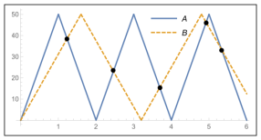
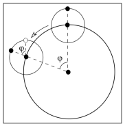

[[Състезания/proletno/8/2019|◂ 2019]] | [[Състезания/proletno/8/2021|условия]] | [[Състезания/proletno/8/2022| 2022 ▸]]

Задача 1. Кинематика 1 - решение

а) VA = fA L = 0.56 m/s \[0.5 т.\], VB = fB L = 0.35 m/s \[0.5 т.\].
б)

 \[1.0 т.\]

 N $f_8$

в) За време T броят на дължините е: NA = fA T, NB = fB T. \[1 т.\] Следователно NA = fA = 5 =
 B B
16
 \[1.0 т.\], т.е. 16 за А и 10 за В, тъй като, за да достигнат едновременно до един и същи край
10
на басейна, NA и NB трябва да са едновременно или четни, или нечетни. \[1 т.\]

За времето получаваме: T = 24 мин. \[1 т.\]

г) Броят пъти е колкото пъти синята крива пресече оранжевата, което е равно на броя
дължини, изплувани от А без една (защото гмурването не се брои за среща). За 24 минути А
изплува 16 дължини. Следователно броят на срещите е 15. \[2 т.\]

д) За да се разминат насрещно, плувците трябва да изплуват общо разстояние 2L. Това става
 2L

за време $\Delta$T $= V + V \approx 111 s$. \[2 т.\]

 A B

Задача 2. Кинематика 2 - решение

а) $t_A = \frac{V_A}{a_A} = 6$ s, $t_B = \frac{V_B}{a_B} = 14$ s. \[2 т.\]

б) $x_A = \frac{a_A t_A^2}{2} = 90$ m, $x_B = \frac{a_B t_B^2}{2} = 294$ m. \[2 т.\]

в) $x_A(t) = x_A + V_A(t - t_A)$, $x_B(t) = x_B + V_B(t - t_B)$. 

Приравняваме ги и получаваме t = 17 s. \[2 т.\]

г) За време T Земята се завърта на ъгъл $\varphi$. Имаме

$\frac{\varphi}{T} = \frac{360^{\circ}}{T_{Е}}$

За време T Луната се завърта на ъгъл $360^{\circ} + \varphi$, а за време
$T_{М}$ се завърта на $360^{\circ}$. Следователно:

$\frac{360^{\circ} + \varphi}{T} = \frac{360^{\circ}}{T_{М}}$

Оттук получаваме $T_{М} = \frac{T\cdot T_{Е}}{T + T_{Е}} = 27,32$ дни. \[4 т.\]

 E

Задача 3: Електрически схеми - решение

а) Поради симетрията (фигура 3а) през консуматора със съпротивление $R/2$ не протича ток.

Следователно токът е 0 A, а мощността е 0 W. \[4 т\]

б) Имаме $I_1 + I_2 = I = 1$ A. Освен това $R_1 I_1 = R_2 I_2$. Следователно
$I_1 = \frac{IR_2}{R_1+R_2} = \frac{1}{4}$ A и $I_2 = \frac{IR_1}{R_1+R_2} = \frac{3}{4}$ A. \[3 т\]

в) Мощностите за съпротивленията $R_1$ и $R_2$ са съответно \[3 т\]

$P_1 = R_1 I_1^2 = \frac{R_1 I^2}{(1 + R_1/R_2)^2} = \frac{1}{8}$ W

$P_2 = R_2 I_2^2 = \frac{R_2 I^2}{(1 + R_2/R_1)^2} = \frac{3}{8}$ W

 2

