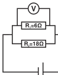

[[Състезания/proletno/8/2021|◂ 2021]] | [[Състезания/proletno/8/2022|условия]] | [[Състезания/proletno/8/2023| 2023 ▸]]

Задача 1:

а) От графиката отчитаме, че времето за промяна на температурата на леда от t = −20 °C до t = 0 °C е $\Delta T_1 = 30\text{ s}$. Топлината от нагревателя за $\Delta T_1$ е $Q_1 = P\cdot\Delta T_1$, т.е. $Q_1 = 33\text{ kJ}$. \[1 т.\]

Необходимата енергия за затопляне на леда е $Q_1 = c_{лед} m\Delta t$, или $c_{лед} = \frac{Q_1}{m\Delta t}$ \[1 т.\]

$c_{лед} = 2063\text{ J/(kg}\cdot^\circ\text{C)}$. \[1 т.\]

б) От графиката получаваме, че времето за топене на леда е $\Delta T_2 = 66\text{ s}$. Мощността на нагревателя при топенето на леда е $P = P_1 + P_2 = 4000\text{ W}$. \[1 т.\]

Топлината от нагревателя за $\Delta T_2$ е $Q_2 = P\cdot\Delta T_2$, т.е. $Q_2 = 264\text{ kJ}$. \[1 т.\] Необходимата енергия за топене на леда е $Q_2 = \lambda m$, или $\lambda = \frac{Q_2}{m}$, \[1 т.\]

$\lambda = 330\,000\text{ J/kg}$. \[1 т.\]

в) От графиката получаваме, че времето за промяна на температурата на водата от t = 0 °C до t = 20 °C е $\Delta T_3 = 94\text{ s}$. Топлината от нагревателя за $\Delta T_3$ е $Q_3 = P\cdot\Delta T_3$, т.е. $Q_3 = 103,4\text{ kJ}$. \[1 т.\]

Необходимата енергия за затопляне на водата е $Q_3 = c_{вода} m\Delta t$, или $c_{вода} = \frac{Q_3}{m\Delta t}$, \[1 т.\]

$c_{вода} = 4308\text{ J/(kg}\cdot^\circ\text{C)}$. \[1 т.\]

Задача 2:

(Фиг.: верига с батерия $U_0$, резистори $R_1 = 6\ \Omega$, $R_2 = 18\ \Omega$, $R_3 = 12\ \Omega$, волтметър V и амперметър A)

Напреженията на резисторите $R_1$ и $R_2$ , са $U_1$ $= U_2$ = UV \[1 т.\] Токът, който протича през
съпротивлението $R_2$ е $I_2 = \frac{U}{R_2} = \frac{U_V}{R_V} = \frac{9\text{ V}}{18\Omega} = 0,5$ A. [1 т.] Токът, който протича през
съпротивлението $R_1$ е $I_1 = \frac{U_1}{R_1} = \frac{U_V}{R_1} = \frac{9\text{ V}}{6\Omega} = 1,5$ A. Общият ток I, който протича във веригата, е
сумата на токовете, които протичат през $R_1$ и $R_2$ , I $= I_1$ $+ I_2$ , I = 2,0 A. \[1 т.\] Напрежението на
резистора $R_3$ е $U_3$ $= I_3 R_3$ = I$R_3$ = 24 V \[1 т.\] Напрежението на батерията е сумата на
напреженията върху резисторите $R_2$ и $R_3$, \[1 т.\] $U_0 = U_V + U_3 = 33\text{ V}$. \[2 т.\]

След изгаряне на един от резисторите, веригата остава от два последователно свързани резистора: $I' = I'R' = I_3'$, $U_0 = U_{R'} + U_3'$. Върху резистора $R_3$ имаме пад на напрежение

$U_3' = I_3'R_3 = 13,2\text{ V}$. \[1 т.\]

Напрежението на другия резистор е $U_{R'} = U_0 - U_3' = 19,8\text{ V}$.

Съпротивлението е $R? = \frac{U'}{I'R} = 18\ \Omega$, т.е. резистор $R_2$ е останал. \[1 т.\] Следователно изгорелият резистор е $R_1$. \[1 т.\]

Задача 3:

Първоначално куршумът има само кинетична енергия $E_k = \frac{mv^2}{2} = 900\text{ J}$. \[1 т.\] При достигане на максималната височина куршумът има само потенциална енергия $E_p = mgh = 725,2\text{ J}$. \[1 т.\]

Извършената работа от силата на триене при издигане на куршума е $A_{up} = E_2 - E_1 = E_p - E_k = -174,8\text{ J}$. \[1 т.\]

Извършената работа от силата на триене при падане на куршума е $A_{down} = -10\%\cdot E_1 = -90\text{ J}$. \[1 т.\] Следователно кинетичната енергия при достигането му на първоначалната точка на изстрелване е $E_{k2} = E_p + A_{down} = 725,2\text{ J} - 90\text{ J} = 635,2\text{ J}$. \[1 т.\]

Крайната скорост на куршума е $v_{кр} = \sqrt{\frac{2E_{k2}}{m}} = 252\text{ m/s}$. \[1 т.\]

Общата работа на силите на триене е $A = -264,8\text{ J}$, \[1 т.\] а общият път е $s = 2h$. \[1 т.\]

Средната сила на триене е $F_{ср} = -\frac{A}{s} = 0,036\text{ N}$. \[2 т.\]

