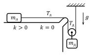
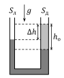

[[Състезания/proletno/8/2023|◂ 2023]] | [[Състезания/proletno/8/2024|условия]] | [[Състезания/proletno/8/2025| 2025 ▸]]

Задача 1. Кинематика (две независими части)

Част I а) От момента, в който шофьорът на камиона бие спирачки, до момента на
разминаване от катастрофа изминава време t и камионът изминава път
$s_k = v_0t - \frac{a_k t^2}{2}$. [0,5 т.]

За това време мотоциклетът изминава път $s_m = v_0t - \frac{a_m(t-\Delta t)^2}{2}$. \[0,5 т.\]

От условието на задачата следва, че sм = sк + $d_0$. От друга страна, скоростите на превозните средства в момента на допиране са
$v_{к0} = v_0 - a_k t$ и $v_{м0} = v_0 - a_m(t - \Delta t)$. \[0,5 т.\]

Относителната скорост тогава е нулева, т.е. vк0 = vм0 и
$t = \frac{a_m \Delta t}{a_m - a_k}$. \[0,5 т.\]

Като заместим времето в съотношението между изминатите пътища, ще получим, че
$d_0 = \frac{a_k a_m (\Delta t)^2}{2(a_m - a_k)}$ [0,5 т.], откъдето
$a_m = \frac{2d_0 a_k}{2d_0 - a_k(\Delta t)^2} = 3\text{ m/s}^2$ \[1 т.\].

б) Изминалото време $t = \frac{a_m \Delta t}{a_m - a_k} = \frac{2d_0}{a_k \Delta t} = 6\text{ s}$. \[1 т.\]

в) Когато разстоянието между превозните средства е отново $d_0$, те са изминали равни
пътища: $s'_k = v_0t' - \frac{a_k {t'}^2}{2} = v_0t' - \frac{a_m(t'-\Delta t)^2}{2} = s'_m$.

Съответното време е
$t' = \frac{\Delta t}{1-\sqrt{1-\frac{a_k(\Delta t)^2}{2d_0}}}$. \[1 т.\]

Търсените скорости са
$v_m = v_0 - a_m(t' - \Delta t) = v_0 - \frac{a_k\Delta t}{\sqrt{1-\frac{a_k(\Delta t)^2}{2d_0}}}\left(1-\sqrt{1-\frac{a_k(\Delta t)^2}{2d_0}}\right) \approx 3,3\text{ m/s}$

и
$v_k = v_0 - a_kt' = v_0 - \frac{a_k\Delta t}{1-\sqrt{1-\frac{a_k(\Delta t)^2}{2d_0}}} \approx 8,2\text{ m/s}$. \[1 т.\]

Част II а) Нека да означим времето на падане във въздуха с $t_1$. Изпълняват се
съотношенията $h = \frac{gt_1^2}{2}$ и $v = gt_1$. \[0,5 т.\] Оттук $v = \sqrt{2gh} = 10\text{ m/s}$. \[1 т.\]

б) Нека да означим времето за потъване във водата с $t_2$. Търсеното
$d = vt_2 = v(t_д - t_1) = v\left(t_д - \sqrt{\frac{2h}{g}}\right) = t_д\sqrt{2gh} - 2h = 3\text{ m}$. \[1 т.\]

в) Средната скорост $v_{ср} = \frac{h+d}{t_д} = \sqrt{2gh} - \frac{h}{t_д} \approx 6,2\text{ m/s}$. \[1 т.\]

Задача 2. Теглилки на триеща се нишка

 а) Първоначално на лявата теглилка действа силата на тежестта $G_л = m_лg$ надолу, реакцията на опората $R = m_лg$ нагоре, силата на опън $T_л$ надясно и силата на триене $f = kR = km_лg$ наляво. \[0,5 т.\]

По условие силата на опън на нишката отдясно на ръба е $T_д = 2T_л$.

На дясната теглилка действа силата на тежестта $G_д = m_дg$, но силата на опън от страна на подвижната макара е $2T_д$ (поради факта, че макарата е безмасова). \[0,5 т.\]

Ако системата е на границата между движението и покоя, $T_л = km_лg$ и $m_дg = 2T_д = 4T_л$. \[1 т.\]

От двете уравнения следва, че $\left(\frac{m_д}{m_л}\right)_{min} = 4k = 1$. \[1 т.\]

б) Като приложим II принцип на Нютон, ще получим: $T_л - km_лg = m_ла_л$ \[1 т.\] (за лявата теглилка) и $m_дg - 4T_л = m_да_д$ \[1 т.\] (за дясната теглилка).

Може да се съобрази, че $a_л = 2a_д$, тъй като лявата теглилка изминава двойно по-голям път от дясната теглилка, а пътят е пропорционален на ускорението при движение без начална скорост. \[0,5 т.\]

От горните уравнения следва, че $\frac{m_д}{m_л} = \frac{8(kg + a_л)}{2g - a_л} = 2$. \[1,5 т.\]

в) В този случай уравненията на Нютон за двете теглилки са: $T_л' = m_лa_л'$ \[0,5 т.\] (за лявата теглилка) и $m_дg - 4T_л' = m_да_л'/2$ \[1 т.\] (за дясната теглилка).

Оттук следва, че $a_л' = \dfrac{2gm_д}{m_д + 8m_л} = 4\text{ m/s}^2$. \[1,5 т.\]

Задача 3. Статика на флуиди (две независими части)

 Част I а) Двете колена на тръбата образуват скачени съдове. Ако мерим височините от долния край на стълба олио, нека да означим височината на стълба вода отляво с $h_в$.

От условието за равенство на наляганията следва, че $\rho_вgh_в = \rho_оgh_о$. \[1 т.\]

Търсеното $\Delta h = h_о - h_в = h_о\left(1 - \frac{\rho_о}{\rho_в}\right) = 2\text{ cm}$. [1 т.]

б) Новото ниво на водата отляво ще бъде на нивото на дупката, т.е. отляво
 нивото на водата спада с dд . \[0,5 т.\] За да има равновесие, отдясно нивото
 на водата също трябва да спадне с dд . \[0,5 т.\] Следователно, обемът на
изтеклата вода ще бъде Vизт = dд (Sл + Sд ) $= 9 \text{cm}^{3}$ . \[1 т.\]

Част II а) Във въздуха силата на опън $T_1$ на нишката е равна на силата на тежестта: $T_1 = m_кg$, където сме означили масата на камъка с $m_к$. \[0,5 т.\]

Във водата условието за равновесие на камъка води до $T_2 + \rho_вV_кg = m_кg$, откъдето $V_к = \frac{T_1 - T_2}{\rho_в g}$. \[1,5 т.\]

Накрая, в неизвестната течност $T_3 + \rho_xV_кg = m_кg$, откъдето $\rho_x = \frac{T_1-T_3}{V_кg} = \frac{T_1-T_3}{T_1-T_2}\rho_в$. \[2 т.\]

б) След прерязването на нишката сумарната сила върху камъка е $m_кg - \rho_xV_кg = m_ка_к$. \[1 т.\]

Оттук $a_к = g - \frac{\rho_xV_кg}{m_к} = g\cdot\frac{T_3}{T_1}$. \[1 т.\]
