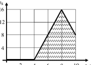
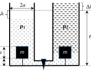

[[Състезания/proletno/8/2024|◂ 2024]] | [[Състезания/proletno/8/2025|условия]] | [[Състезания/proletno/8/2026| 2026 ▸]]

Задача 1. Насам - натам
 $2 F_2 - F_1 - \text{km}$g
А) a= (2 т)
 m

Б) Равнодействащата сила от страна на нишките върху трупчето е:
 F $= 2 F_2$ - $F_1$ (0,5 т)
Трупчето ще започне да се движи, ако силата F = kmg = 4 N. (0,5 т) Видно е от графиките,
че движението ще започне в момента $t_0$ = 4 s. (0,5 т). Ускорението на трупчето а1:
 F-f
 $a_1$ = m = 4 m/$s_2$ (1 т)

След момента $t_1$ = 8 s до момента $t_2$ = 10 s трупчето ще се движи равнозакъснително, само
под действие на силата на триене, с ускорение $a_2$ = $- 4 \left(\text{m/s}\right)^{2}$. (0,5 т)
Да обобщим: № Интервал от време, s Ускорение, а
 (разлика в моментите) m/$s_2$
 1 0-4 0 (покой)
 2 4-8 4
 3 8 - 10 -4

В)
 F, N v, m/s
 8 16

 6 12

 4 8

 2 4

 2 4 6 8 10 t, s 2 4 6 8 10 t, s
За вярна графика по F = F(t) (2 т) За вярна графика v = v(t) (1 т)
Г) От графиките за силите $F_1$, $F_2$ е ясно, че с ускорение а1 трупчето ще се движи до момент
$t_1$ = 8 s. В момента $t_1$ = 8 s силите прекратяват действието си. Скоростта на тялото в този
момент:
 $v_1$ $= a_1$.($t_1$ - $t_0$) = 16 m/s (0,5 т)
В момента $t_2$ = 10 s скоростта е равна на: $v_2$ $= v_1$ + $a_2$($t_2$ - $t_1$) = 8 m/s. (0,5 т)
Д) За по-лесно намиране на изминатия път S ще използваме графиката v = v(t).
Защрихованата площ е равна на изминатия път за 10 s: S = 0,5.16.4 + 0,5.(16 + 8).2 = 56 m (1
т)
Зад. 2. Powerbank - ремарке с батерия за електромобил
А) за ремаркето: $\frac{m_1 v^2}{2} = km_1 g S_{рем}$ (0,5 т)

за електромобила: $\frac{(m-m_1)v^2}{2} = k(m - m_1)gS_{електро}$ (0,5 т)

Двете разстояния са равни (Sрем = Sелектро). (0,5 т)
Б) Докато автомобилът и ремаркето са свързани и се движат равномерно, теглителната Fт
сила е равна на силата на триене f:
$F_т = f = kmg$. (0,5 т)
След като ремаркето се откъсне, силата на триене намалява, но теглителната сила остава
същата. Равнодействащата сила F е:
$F = kmg - k(m - m_1)g = km_1 g$ (1 т)
$F = 800$ N (0,5 т)
В) Поради действието на силата F се изменя кинетичната енергия на електромобила.
Изменението на кинетичната енергия $\Delta E_k$ е равна на:
$\Delta E_k = F\cdot S = km_1 gS$ (1 т)
Нека отбележим с $S_1$ (в нашия случай $S_1$ = Sрем, получено в подусловие А)) пътя, изминат от
ремаркето до пълно спиране и с $S_2$ - пътя, изминат от електромобила до пълно спиране
след спирането на двигателя му. Тогава за търсеното разстояние Sx:
$S_x = S + S_2 - S_1$ (0,5 т)
Когато се е изключил двигателя на електромобила, кинетичната му енергия Ek е:
$E_k = \frac{(m-m_1)v^2}{2} + \Delta E_k = \frac{(m-m_1)v^2}{2} + km_1 gS$ (1 т)

От друга страна, ако електромобилът веднага изключи двигателя след откъсването на
ремаркето (вж подусловие А)):
$\frac{(m-m_1)v^2}{2} = k(m - m_1)gS_1$ (1 т)

$E_k = k(m - m_1)gS_1 + km_1 gS$. (1 т)
Тази кинетична енергия ще бъде "изразходвана" за работа от силата на триене за
преодоляване на пътя $S_2$:
$k(m - m_1)gS_2 = k(m - m_1)gS_1 + km_1 gS$ (1 т)

$S_2 - S_1 = \frac{m_1 S}{m-m_1}$ (0,5 т)

Окончателен резултат: $S_x = S + S_2 - S_1$
$S_x = \frac{mS}{m-m_1} \approx 222$ m (0,5 т)

Зад. 3. Скачени съдове
А) Записваме условие за равновесие на кубчетата до отваряне на крана:
$mg + 3T = \rho_1 g a^3$; /1/ (0,5 т)
$mg + T = \rho_2 g a^3$; /2/ (0,5 т)
Откъдето и получаваме:
$\rho_1 - \rho_2 = \frac{2T}{a^3 g} > 0$ /2a/ (0,5 т)

Следователно $\rho_1 > \rho_2$. (0,5 т)
Б) След отварянето на крана част от течността $\rho_1$ (по-плътната) ще прелее в десния съд.
Силата на опън върху дясното кубче се е увеличила до 2T, следователно дясното кубче не е
потопено изцяло в течността с плътност $\rho_1$, а само частично. (0,5 т) Нека в по-леката
течност е потопена k - част от дясното кубче.
$mg + 2T = (1-k)\rho_1 g a^3 + k\rho_2 g a^3$; /3/ (1 т)
Като използваме уравнения /1/, /2/ и /3/ (удвоената част на уравнение /3/ е равна на сумата
на левите части на /1/ и /2/) се получава:
$2(1-k)\rho_1 g a^3 + 2k\rho_2 g a^3 = \rho_1 g a^3 + \rho_2 g a^3$ (1 т)
$2(1-k)\rho_1 + 2k\rho_2 = \rho_1 + \rho_2$
$\rho_1 - \rho_2 = 2k(\rho_1 - \rho_2)$, $k = 0,5$ (0,5т)
Следователно кубчето ще е потопено наполовина в течност $\rho_1$ и наполовина в течност $\rho_2$. (0,5 т)
В) Височината на стълба от течността $\rho_1$ в дясното коляно е равна на $h_1 = a$, а в левия съд кубът остава
изцяло потопен в $\rho_1$. (0,5 т) Понеже течностите са несвиваеми, намираме изменението на нивото $\Delta h$
за двата съда:
$\Delta h \cdot 4a^2 = a\cdot 4a^2 - \frac{a}{2}\cdot a^2$ (0,5 т)

$\Delta h = \frac{7a}{8}$ (0,5 т)

Нека запишем условието за равновесие на течностите спрямо дъното на съдовете (нивото
на тънката тръбичка):
$p_0 + \rho_1 g(6a - \Delta h) = p_0 + \rho_1 ga + \rho_2 g(6a + \Delta h - a)$ (0,5 т)
Където с $p_0$ е отбелязано атмосферното налягане. Окончателно за $\rho_2$:
$\rho_2 = \frac{33}{47}\rho_1$ (0,5 т)

Като използваме уравнение /2а/ се получава за търсените плътности:
$\rho_1 = \frac{47T}{7a^3 g}$; $\rho_2 = \frac{33T}{7a^3 g}$ (1 т)

От условието за равновесие за кубчето:
$mg + T = \frac{33T}{7a^3 g}\cdot ga^3$ (0,5 т)
$m = \frac{26T}{7g}$ (0,5 т)

