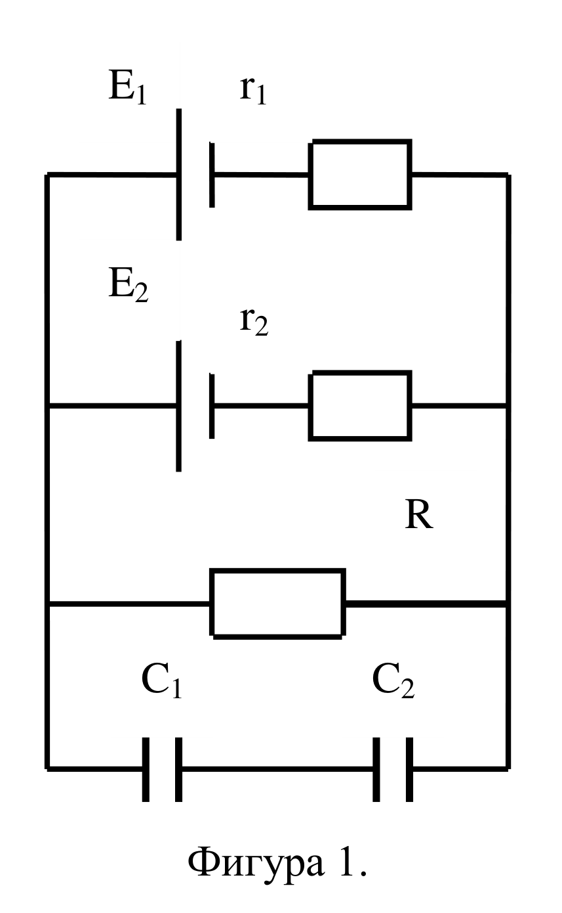
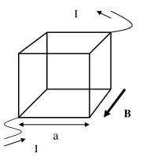

**Задача 1.**

Коефициентът на полезно действие на топлинни машини се дефинира като $\eta = A/Q_H$, където $A$ е работата, а $Q_H$ — полученото по време на процеса количество топлина. [1 т.]

За машина на Карно $\eta = 1 - T_0/T_H$, където $T_0$ е температурата на охладителя, а $T_H$ — на нагревателя. [1 т.]

Откъдето получаваме

$$A = Q_H\left(1 - \frac{T_0}{T_H}\right). \qquad [1 \text{ т.}]$$

или

$$T_H = \frac{T_0}{1 - A/Q_H}. \qquad [1 \text{ т.}]$$

Работата изразяваме чрез придобитата кинетична енергия на тялото

$$A = \tfrac{1}{2}\left(m v_2^2 - m v_0^2\right) = \tfrac{1}{2} m v_2^2. \qquad [2 \text{ т.}]$$

Откъдето получаваме за температурата на нагревателя

$$T_H = \frac{T_0}{1 - \dfrac{m v_2^2}{2 Q_H}}. \qquad [2 \text{ т.}]$$

Или съответно $T_{H_1} = 332\ \mathrm{K}$ [1 т.] и $T_{H_2} = 449\ \mathrm{K}$. [1 т.]

**Задача 2.**

Ако означим с $I_1$ тока, който тече през ЕДН$_1$, с $I_2$ — този през ЕДН$_2$ и с $I$ — тока през товарното съпротивление $R$, прилагайки правилата на Кирхоф получаваме:

$$I = I_1 + I_2,$$
$$E_1 = r_1 I_1 + R I,$$
$$E_2 = r_2 I_2 + R I.$$

[1 т.]

Откъдето може да определим трите тока

$$I = \frac{E_1 r_2 + E_2 r_1}{r_1 r_2 + (r_1 + r_2)R},$$
$$I_1 = \frac{(E_1 - E_2)R + E_1 r_2}{r_1 r_2 + (r_1 + r_2)R},$$
$$I_2 = \frac{(E_2 - E_1)R + E_2 r_1}{r_1 r_2 + (r_1 + r_2)R}.$$

[1 т.]

$I = 3/8\ (0{,}375)\ \mathrm{A}$; $I_1 = -6/8\ (-0{,}75)\ \mathrm{A}$; $I_2 = 9/8\ (1{,}125)\ \mathrm{A}$. [1 т.]

а) Напрежението върху кондензаторите е равно на пада на напрежение върху товарното съпротивление

$$\frac{q_1}{C_1} + \frac{q_2}{C_2} = I R,$$

но зарядът върху кондензаторите е един и същ $q$, или

$$q = I R \frac{C_1 C_2}{C_1 + C_2}. \qquad [1 \text{ т.}]$$

$$U_1 = \frac{q}{C_1} = I R \frac{C_2}{C_1 + C_2} = \frac{(E_1 r_2 + E_2 r_1) R C_2}{(C_1 + C_2)\left[r_1 r_2 + (r_1 + r_2)R\right]},$$
$$U_2 = \frac{q}{C_2} = I R \frac{C_1}{C_1 + C_2} = \frac{(E_1 r_2 + E_2 r_1) R C_1}{(C_1 + C_2)\left[r_1 r_2 + (r_1 + r_2)R\right]}.$$

[1 т.]

$U_1 = 5/2\ (2{,}5)\ \mathrm{V}$; $U_2 = 5/4\ (1{,}25)\ \mathrm{V}$. [1 т.]

б) Мощността на енергията, която се разсейва от всяко едно от съпротивленията е:

$$W_1 = r_1 I_1^2, \qquad W_2 = r_2 I_2^2 \qquad \text{и} \qquad W = R I^2. \qquad [1 \text{ т.}]$$

Или

$W_1 = 9/16\ (0{,}5625)\ \mathrm{W}$; $W_2 = 81/32\ (2{,}53)\ \mathrm{W}$ [1 т.]
$W = 45/32\ (1{,}41)\ \mathrm{W}$. [1 т.]

в) Енергията, запасена във всеки един от кондензаторите

$$W_{C_1} = \tfrac{1}{2} C_1 U_1^2 \qquad \text{и} \qquad W_{C_2} = \tfrac{1}{2} C_2 U_2^2. \qquad [1 \text{ т.}]$$

или [1 т.], като големините са съответно

$W_{C_1} = 125/2\ (62{,}5)\ \mu\mathrm{J}$ и $W_{C_2} = 125/4\ (31{,}25)\ \mu\mathrm{J}$. [1 т.]

**Задача 3.**

Ако проводник с дължина $L$, по който тече ток с големина $I$ е поставен във външно магнитно поле с големина $B$, на него действа сила. Когато проводникът е успореден на магнитното поле, силата е нула [1 т.], а когато е перпендикулярен на полето, силата $F$ е максимална с големина

$$F = I L B. \qquad [1 \text{ т.}]$$

Задачата се свежда до определяне на тока през всеки един ръб на куба и посоката на действащата сила, използвайки правилото на дясната ръка.

Тъй като кубът е фигура с висока симетрия, разпределението на тока се получава отчитайки тази симетрия. Във входната точка тока се разделя на три — т.е. по всеки един от прилежащите на входната точка проводници тече ток с големина $I/3$. [1 т.] Същото важи и за входящите в изходната точка три проводника. В останалите 6 проводника, които също са разположени симетрично, трябва да тече два пъти по-малко ток — $I/6$. [1 т.]

Четири от проводниците са успоредни на външното магнитно поле и върху тях силата ще бъде нула. [1 т.] От останалите 4 са ориентирани по посока ляво-дясно за нас, при всичките токовете текат от ляво на дясно и следователно силите са насочени надолу [1 т.], като големините са съответно

$$F = \frac{I}{3} a B$$

за проводници до входящите и изходящи точки и

$$F = \frac{I}{6} a B \qquad [1 \text{ т.}]$$

за другите два проводника, като общата сила, действаща върху куба и сочеща надолу ще бъде

$$F = I a B,$$

или $F = 0{,}05\ \mathrm{N}$. [1 т.]

По подобен начин разглеждаме и останалите 4 проводника с посока горе-долу на чертежа. Силата е насочена надясно за нас [1 т.] и е със същата големина $F = 0{,}05\ \mathrm{N}$. [1 т.]
