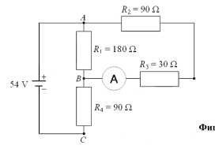
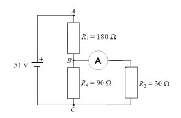
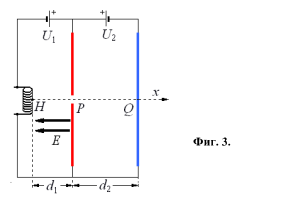
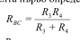
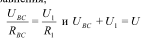
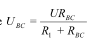

[[Състезания/proletno/9/2012|◂ 2012]] | [[Състезания/proletno/9/2013|условия]] | [[Състезания/proletno/9/2014| 2014 ▸]]

Задача 1. Куршум
а) Промяната в кинетичната енергия на куршума е:

$\Delta E = m\frac{v_1^2 - v_0^2}{2} = -24$ J 2 точки

б) Промяната в кинетичната енергия се изразходва за стопяването на леда:

$\Delta E = \lambda_{л}\Delta m$ 1 точка

$\Delta m = 7\cdot 10^{-5}$ kg $= 0,07$ g 1 точка
 в) 80% от кинетичната енергия на куршума се превръщат в топлинна. В резултат
куршумът се нагрява до температурата на топене на оловото и след това се стопява.
Уравнението, описващо процеса на стопяване на куршума, е:

$0,8m\cdot\frac{v_2^2}{2} = m(T_{Pb} - T)c_{Pb} + m\lambda_{Pb}$ 2 точки

Чрез съкращаване на масата и преобразуване се стига до крайния резултат:

$T = T_{Pb} - \frac{1}{c_{Pb}}(0,4v_2^2 - \lambda_{Pb}) = 280\ ^\circ C$ 2 точки
 г) Според резултата от предишната подточка количеството разтопено олово не
зависи от масата на куршума. 1 точка
 По тази причина и при двойно по-голяма маса целият куршум ще се разтопи.1 точка

 Задача 2. Електрическа верига
 Обозначаваме общото напрежение с U.

 Фиг. 1.

 а) Отвореният ключ може да бъде пренебрегнат и с това електрическата верига може
да бъде представена като на фиг. 1. 1 точка
 Резисторите $R_2$ и $R_3$ са свързани последователно. Заедно те са свързани успоредно на
$R_1$. С това еквивалентното съпротивление между A и B е

$R_{AB} = \frac{R_1(R_2 + R_3)}{R_1 + R_2 + R_3} = 72\ \Omega$ 1 точка

 б) RAB е последователно свързано с $R_4$. Това означава, че токът през тях е един и същ
и важат следните уравнения,

$\frac{U_{AB}}{R_{AB}} = \frac{U_4}{R_4}$ и $U_{AB} + U_4 = U$ 1 точка

Чрез преобразуване получаваме $U_{AB} = \frac{UR_{AB}}{R_4 + R_{AB}} = 24$ V 1 точка

 в) Токът през амперметъра е

$I_1 = \frac{U_{AB}}{R_2 + R_3} = \frac{UR_1}{R_4(R_1 + R_2 + R_3) + R_1(R_2 + R_3)} = 0,2$ A 1 точка

 г) Съпротивлението $R_2$ е под същото напрежение U = 54 V като останалите три
резистора, взети заедно. 1 точка
 То не влияе нито на напреженията, нито на токовете през тях. Еквивалентната схема
е показана на фиг. 2. 1 точка

 Фиг. 2.

 д) В случая е необходимо да определим напрежението между точките B и C. За
целта първо определяме еквивалентното съпротивление,

$R_{ВС} = \frac{R_3 R_4}{R_3 + R_4}$ 0,5 точка

$R_{BC}$ е последователно свързано с $R_1$. Токът през тях е един и същ и важат следните
уравнения,

$\frac{U_{BC}}{R_{BC}} = \frac{U_1}{R_1}$ и $U_{BC} + U_1 = U$ 1 точка

Чрез преобразуване получаваме $U_{BC} = \frac{UR_{BC}}{R_1 + R_{BC}}$ 0,5 точка
 Токът през амперметъра е

$I_2 = \frac{U_{BC}}{R_3} = \frac{UR_4}{R_1(R_3 + R_4) + R_3 R_4} = 0,2$ A 1 точка

Задача 3. Електрони в електростатично поле
 а) Плочата P е положително заредена. Линиите на електричното поле са, както е
показано на фиг. 3. 0,5 точки

 Фиг. 3.

 Електроните се движат срещу линиите на полето. Върху тях действа постоянна
електростатична сила което означава, че движението им е равноускорително. 0,5 точки
б) Силата, която действа на електроните, е

$F = ma_1 = eE = e\frac{U_1}{d_1}$ 0,5 точки

а ускорението а1 е $a_1 = \frac{eU_1}{md_1} = 3,5\cdot 10^{15}$ m/s² 0,5 точки

в) Изминатият от електроните път е

$d_1 = \frac{a_1 t^2}{2}$ 0,5 точки

Времето за изминаване на разстоянието е

$t = \sqrt{\frac{2d_1}{a_1}} = 5,3\cdot 10^{-9}$ s 0,5 точки

 г) Тук важи същото като в подточка б). Ускорението а2 на електроните е,

$a_2 = \frac{eU_2}{md_2} = 2,6\cdot 10^{15}$ m/s² 1 точка

 д) До момента на спирането на електрона цялата му кинетична енергия се превръща
в потенциална. Електричната сила извършва работа, равна на кинетичната енергия на
електрона,

$E_k = Fx$ 0,5 точки

Кинетичната енергия в началото е $E_k = eU_1$ 0,5 точки

$eU_1 = Fx = \frac{eU_2}{d_2}x$ 0,5 точки

Разстоянието на което се отдалечава електроните е

$x = \frac{U_1 d_2}{U_2} = 6,7\cdot 10^{-2}$ m. 0,5 точки

 е) Зависимостта между изминатия път и времето е показана на фиг. 4, а зависимостта
между скоростта и времето е показана на фиг. 5. За всяка графика се дават по 1,5 точки,
като на всяка от тях трябва да присъстват следните елементи:

Време-път:
 - начало и точка P ($5,3\cdot 10^{-9}$ s; $5\cdot 10^{-2} m$) 0,5 точки
 - крайна точка ($12,6\cdot 10^{-9}$ s; $11,7\cdot 10^{-2} m$) 0,5 точки
 - правилна форма на графиката 0,5 точки

 Фиг. 4.

Време-скорост:
 - начало и точка P ($5,3\cdot 10^{-9}$ s; $1,9\cdot 10^{7} \text{m/s}$) 0,5 точки
 - крайна точка ($12,6\cdot 10^{-9}$ s; 0 m/s) 0,5 точки
 - правилна форма на графиката 0,5 точки

 Фиг. 5.

ж) Използваме резултата за изминатия път от подточка д) $x = \frac{U_1 d_2}{U_2}$ 0,5 точки

Заместваме x с $d_2$ и получаваме $U_1 = U_2 = 1,2$ kV 0,5 точки
