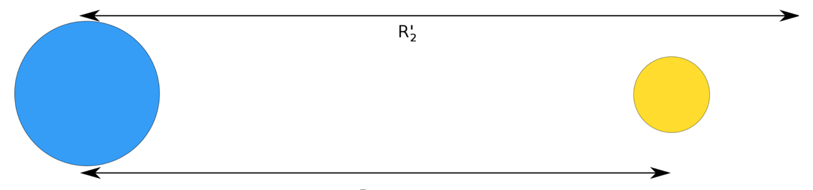
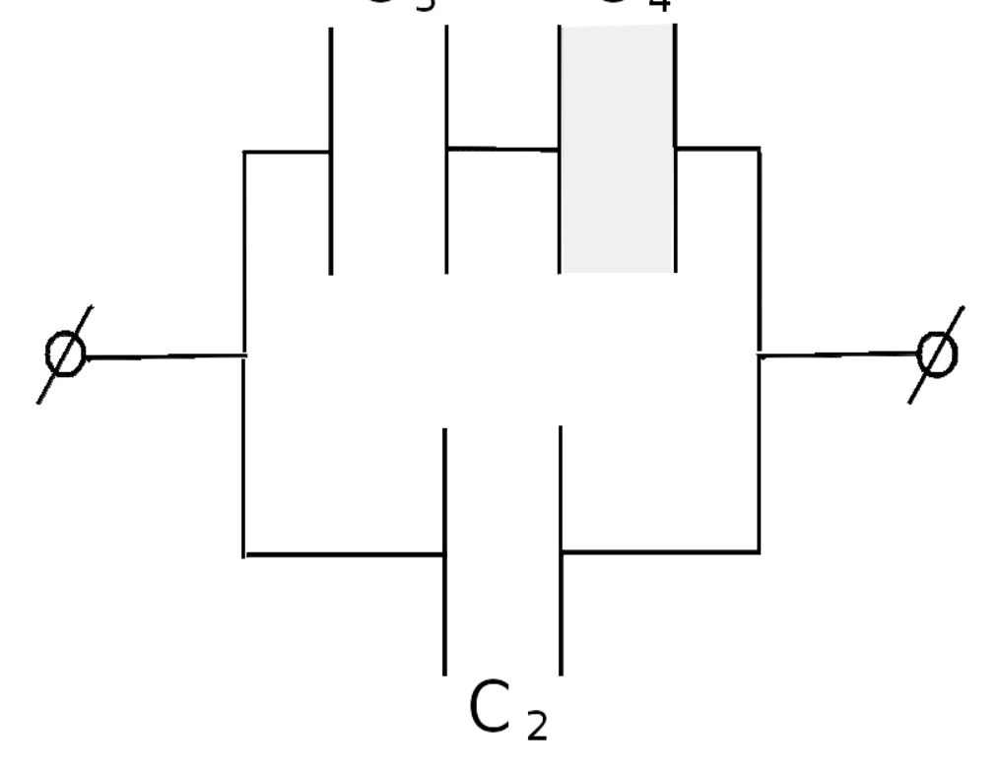
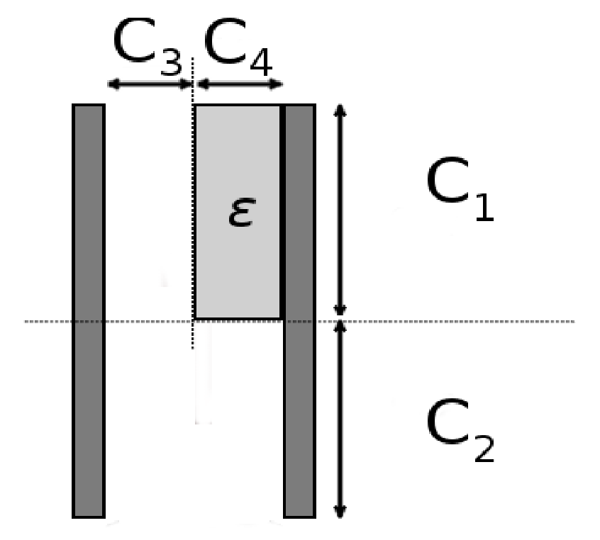

[[Състезания/proletno/9/2013|◂ 2013]] | [[Състезания/proletno/9/2014|условия]] | [[Състезания/proletno/9/2015| 2015 ▸]]

Задача 1. Електростатика (10 точки)

Част 1.

а) Броят електрони се намира по формулата
Q = Ne, където e e елементарният заряд на електрона. (0,5 точки)
$N = \frac{Q}{e} = \frac{2,4.10^{-3} C}{1,6.10^{-19}C} = 1,5. 10^{16}$ . (0,5 точки)

б) Вратата е електронеутрална, защото е свързана със земята. Докосвайки я, Елена й предава заряда си, докато се неутрализира. Това се усеща като лек токов удар и понякога може да се види лека искра. (1 точка)

в) Токът се определя по формулата

$I=\frac{Q}{t} =\frac{  2,4.10^{-3} C}{ 0,25 s}= 9,6.10^{-3} A$. (1 точка)

Част 2. Когато вторият кондензатор се свърже към първия, зарядът в системата остава постоянен. Той се определя по формулата $q = CU_1$ . (0,5 точки)

Капацитетът на системата от два кондензатора е $C'' = C + C'$.

Тъй като зарядът е непроменен,
$q = CU_1 = C''U_2 = (C + C')U_2$ (0,5 точки)

С това за втория кондензатор се получава

$C' = \frac{ C(U_1 -U_2 )}{U_2}$ (0,5 точки)
$C ' = 0,1 pF$. (0,5 точки)

Част 3.

Кондензаторът може да се разглежда като система от два успоредно свързани кондензатора с капацитети $C_1$ и $C_2$ , както е показано на фиг. 1. $C_1$ е система от два последователно свързани кондензатора, като единият от тях не съдържа диелектрична пластина и има капацитет $C_3$ , а другият е изцяло запълнен с диелектрик и има капацитет $C_4$ . Еквивалентната схема е показана на фиг. 2. Правилна схема+обяснение. (1 точка)

Определяме капацитетите на кондензаторите поотделно. Капацитетът на кондензатора без диелектрична пластина е $C = \frac{\varepsilon_0 S}{d}$.

$C_2 = \frac{\varepsilon_0 S}{2d} = \frac{C}{2}$ (0,5 точки)
$C_3 = \frac{\varepsilon_0 S}{d} = C$ (0,5 точки)
$C_4 = \frac{\varepsilon\varepsilon_0 S}{d} = \varepsilon C = 2C$ (0,5 точки)
$\frac{1}{C_1} = \frac{1}{C_3} + \frac{1}{C_4}$ (0,5 точки)
$C_1 = \frac{2}{3}C$ (0,5 точки)
$C_0 = C_1 + C_2$ (0,5 точки)
$C_0 = \frac{C}{2} + \frac{2}{3}C = \frac{7}{6}C = 0,7 \text{ pF}$ (1 точка)

Задача 2. Заряди в гравитационно поле (10 точки)

а) Силата на опъване на нишката T е равна по големина и противоположна по посока на
силата на тежестта G, която действа на топчето
T = G = mg (0,5 точки)

T = 0,0098 N. (0,5 точки)

б) Силата на опъване на нишката е 0, т.е. силата на тежестта и силата на Кулон, с която
второто топче му действа, се уравновесяват. (0,5 точки)

Това означава, че двете топчета се отблъскват, т.е. зарядът на второто топче е със същия знак като на първото - положителен. (0,5 точки)

в) Силата на опъване на нишката е 0, ако
$G = F_C$ (0,5 точки)
$G = \frac{ kq^2}{H^2}$ (0,5 точки)
$H = q\sqrt{\frac{k}{G}}$ (0,5 точки)

H = 0,096 m (0,5 точки)

г) Означаваме топчетата с 1 (най-горно), 2 (средно) и 3 (най-долно).

За средното топче важи
$G + F_C^{12} = F_C^{23}$ . (0,5 точки)

За да може силата на опъване на долната нишка да е 0, е необходимо поне една сила да
действа нагоре, т.е. то се отблъсква от най-долното топче. Това означава, че най-долното
топче е със същия по знак заряд - положителен. (0,5 точки)

Така уравнението на силите на средното топче е

$G + \frac{ kq^2}{h^2} = \frac{ kQq}{4h^2}$ . (1 точка)

За най-горното топче важи:

$G = F_C^{12} + F_C^{13}$ , (0,5 точки)
тъй като знаем, че силата на опъване на нишката е 0. Уравнението може да се представи като
$G = \frac{ kq^2}{h^2} + \frac{ kQq}{9h^2}$ . (1 точка)

След изваждане на двете уравнения едно от друго и преобразуване се получава
$Q= \frac{72}{5}q$ (2 точки)

Q = 1,44 $\mu$C. (0,5 точки)

Задача 3. Свободно падане и земно ускорение (10 точки)

Част 1. Времето от момента на пускане на камъка до момента, в който той се чува да удря дъното на кладенеца, може да се разглежда като сума на две времена:

$t_1$ е времето на падане на камъка до дъното
$t_2$ е времето, необходимо на звука да стигне от дъното на кладенеца до върха му.

$t = t_1 + t_2$ , т.е. $t_2 = t - t_1$ .

Първо разглеждаме свободното падане на камъка. Времето на падане се определя от
формулата
$h = \frac{gt_1^2}{2}$ . (0,5 точки)

Второто движение е това на звука. То е равномерно и се определя по формулата
$h = v_S t_2 = v_S (t - t_1 )$. (0,5 точки)

Това води до уравнението

$\frac{gt_1^2}{2} = v_S (t - t_1 )$, което след преобразуване може да се представи като
$gt_1^2 + 2v_S t_1 - 2v_S t = 0$. (0,5 точки)

Това уравнение има две решения,
$t_1^{1,2} =\frac{-v_S \pm\sqrt {v_S^2 +2gtv_S}}{g}$
 , от които очевидно едното е с отрицателна стойност и няма физичен
 g
смисъл. (0,5 точки)

Второто решение е $t_1^{2} =\frac{-v_S +\sqrt {v_S^2 +2gtv_S}}{g} = 2,88 s$. (0,5 точки)

За него намираме $h = \frac{gt_1^2}{2} = 40,6 m$. (0,5 точки)

Алтернативно решение
Времето от момента на пускане на камъка до момента, в който той се чува да удря дъното на кладенеца, може да се разглежда като сума на две времена:

$t_1$ е времето на падане на камъка до дъното
$t_2$ е времето, необходимо на звука да стигне от дъното на кладенеца до върха му.

Времето на разпространение на звука може да се пренебрегне, тъй като е много малко в
сравнение с времето на падане на камъка. (1 точка)
$h = \frac{gt_1^2}{2} =  44,1 m$. (1 точка)

Звукът изминава това разстояние за $t_2 = \frac{h}{v_s} = 0,13 s$. (0,5 точки)

Това време е много по-малко от времето на падане на камъка и може да се пренебрегне,
защото грешката при измерването би била от същия порядък, ако то се извършва по не
особено прецизен начин, например с ръчно управляван секундомер или ако се вземе
предвид, че земното ускорение варира в зависимост от местоположението и географската ширина. (0,5 точки)

Част 2.

а) На повърхността на Земята
$g_E(R_E) = \frac{C_E}{R_E^2} \Rightarrow C_E = g_E(R_E)R_E^2$
$C_E = 4,02 \cdot 10^{14} \text{ m}^3 / \text{s}^2$.

б) По същия начин както в подточка а),
$C_M = g_M(R_M)R_M^2 = 0,179,81 \text{ m/s}^2 \cdot 2,96 \cdot 10^{12}\text{m} = 4,8 \cdot 10^{12} \text{ m}^3 / \text{s}^2.$

в) $\frac{m_E}{m_M} = \frac{C_E}{C_M} = 83,8$

г) Силите на тежестта на Луната и на Земята, които действат на даден обект, се уравновесяват, когато $g_E = g_M$. (0,5 точки)

Разстоянието до Земята е $R'$, а това до Луната е $R - R'$.

$g_E(R') = g_M(R - R')$
$\frac{C_E}{R'^2} = \frac{C_M}{(R - R')^2}$ (0,5 точки)

След преобразуване
$(C_E - C_M)R'^2 - 2C_E R R' + C_E R^2 = 0.$ (0,5 точки)

Това уравнение има две решения,
$R'_{1,2} = \frac{C_E R \pm \sqrt{(C_E R)^2 - (C_E - C_M)C_E R^2}}{C_E - C_M} = \frac{C_E R \pm \sqrt{C_M C_E} R}{C_E - C_M}$ (0,5 точки)

$R'_1 = 0,90R = 3,46 \cdot 10^5 \text{ km}$ (0,5 точки)
$R'_2 = 1,12R = 4,31 \cdot 10^5 \text{ km}$. (0,5 точки)

Второто решение на уравнението се намира "зад" Луната от гледна точка на Земята. Там
силите на тежестта на Луната и на Земята са равни, но действат в една и съща посока, т.е. не се уравновесяват. Физично решение е единствено $R'_1$. (0,5 точки)

Правилен чертеж. (0,5 точки)