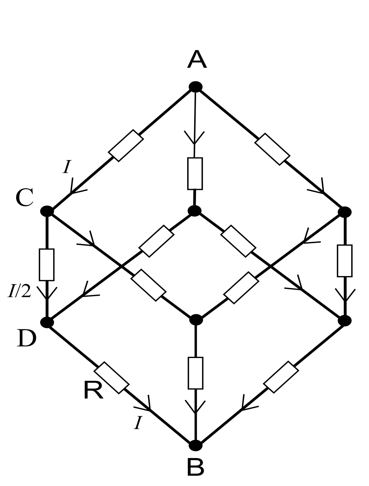
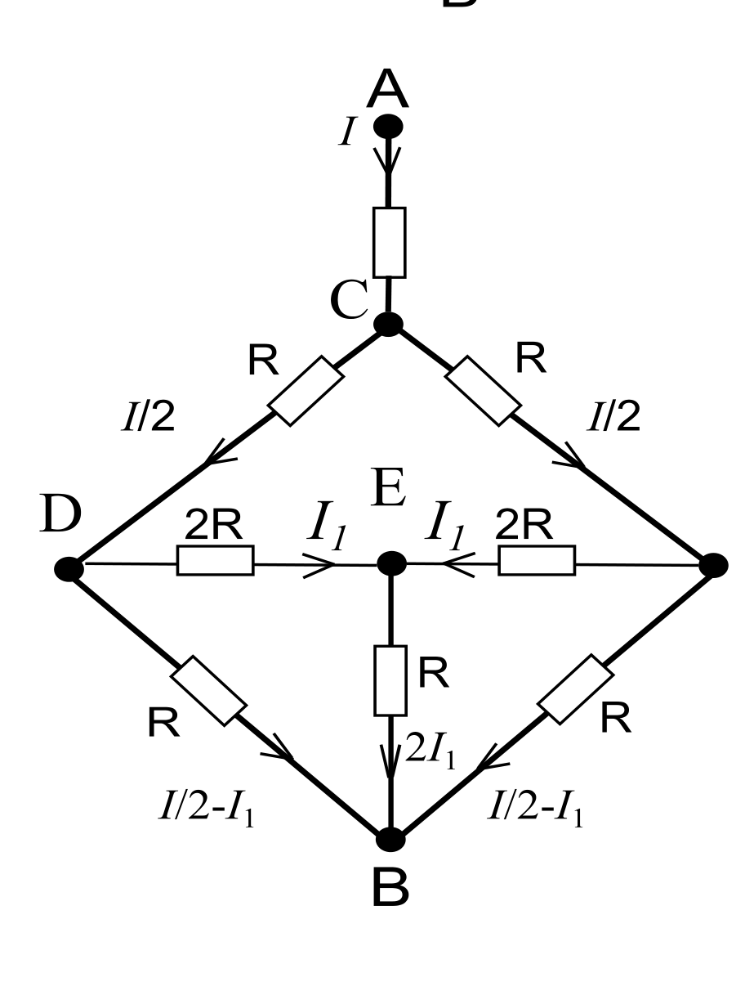
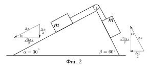

[[Състезания/proletno/9/2014|◂ 2014]] | [[Състезания/proletno/9/2015|условия]] | [[Състезания/proletno/9/2016| 2016 ▸]]

Задача 1. Електрическа схема

а) Схемата е показана на фигура 1а \[0.5т\]. Нека в т. А влиза ток $3I$.

Поради симетрията, токът се разделя на три равни части, така че по клона А-С тече ток с големина $I$. Във възел С, отново от съображения за симетрия, токът се дели на две равни части и по клона C-D тече ток $I/2$. По клона D-B тече ток $I$ \[1т\].

Нека да сумираме потенциалните разлики по контура А-C-D-B.

Имаме $U = U_{AC} + U_{CD} + U_{DB} = R_{AB}\cdot 3I$ \[0.5т\], където $U$ е напрежението между т. А и т. В. Така получаваме

$$R_{AB}\cdot 3I = RI + \frac{RI}{2} + RI, \qquad \text{т.е.} \qquad R_{AB} = \frac{5R}{6}. \qquad [1\text{т}]$$

(Друг подход е да се разгледа еквивалентна схема от последователно свързани резистори с големина $R/3$, $R/6$ и $R/3$.)

б) Кондензаторът се зарежда до напрежение $U_{AC}$, което е равно на $RI$ \[1т\]. За заряда намираме $q = CU_{AC} = CRI$ \[0.5т\].

Изразяваме $I$ чрез $U$ и $R$: $U = R_{AB}\cdot 3I = \frac{5RI}{2}$, откъдето $I = \dfrac{2U}{5R}$ \[0.5т\]. Така получаваме $q = \dfrac{2CU}{5}$ \[1т\].

в) Еквивалентната схема е показана на фигура 1в \[1т\].

Отново сумираме напреженията на отделните участъци.

Получаваме $U = U_{AC} + U_{CD} + U_{DB} = RI + \dfrac{RI}{2} + R\left(\dfrac{I}{2} - I_1\right)$ \[1т\].

Токът $I_1$ намираме от равенството: $U_{DB} = U_{DE} + U_{EB}$ \[0.5т\]. Така намираме

$$R\left(\frac{I}{2} - I_1\right) = 2RI_1 + R\cdot 2I_1, \qquad \text{т.е.} \qquad I_1 = \frac{I}{10}$$

и $U = \dfrac{19}{10}RI$ \[0.5т\]. Следователно $R_{AB} = \dfrac{U}{I} = \dfrac{19}{10}R$ \[1т\].

Задача 2. Механика

Ще използваме изцяло енергетичен подход. Друг възможен метод е чрез използване на сили.
a)

 Фиг. 2

Тъй като телата се движат с постоянна скорост v, за време $\Delta t$ те изминават разстояние $\Delta x = v\Delta t$ по
наклонените повърхности. Така лявото тяло се спуска с $H_1 = \frac{\Delta x}{2}$ [0.5т] (срещулежащият катет на
ъгъл от 30° е наполовина по-къс от хипотенузата, виж фиг. 2), а дясното тяло се изкачва с
$H_2 = \frac{\Delta x\sqrt{3}}{2}$ [0.5т] (използваме Питагоровата теорема). Промяната в енергията на системата за
време $\Delta t$ е $\Delta E = -mg\Delta H_1 + mg\Delta H_2 = \frac{\sqrt{3}-1}{2}mg\Delta x$ [1т]. Така за мощността получаваме
$P = \frac{\Delta E}{\Delta t} = \frac{\sqrt{3}-1}{2}mgv$. [1т]

За тока получаваме
$I = \frac{P}{U} = \frac{\sqrt{3}-1}{2}\frac{mgv}{U}$. [1т]

б) След време t тялото е изминало разстояние $x = \frac{gt^2}{2}$, съответстващо на относителна височина
$H = \frac{x}{2} = \frac{gt^2}{4}$ [0.5т], и се движи със скорост $v = gt$ [0.5т]. Енергията на тялото се дава с израза
$E = mgH + \frac{mv^2}{2}$, [1т]
което е равно на $E(t) = \frac{3}{4}mg^2t^2$. [1т]

За мощността имаме $P = \frac{E(t+\Delta t) - E(t)}{\Delta t}$, където $\Delta t$ е пренебрежимо малък интервал от време.

Получаваме $P = \frac{3}{4}mg^2\frac{(t+\Delta t)^2 - t^2}{\Delta t} = \frac{3}{4}mg^2\frac{\Delta t(2t+\Delta t)}{\Delta t} \approx \frac{3}{2}mg^2t$. [1т]

в) При спускане с височина H тялото губи потенциална енергия, част от която се превръща в
кинетична енергия, а останалата част се превръща в енергия на кондензатора [1т]. Имаме
$mgH = \frac{mv^2}{2} + \frac{q^2}{2C}$, откъдето получаваме
$q = \sqrt{C(2mgH - mv^2)}$ [1т].

Задача 3. Кондензатори

а) Енергията на кондензатор с капацитет C и напрежение U се дава с израза
$W = \frac{CU^2}{2}$. [0.5т]

Капацитетът на кондензатора е
$C = \frac{\varepsilon_0 S}{d}$, [0.25т]
а напрежението му е
$U = Ed$. [0.25т]

За енергията получаваме
$W = \frac{\varepsilon_0 E^2}{2}Sd$. [1т]

За плътността на енергията имаме $w = \frac{W}{V}$, където V е обемът, заграден от плочите на кондензатора,
$V = Sd$. Получаваме
$w = \frac{\varepsilon_0 E^2}{2}$. [0.5т]

б) Зарядите на кондензаторите са $q_1 = C_1 U_1$ и $q_2 = C_2 U_2$ [0.5т], като по условие имаме $q_1 > q_2$.

Зарядът в електродите на получения кондензатор е q и -q, като $q = q_1 + q_2$ [0.5т] за случая от фиг. 3а
и $q = q_1 - q_2$ за случая от фиг. 3б [0.5т]. При свързването q се разпределя между кондензаторите,
като $q = q_1' + q_2'$, където $q_1'$ и $q_2'$ са зарядите на кондензаторите след свързването. Зарядът се
разпределя така, че напрежението U' на кондензаторите да е равно. Това налага условието
$U' = \frac{q_1'}{C_1} = \frac{q_2'}{C_2}$. [0.5т]

Така получаваме
$q_1' = C_1\frac{C_1 U_1 + C_2 U_2}{C_1 + C_2} = 0{,}5\ \mu\mathrm{C}$, $q_2' = C_2\frac{C_1 U_1 + C_2 U_2}{C_1 + C_2} = 1\ \mu\mathrm{C}$ за фиг. 3а; [0.5т]
$q_1' = C_1\frac{C_1 U_1 - C_2 U_2}{C_1 + C_2} \approx 0{,}17\ \mu\mathrm{C}$, $q_2' = C_2\frac{C_1 U_1 - C_2 U_2}{C_1 + C_2} \approx 0{,}33\ \mu\mathrm{C}$ за фиг. 3б. [0.5т]

За напрежението получаваме
$U' = \frac{C_1 U_1 + C_2 U_2}{C_1 + C_2} = 0{,}5\ \mathrm{V}$ за фиг. 3а; [0.5т]
$U' = \frac{C_1 U_1 - C_2 U_2}{C_1 + C_2} \approx 0{,}17\ \mathrm{V}$ за фиг. 3б. [0.5т]

в) Енергията, която се губи при свързване, е $\Delta W = W_1 - W_2$, където $W_1$ е началната енергия на
системата от двата кондензатора, а $W_2$ е крайната. Имаме
$W_1 = \frac{C_1 U_1^2}{2} + \frac{C_2 U_2^2}{2}$ [0.25т]
и $W_2 = \frac{1}{2}(C_1 + C_2)U'^2$, т.е.

$W_2 = \frac{(C_1 U_1 + C_2 U_2)^2}{2(C_1 + C_2)}$ за фиг. 3а; [0.5т]
$W_2 = \frac{(C_1 U_1 - C_2 U_2)^2}{2(C_1 + C_2)}$ за фиг. 3б. [0.5т]

Така получаваме
$\Delta W = \frac{C_1 C_2}{2(C_1 + C_2)}(U_1 - U_2)^2 \approx 0{,}19\ \mu\mathrm{J}$ за фиг. 3а; [1т]
$\Delta W = \frac{C_1 C_2}{2(C_1 + C_2)}(U_1 + U_2)^2 \approx 0{,}52\ \mu\mathrm{J}$ за фиг. 3б. [1т]

Условието, при което енергията на системата от фиг. 3а няма да се промени при свързване, е $U_1 = U_2$. \[0.25т\]
